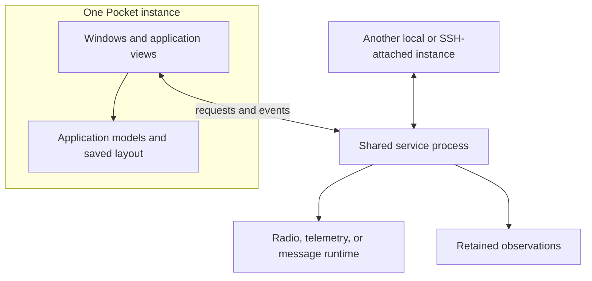
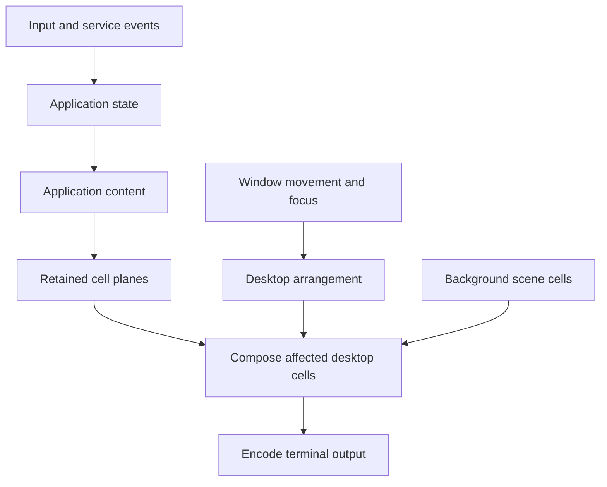

# How the platform, desktop, and services fit together

The N810 platform supplies boot, storage, networking, power, input, and display behavior. Its runtime commands live under `platform/scripts/`; service definitions and keymaps live under `platform/device/`; configuration templates live under `platform/config/`.

Pocket supplies the window host and applications. Python maintains models, focus, settings, and saved layouts. Views produce retained cells and structured text; the native graphical frontend also accepts direct scene pixels. The terminal frontend sends changed cells to the N810 RGB console or a laptop terminal. The SDL/OpenGL frontend consumes native composition batches while retaining the same desktop model and application lifetimes.

*Each desktop has its own layout. Several desktops can subscribe to the same service. Closing a window releases its view while the service continues acquiring data.*

A service owner holds resources that must survive an individual window: radio transport, receive history, device telemetry, or a messaging runtime. Views subscribe to that owner and issue explicit commands through its interface. Closing a view releases its own renderer, workers, and caches. Reopening it creates a fresh view over the shared data.

The remote desktop path keeps this division. OpenSSH forwards the Unix sockets so a laptop UI can use a tablet owner. Reticulum service sharing supplies another transport with verified peer identities and explicit operation grants. The application-facing provider retains a common request, snapshot, and subscription contract.

State changes drive persistence and redraw. A packet can change a hidden application's model and saved state while its view remains idle. Input acquisition can run separately, but the window host still needs time to dispatch input, compose output, and present it. These boundaries explain the project's separate measurements for acquisition, application work, composition, and output.

## What changes when a window moves

Application data and desktop arrangement have separate lifetimes. A new packet changes the application's model. A moved window changes its position and which cells are visible. The host can retain the application's existing content while updating the desktop arrangement.

The [window host](https://github.com/gordol/n810-revival/blob/main/pocket/shell/core.py) contains opaque cell-plane caches, producer-owned layers, and damage tracking. Here, damage means cells whose displayed result needs reconsideration. The [native scene adapter](https://github.com/gordol/n810-revival/blob/main/pocket/shell/native_scene.py) exposes native planes and a damage collection to the Python host. These mechanisms are already part of the implementation; their effectiveness depends on which application and rendering path is active.

This diagram describes relationships in the terminal desktop. The glyphs and colors remain cells through composition. The integrated graphical frontend also composes direct Room images with window chrome and overlays. Its platform adapter provides input, dimensions, and presentation; the [graphical build guide](../pocket/graphics.md) and [native desktop journal](../posts/2026-11-07-native-desktop.md) describe that path.

## Which accelerator is involved?

A native implementation executes compiled machine code; its name alone establishes no GPU use. The [scene acceleration selector](https://github.com/gordol/n810-revival/blob/main/pocket/shell/scene_acceleration.py) includes a host GPU path with MLX dependencies. The [N810 MBX checkpoint](../how-to/build-gpu-30fps.md) instead concerns the tablet's graphics processor and Mesa/X11 presentation. Backend selection, successful setup, fallback state, and actual calls all matter when reporting acceleration.

The [rendering explanation](rendering.md) describes cell colors and the console extension. The [development roadmap](../roadmap.md) separates possible future rendering changes from the implementation described here.

The [source map](../source.md) identifies the imported components. The [journal](../journal.md) describes how the architecture developed from the original console and sidebar desktop.
