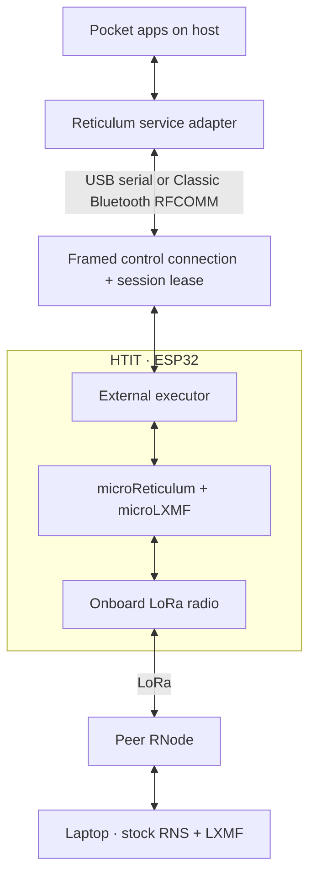

# Radio ownership and messaging paths

The APRS feed owns the Classic Bluetooth serial connection and KISS receiver. Maps, packet views, station history, and directory tools consume its events and retained snapshots. This lets several windows and remote clients inspect the same stream while acquisition continues under one owner.

APRS observations retain source and time. A radio-received packet, an Internet-supplied position, a locally submitted transmission, and a remotely acknowledged message describe different events. The UI uses those distinctions when reporting station activity and delivery.

Reticulum and LXMF use a separate owner. Reticulum supplies transport, links, and resources; LXMF supplies signed messages and delivery behavior. Peer discovery supplies observations, signature verification checks the cryptographic identity, and the saved contact records the user's trust decision. Explicit grants govern remote service reads and commands.

Pocket can execute this stack locally or use an external HTIT executor. The host keeps its application identity and selects a backend through the service bridge. The board advertises capabilities, identifies itself, and leases its runtime to the controlling session. USB or encrypted Classic RFCOMM carries the executor protocol. LoRa carries the radio traffic.

MeshCore has its own service integration and availability state. Radio applications share navigation and presentation conventions while preserving each protocol's identity, transport, and delivery semantics.

Recovery is part of the contract. A failed operation reports its result; a timeout may leave the outcome unknown. New subscriptions can attach after a backend recovers. Link generations and owner lifetimes prevent late callbacks from changing a replacement session. The HTIT recovery posts show why those details matter under peer loss and resource interruption.

## External execution on the HTIT

The host can delegate Reticulum operations to the ESP32 executor. The [HTIT journal entry](../posts/2026-10-29-htit.md) explains its development; the [executor protocol](../pocket/external-node.md) describes the current interface.

