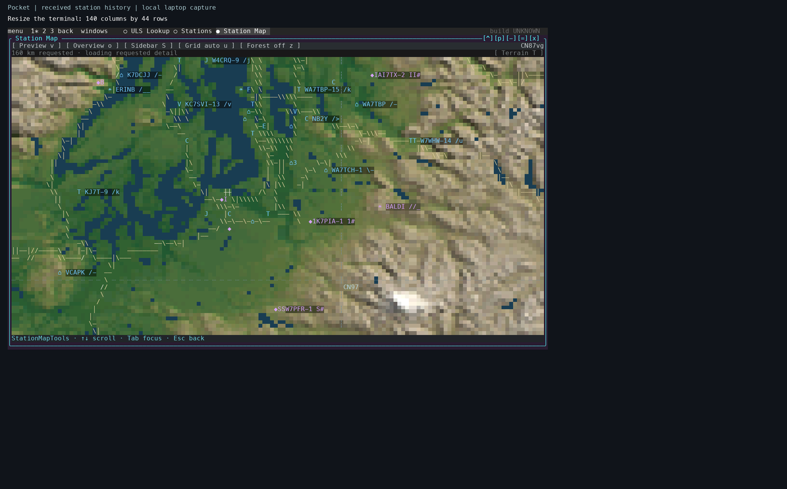
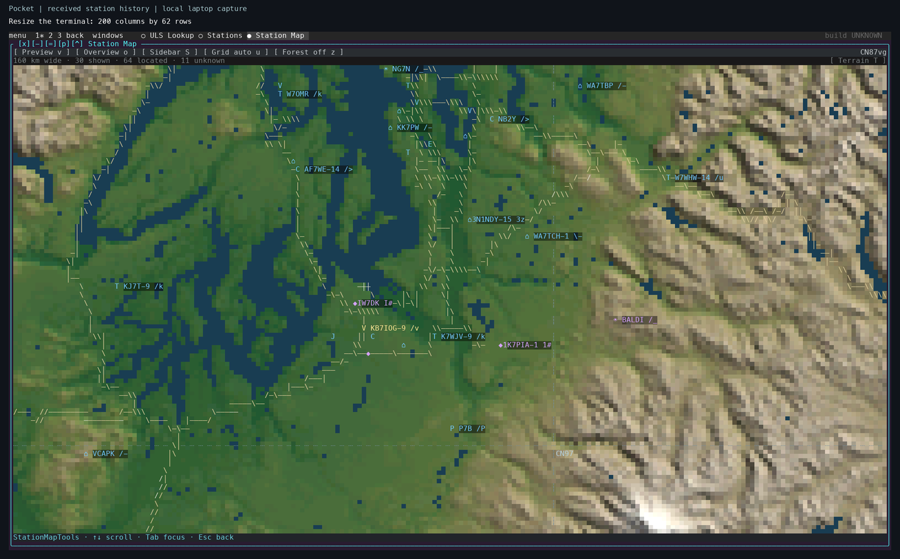
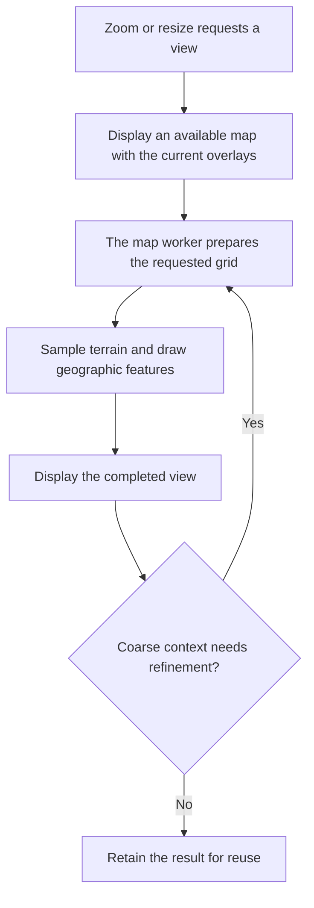
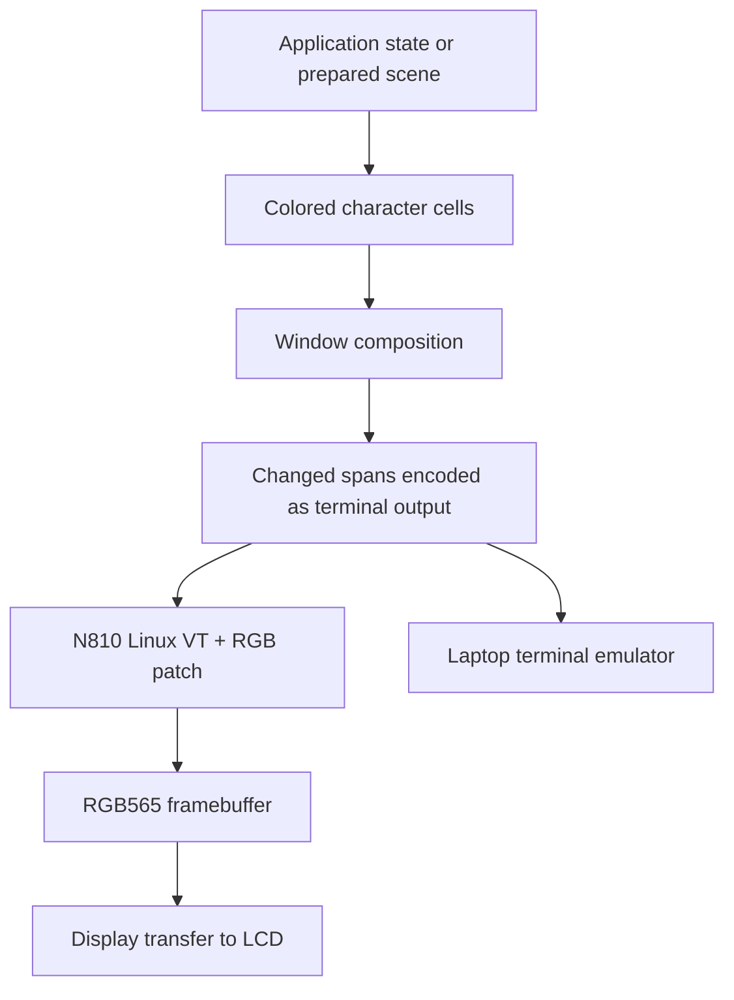

# Rendering from application state to the display

Pocket's terminal renderer has three main stages: application or scene preparation, cell composition, and terminal output. A map prepares geographic features. A 3D scene transforms and shades geometry. The compositor combines the resulting cell layers with windows and controls, then encodes changed spans for the terminal.

## Foreground, background, and glyphs

A terminal cell combines a glyph with two colors. The glyph is the character's visible shape. Its foreground color paints that shape, and its background color fills the remaining area of the cell. A space therefore shows the background; a solid block shows the foreground. An upper-half block (`▀`) divides the cell into an upper foreground sample and a lower background sample. Pocket can use those two samples to represent terrain at twice the vertical sampling density of one solid color per cell.

These colors also let text and line symbols share the map grid. A station label uses the foreground for its letters while its background supplies the color behind them. Replacing a terrain glyph with a letter changes the shape represented by that cell, so labels and road strokes require composition decisions about which information remains visible.

The desktop's animated background is a separate concept: it is a scene layer behind windows. Every cell in that layer still has its own foreground, background, and glyph. Window composition chooses or combines layer content before terminal output is generated.

## Carrying those colors through the Linux console

The N810 console work changes actual Linux kernel source. The [RGB console patch](../reference/console-rgb-patch.md) modifies `drivers/tty/vt/vt.c`, `drivers/video/fbdev/core/fbcon.c`, and `include/linux/console_struct.h`, and adds `include/linux/vt_rgb.h`. The [kernel build guide](../how-to/build-kernel.md) describes rebuilding the maintained kernel.

The virtual terminal parses application output and maintains the console's character state. The framebuffer console draws that state using font glyphs. Our extension preserves richer color information alongside the traditional character cells. This extra per-cell storage must follow the characters when rows scroll, regions move, or cells are erased. The patch therefore changes the handling of those operations as well as color rendering. The framebuffer path ultimately converts the colors to the display's RGB565 representation (five red bits, six green bits, and five blue bits).

A laptop terminal interprets the terminal output in its own process. The N810's local Linux console interprets it in the kernel. The [source map](../source.md) distinguishes the upstream kernel inputs, project modifications, and application code.

## Resizing gives the map more cells

Map data © [OpenStreetMap contributors](https://www.openstreetmap.org/copyright); elevation: USGS 3DEP.

Each terminal cell has a character, a foreground color, and a background color. A half-block character can show two terrain samples in one cell: its upper half uses the foreground color and its lower half uses the background color. Road strokes and station labels occupy that same grid.

*A local laptop capture on 6 November 2026, with received station history and a 160 km map span. The terminal has 140 columns and 44 rows. The surrounding dark area preserves the recording's larger canvas.*

*The terminal now has 200 columns and 62 rows. The geographic center and horizontal span stay fixed. The map prepares a new grid for the available area, so the coast, relief, road strokes, and labels can occupy more cells. The viewport's changing aspect ratio also changes its north–south coverage.*

This demonstration maximizes the map before resizing the terminal. Pocket receives a terminal-size change, measures the new rows and columns, and fits the maximized window to that area. The map's cache key includes its dimensions; a new size therefore requests a matching image. Ordinary floating windows keep their own dimensions and are moved or reduced as needed to fit the desktop. Enlarging a floating map window also requests a new image.

The [terminal resize handler](https://github.com/gordol/n810-revival/blob/main/pocket/shell/desktop.py), [window geometry code](https://github.com/gordol/n810-revival/blob/main/pocket/shell/core.py), and [`raster_size` and map request code](https://github.com/gordol/n810-revival/blob/main/pocket/shell/offline_map.py) implement these steps. The desktop raster has a bounded cell budget. Extra display cells improve sampling and placement up to that budget; the source elevation data and vector features determine the geographic detail available.

Try this with the Station Map open: press **Ctrl-]**, then **Z**, and resize the terminal. Wait for the terrain to finish updating at each size. Press **Z** again to restore the floating window. The [window-controls tutorial](../tutorials/laptop-tour.md) explains the input modes and other controls.

## Why detail can arrive after the camera stops

A zoom changes the requested geographic view. Pocket keeps an available map on screen while its worker prepares the requested view. In preview mode, the yellow rectangle marks the proposed destination; Enter commits it. The map behind that rectangle can continue to change as results arrive, even while the rectangle stays in the same place.

Station Map's overview renderer first requests context at a width of up to 160 cells. It then requests context at the full map dimensions. The [map overview code](https://github.com/gordol/n810-revival/blob/main/pocket/shell/map_overview.py) keeps those results separately, and the [navigation code](https://github.com/gordol/n810-revival/blob/main/pocket/shell/map_navigation.py) displays the available result while the next request runs. One background worker prepares these images, with later views replacing requests that are still waiting to start.

Terrain preparation samples the elevation or prepared terrain inputs, applies the geographic layers, and packs the result into colored cells. Roads and streams are drawn from geographic features at the requested scale. Station markers are then placed against the displayed map's projection. See the [terrain adapter](https://github.com/gordol/n810-revival/blob/main/pocket/shell/map_terrain.py) and [geographic layers](https://github.com/gordol/n810-revival/blob/main/pocket/shell/map_geography.py).

This explains why successive views can look more detailed after the last input. The elapsed delay depends on the requested size, available map packs, cached results, and pending work. Identifying a slow step requires the renderer's request and worker timings alongside the recording. A sequence of screenshots establishes what became visible and when. The [map preparation guide](../how-to/build-map-data.md) describes the supplied inputs, precomputation, source attribution, and build tools.

## Composition and terminal output

*This is Pocket's terminal path. The [MBX experiment](../posts/2026-11-03-mbx-rendering.md) has its own Mesa-to-X11 path. A faster stage only shortens the portion of the frame spent in that stage.*

The retained C compositor stores glyph, ink, and validity arrays. Opaque planes can reuse their existing content when a window moves. Blended effects and incompatible layers take additional paths. Backend selection and actual call counts therefore matter when measuring a scene.

On the N810, the RGB kernel extension carries application colors through the Linux virtual terminal to RGB565 framebuffer pixels. On a laptop, the terminal emulator interprets the color sequences. A completed output write marks one point in the pipeline; the display transfer and visible scanout follow it.

## Geometry and the graphics processor

The early MBX graphics test used Mesa CPU geometry followed by GPU rasterization and X11 presentation. The [4 November checkpoint](../posts/2026-11-04-gpu-performance.md) moved the gears' transformation and lighting onto the VGP, the GPU's vertex geometry processor, and completed two physical-device runs at 30.78 and 30.63 FPS. MBX performs rasterization, depth testing, and interpolation. Shared image storage and format conversion determine how much work remains before X can present the result. The [build guide](../how-to/build-gpu-30fps.md) links the frozen driver, Mesa changes, and tests for that checkpoint.

VFP accelerates ARM floating-point instructions. MBX is the graphics processor. The VGP executes the supported geometry work described above. C55x is a separate DSP with its own instruction, loader, and memory requirements. The [acceleration reference](../reference/acceleration.md) records the evidence for each.

The renderer studies supplied repeatable stress workloads: Room, terrain, water, wildlife, and window overlap. A controlled comparison holds the scene and output dimensions fixed, checks the output, and measures preparation, packing, composition, transfer, and background work separately.

The [overview and backgrounds tour](../tutorials/overview-and-backgrounds.md) shows this composition path in motion, including Matrix and Flux behind the desktop and window previews. Flux calculates points for the current terminal dimensions and applies a bounded density budget. Its density setting changes the number of samples; the [budget calculation](https://github.com/gordol/n810-revival/blob/main/pocket/shell/weather.py) also caps the base workload. Map sampling and Flux density have separate controls and limits.

## A native graphical frontend beside the terminal

The [7 November frontend investigation](../posts/2026-11-07-native-desktop.md) attaches a platform adapter to the same desktop model. Applications retain their state, event handling, windows, and service lifetimes. The native path consumes packed cell composition and structured text directly; the terminal path continues to encode changed spans for its terminal.

Cells still define the text and controls. A graphical application can also supply an image at its window's pixel dimensions. Surface Room uses that path for its geometry while sharing the existing camera/input model. The compositor places that image among windows, chrome, shadows, and overlays according to the desktop's stacking order. A native resize changes the desktop grid and pixel canvas together.

GPU use is stage-specific. The [Mac provider investigation](../posts/2026-11-07-gpu-effects.md) moves selected effect accumulation, map and terrain shading, and composition work to the GPU. Layout, input-data preparation, some geometry preparation, and counted precision corrections continue on the CPU. Readbacks and presentation uploads remain measurable costs. The journal records the tested split and its comparisons; the [roadmap](../roadmap.md#native-graphical-desktop-and-interactive-scenes) identifies the remaining integration and physical-device checks.
