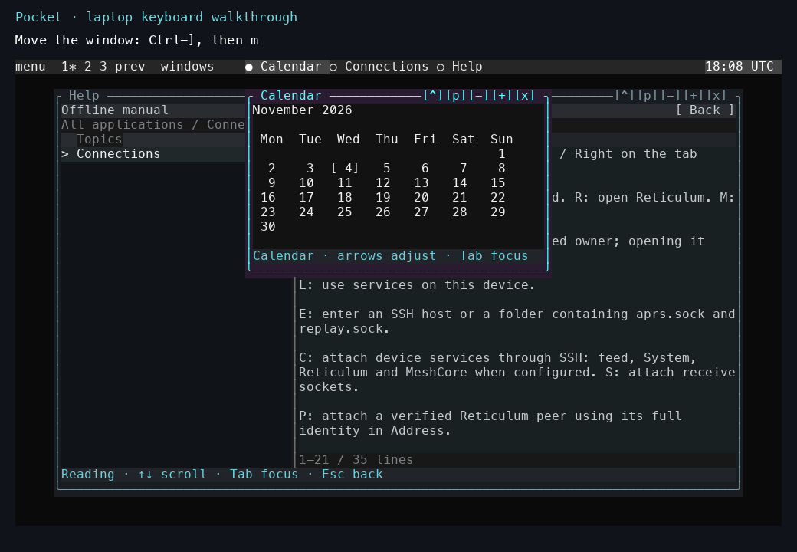

# Guides

Start with [Set up an N810](start.md) to choose the installation route for your tablet. You can also explore Pocket on a laptop or build an individual component. The references describe the hardware, controls, and service interfaces.

*Start with the [recorded laptop tour](tutorials/laptop-tour.md) to see the controls, then use the tutorial below to try them.*

## Tutorial

[Explore a local Pocket session](tutorials/first-session.md) walks through launch, Help, window navigation, exit, and reopening your saved session.

The [laptop window-controls tour](tutorials/laptop-tour.md) demonstrates the same controls in a recorded local session.

[Explore the overview and backgrounds](tutorials/overview-and-backgrounds.md) shows desktop miniatures, window previews, Matrix, rain, snow, leaves, flowers, and Flux. The [APRS recording](posts/2026-10-14-aprs.md#watch-the-map-and-workspace-in-use) demonstrates packet selection, map navigation, inspection, and tmux windows.

## How-to guides

- [Use Pocket over SSH](how-to/ssh.md).
- [Build the N810 kernel and modules](how-to/build-kernel.md).
- [Build the HTIT firmware](how-to/build-htit.md).
- [Rebuild and inspect map data](how-to/build-map-data.md).
- [Start the N810 GPU desktop](how-to/run-n810-gpu.md).
- [Run Symbian applications](how-to/run-symbian.md).
- [Build the Mac/Linux graphical desktop](pocket/graphics.md).
- [Build the local native compositor](how-to/build-native.md).
- [Build and test the 30 FPS GPU driver](how-to/build-gpu-30fps.md).
- [Run the Pocket tests](how-to/validate.md).
- [Run the APRS map and tmux demo](how-to/aprs-demo.md).

The detailed Pocket operator guides cover [installation](pocket/install.md), [Nokia packaging](pocket/nokia.md), [RNode Bluetooth](pocket/rnode-bluetooth.md), and [local owner recovery](pocket/local-owner-recovery.md).

## Reference

- [Controls](reference/controls.md).
- [Applications and dependencies](reference/applications.md).
- [Kernel checkpoints](reference/kernels.md).
- [Acceleration checkpoints](reference/acceleration.md).
- [Source map](source.md) and [current status](status.md).

Detailed protocol references cover [service transports](pocket/service-transports.md), [external executors](pocket/external-node.md), [service publication](pocket/service-publication.md), and [versioning](pocket/versioning.md).

## Explanation

- [Platform, desktop, and services](explanation/architecture.md).
- [Rendering and presentation](explanation/rendering.md).
- [Radio ownership and messaging](explanation/radio.md).

The implementation notes expand on [apps and services](pocket/apps-and-services.md), [receive history](pocket/receive-history.md), and [touch acquisition](pocket/touch-acquisition.md). The [0.1.0 release notes](pocket/releases-0.1.0.md) record the integrated source scope.
