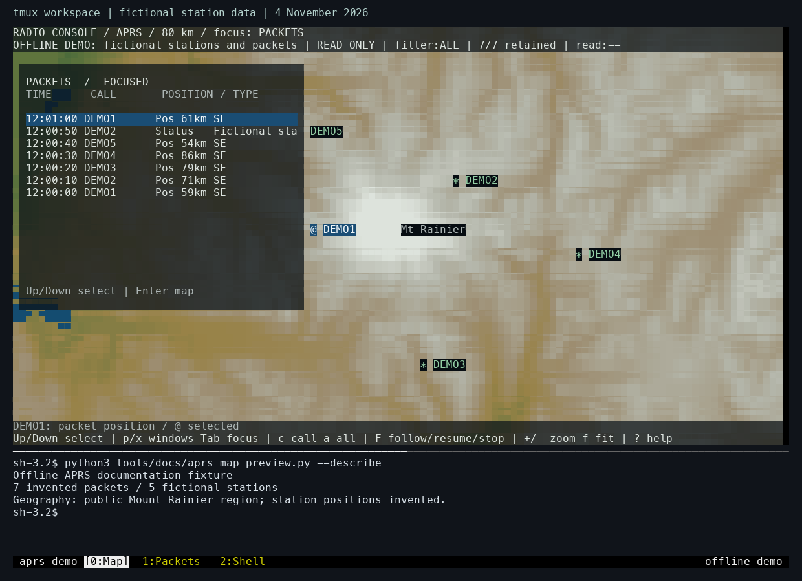

# Run the APRS map and tmux demo

This demonstration opens the APRS map with seven invented packets from five fictional stations near Mount Rainier. It uses the project's map renderer and locally built geography packs. The tmux version adds a shell pane and separate Map, Packets, and Shell windows.



*Laptop capture from 4 November 2026. The station positions and packet contents are fictional. The map combines public geography from OpenStreetMap, USGS, Natural Earth, and NOAA. Map data © [OpenStreetMap contributors](https://www.openstreetmap.org/copyright).*

Use Python 3.11 or newer and a terminal with RGB color support. The tmux workspace also requires tmux. Allow at least 100 columns by 34 rows for the standalone map, or 120 columns by 44 rows for the workspace pictured above.

## Open the map

First follow [Download and build offline maps](build-map-data.md), including `make maps-terrain`. Then, from the repository root, run:

```sh
python3 tools/docs/aprs_map_preview.py --maps pocket/shell/vendor/packet-console/maps --packets
```

The viewer reads the locally built geography packs and generates the station reports in memory. It runs entirely offline. The `@` marker follows the selected packet's position; the other station positions use `*`.

| Action | Control |
|---|---|
| Show or hide the packet panel | Press `p`. |
| Move focus between panels | Press Tab. |
| Select a packet | Focus the packet panel, then use Up or Down. |
| Pan the map | Focus the map, then use the arrow keys. |
| Zoom in or out | Press `+` or `-`. |
| Show or hide the selected packet's inspector | Press `x`. |
| Toggle terrain or roads | Press `t` or `r`. |
| Close the standalone viewer | Press `q`. |

## Open the tmux workspace

After closing the standalone viewer, run:

```sh
python3 tools/docs/tmux_preview.py --maps pocket/shell/vendor/packet-console/maps
```

The launcher creates a temporary tmux server using the project's keyboard bindings and appearance. Map starts with the packet panel open and a shell beneath it. Packets contains the standalone packet inspector; Shell provides another command prompt.

Press Ctrl-B, release it, then press `0`, `1`, or `2` to select Map, Packets, or Shell. Return to Map to continue with the same map position and packet selection. Finish with Ctrl-B followed by `d`; the launcher closes its temporary server and removes its configuration.

The [APRS journal entry](../posts/2026-10-14-aprs.md#watch-the-map-and-workspace-in-use) shows these interactions in a recording and explains how the original radio workspace developed. The [map build guide](build-map-data.md) describes the geography formats and preparation tools. The [map fixture](https://github.com/gordol/n810-revival/blob/main/tools/docs/aprs_map_preview.py) and [tmux launcher](https://github.com/gordol/n810-revival/blob/main/tools/docs/tmux_preview.py) contain the complete demonstration setup.
