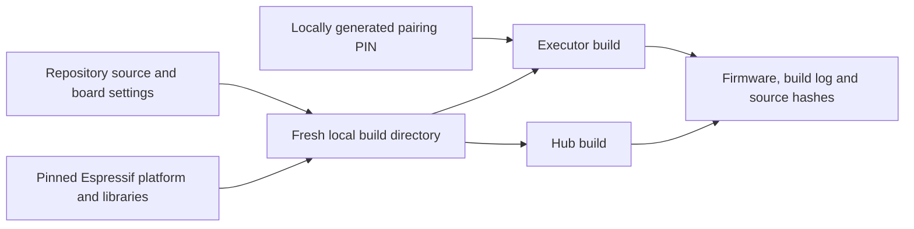

# Build the HTIT firmware

Choose the firmware by the work it performs. The hub exposes transport services to a host. The executor runs Reticulum and LXMF on the ESP32. Both targets use the original Heltec HTIT-TB Wireless Bridge.



## Install the builder

Use Python 3.12 or 3.13 and a C/C++ compiler for these builds and host tests. The compiled RSN adapter uses Python’s filtered archive extraction. From the repository root:

```sh
python3 -m venv .venv-htit
.venv-htit/bin/pip install -r hardware/htit/requirements-build.txt
```

PlatformIO downloads the platform and compiler versions selected in each project's `platformio.ini`. The executor's vendored libraries live in `microreticulum/executor-libs/`; remaining library dependencies use explicit versions or Git revisions.

## Build a new source copy

```sh
python3 hardware/htit/build.py executor     --pio .venv-htit/bin/pio --work /tmp/htit-executor-build
python3 hardware/htit/build.py hub     --pio .venv-htit/bin/pio --work /tmp/htit-hub-build
```

Each output directory must be new. The wrapper copies the selected source into it, invokes the named build environment, and writes `BUILD.json` with source and output hashes. Read `build.log` for compiler diagnostics.

The executor wrapper creates `source/HTITPrivate.h` inside the private build directory. It contains a random pairing PIN, and the directory has owner-only permissions. Keep that header with the local build if you need to reproduce the same firmware bytes or pair the board. Each newly generated PIN changes the resulting firmware. The repository contains the generator and an example header.

The firmware images are under `source/.pio/build/<environment>/`. Device installation requires the matching partition layout, bootloader and a recovery plan. The build command ends after compilation.

## Run the host checks

The [7 November walkthrough](../reference/component-build-verification.md#failures-exposed-by-the-reader-commands) found a GCC signedness error in the wire-protocol test. The length comparison now uses `size_t`. The [verified container run](../reference/component-build-verification.md#github-container-build-7-november) passed all six wire-protocol host tests, 28 Python RSN tests and 11 compiled RSN tests, and built both firmware projects.

```sh
.venv-htit/bin/pip install -r hardware/htit/rfcomm-ble-hub/host/requirements.txt     -r pocket/requirements-meshcore.txt     -r hardware/htit/experiments/ibss-rsn/requirements-test.txt
POCKET_SOURCE="$PWD/pocket" .venv-htit/bin/python -m unittest discover     -s hardware/htit/rfcomm-ble-hub/tests -q
.venv-htit/bin/python -m unittest discover     -s hardware/htit/experiments/ibss-rsn -p 'test_*.py' -q
HTIT_RSN_WORK=/tmp/htit-rsn-build .venv-htit/bin/python -m unittest discover     -s hardware/htit/experiments/ibss-rsn/rsn-port -p test_rsn.py -q
```

The hub tests compare the C framing code with the Python implementation, simulate radio registers and FIFOs, and connect the official MeshCore client through local serial pseudo-terminals. The RSN checks exercise frame bounds, authentication, replay handling and key installation using test peers. The RSN host build also needs OpenSSL development headers and `pkg-config`.

[Source inputs](../reference/htit-inputs.md) · [Build verification](../reference/component-build-verification.md) · [External executor protocol](../pocket/external-node.md)
