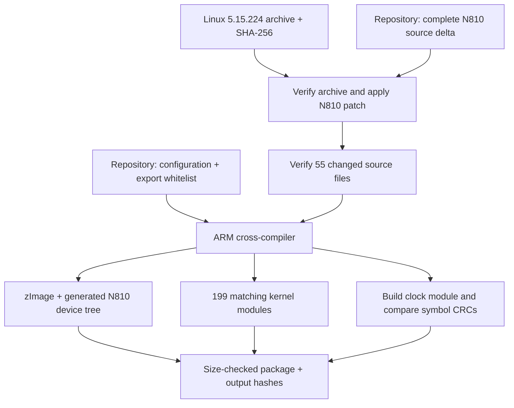

# Build the N810 kernel and matching modules

The repository contains the N810 changes for Linux 5.15.224, the configuration,
the external-module export list, and a Linux build script. The script obtains the
pinned upstream archive and reconstructs the maintained source before compiling.



## Prepare a Linux builder

Use a Linux machine or VM with at least 3 GiB of free build space. On Debian:

```sh
sudo apt-get install build-essential gcc-arm-linux-gnueabihf \
    binutils-arm-linux-gnueabihf flex bison bc libssl-dev libelf-dev \
    kmod curl ca-certificates xz-utils patch python3
```

The compiler targets ARM. The kernel's Kbuild system supplies the kernel-specific
options. Debian armel userspace and the renderer's floating-point options have a
separate build path described in the [CPU entry](../posts/2026-10-18-cpu-acceleration.md).

## Build from the repository

From a checkout of [n810-revival](https://github.com/gordol/n810-revival), run:

```sh
python3 platform/kernel/build.py --work /tmp/n810-kernel-build --jobs 4
```

The output directory must be new. The script downloads approximately 122 MiB of
upstream source from kernel.org, checks its pinned SHA-256, applies the N810
changes with zero patch fuzz, and verifies all 55 changed kernel-source files.
It then configures, compiles and stages the results. Progress appears in the
terminal; detailed logs stay under `/tmp/n810-kernel-build/logs/`.

An existing archive can be supplied with `--archive /path/to/linux-5.15.224.tar.xz`.
The checksum requirement is the same for both paths. The [source lock](https://github.com/gordol/n810-revival/blob/main/platform/kernel/source.lock.json)
records the URL, checksum and source revisions. Local review copies are available
for the [complete N810 patch](../assets/kernel/n810-5.15.224.patch),
[configuration](../assets/kernel/n810.config), and
[source lock](../assets/kernel/source.lock.json). The checksum comes from
[kernel.org's release checksums](https://cdn.kernel.org/pub/linux/kernel/v5.x/sha256sums.asc).

## Select the intended root filesystem

The repository configuration uses `/dev/mmcblk0p2` as an example SD-root layout.
The kernel command line selects that root filesystem and enables RGB console
output with `vt.rgb=1`. For a tablet-specific build, supply its root device:

```sh
python3 platform/kernel/build.py --work /tmp/n810-kernel-custom \
    --root-device /dev/mmcblk0p2 --jobs 4
```

The option also accepts a `PARTUUID=...` value. Keep personal partition identifiers
in local invocations. The source configuration and recipe use generic paths.

## Inspect the package

The `package/` directory contains:

- `zImage-omap2420-n810`, formed by appending the generated N810 device tree to `zImage`.
- The separate `zImage` and `omap2420-n810.dtb` files.
- Matching modules under `root/lib/modules/5.15.224-n810-mbx-clock-wip1/`.
- The separate clock trial module and its symbol-version comparison results.
- `kernel.config`, `Module.symvers`, `KERNELRELEASE`, and `BUILD.json`.

The build checks the 2,095,104-byte image budget and the expected 199 configured
modules. It compares the clock module's imported symbol versions with this
build's exported versions. The result manifest records file hashes, compiler,
source inputs and configuration choices. Generated development symlinks are
removed from the staged module directory so that it can be moved as a unit.

The maintained source revision is `6bd43ee8d27b207c958808368251d55ec0475f9e`,
incorporating Linux stable `700e62ea909a70b9f72692d8b7a192ac7ebde0aa`.
The [kernel input reference](../reference/kernel-build-inputs.md) describes the
packaged files. The [kernel checkpoints](../reference/kernels.md) distinguish
historical device runs from the new clean-build verification.

Device use additionally depends on the intended filesystem, device firmware,
calibration, recovery procedure and attended boot testing. The
[boot diagram](../posts/beginnings.md#keeping-a-way-back-to-a-working-kernel)
explains temporary RAM boots. This guide ends with a compiled local package.
