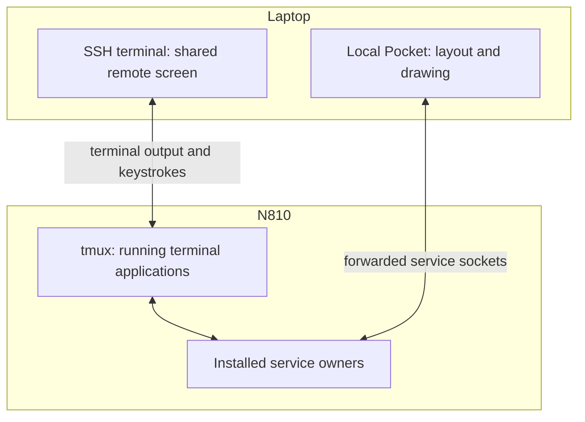

# Use Pocket from a laptop over SSH

Pocket supports two workflows. An SSH terminal can display a program running on the tablet. A local Pocket instance can also draw on the laptop while attaching to services on the tablet. Choose the workflow according to where you want the desktop process and saved layout to live.



*Follow the first procedure for a desktop that draws on the laptop, or the second to attach to a terminal session running on the tablet.*

## Attach a locally rendered Pocket desktop

First establish ordinary OpenSSH authentication to your configured tablet host and verify its host key. The tablet needs the installed Pocket service catalogue and the owner services you intend to use. Your SSH configuration can supply the host name, account, and key without placing those values in this repository.

From the repository root, start a distinct local instance:

```sh
make -C pocket n810 INSTANCE=laptop
```

Open Connections, enter your SSH configuration alias in the address field, and choose SSH. The adapter uses strict host-key checking and noninteractive key authentication. It forwards the service sockets and reads the tablet's service catalogue. System telemetry and individual radio services report availability independently.

Open the required service once its row becomes ready. A service attachment gives the UI access to that owner; the radio application's controls operate the radio. Disconnect in Connections when finished. Independently selected service owners retain their own connection state.

The remote installation provides `device_services.py` under `/usr/local/share/n810-pocket/`. Its catalogue supplies System, Reticulum, and MeshCore endpoints. The APRS profile uses the installed feed and replay sockets. See the [detailed connection contract](../pocket/connections.md) for endpoint selection and recovery behavior.

## Display the tablet's terminal session

For an existing tmux workspace, use your SSH alias to open an interactive terminal on the tablet, list sessions with `tmux list-sessions`, and attach to the intended session with `tmux attach-session -t SESSION`. Replace `SESSION` with the listed name. This displays the tablet's running terminal applications and follows tmux's sizing policy. Detach with your configured tmux prefix followed by d.

The historical phone bridge used a fixed terminal size to preserve the tablet's pane geometry. The current locally rendered Pocket workflow gives each client its own layout.
