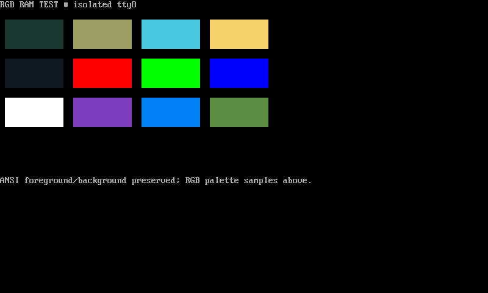

# N810 revival

The N810 runs Debian Bookworm and a keyboard-first terminal desktop called
Pocket. This repository holds Pocket's current source, a selected slice of the
N810 OS-side runtime, and these field notes.

*Physical framebuffer capture from the 16 October console work.*

Start with [what is in the repository](source.md), [what has been tested](status.md),
or the [journal](journal.md). Pocket's own [installation](https://github.com/gordol/n810-revival/blob/main/pocket/docs/install.md)
and [navigation](https://github.com/gordol/n810-revival/blob/main/pocket/docs/navigation.md)
guides live beside its code.

The goal is a general-purpose handheld. Maps and radio put useful pressure on
Bluetooth ownership, storage, rendering, and input, but they are applications
of the platform rather than the entire project.
