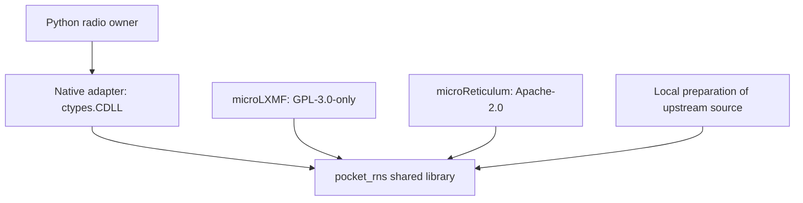

# Component licenses and source history

Reviewed 7 November 2026. This guide describes the retained source checkpoints, their upstream relationships, and the scope of the project license.

## Original code and imported code

The [original code grant](original-code-gpl.md) supplies GPL-2.0-or-later permissions for reviewed original software and glyph additions. Twenty native messaging files retain their explicit GPL-3.0-only grants. The [scope manifest](https://github.com/gordol/n810-revival/blob/main/LICENSE-SCOPE.json) identifies covered files and their hashes. Existing upstream grants remain attached to borrowed expression. The [Cat Wormhole License](license.md) covers the original prose specified in [Licensing and attribution](licensing.md).

The distributed scope manifest identifies the applicable grants and their limits.
Internal review logs and source-history investigations are retained by maintainers.
The release includes the upstream license texts, attribution, and original-code
grants needed to identify the terms for its components.

## Terminal parser and character tables

The nine bundled pyte files exactly match the published 0.8.2 wheel. The six wcwidth files exactly match version 0.2.13. Their original notices remain beside the source. See the [upstream notice guide](upstream-notices.md#terminal-support) for release identities and authors.

Pyte declares LGPL terms and also identifies two character tables in `charsets.py` as copied from Linux under GPL. Each table contains 256 entries. Both arrays match the corresponding tables in [Linux v2.6.39 consolemap.c](https://github.com/torvalds/linux/blob/v2.6.39/drivers/tty/vt/consolemap.c). The notice was present in pyte's initial Git import in June 2011. That import supplies no exact copied Linux revision or GPL version. The package preserves the table notice alongside pyte's license and authorship notices.

Pyte's color table also credits Pygments. The July 2016 [pyte change](https://github.com/selectel/pyte/commit/6ba414f74daefaac99d90a817e4b5692c6160d6c) introduced the table and its BSD attribution. The repository now retains the license and author list from the contemporaneous Pygments 2.1.3 release. The provenance record distinguishes that comparison source from the unknown exact revision originally copied.

## Native messaging

The native build pins nine upstream repositories. Six carry MIT license texts, microReticulum and microStore carry Apache-2.0 texts, and microLXMF declares GPL-3.0-only. The exact revisions, notice hashes, and source URLs are recorded in the [upstream notice guide](upstream-notices.md#native-messaging-build).

The [CMake target](https://github.com/gordol/n810-revival/blob/main/pocket/shell/native/reticulum/CMakeLists.txt) compiles microLXMF sources into the shared library. The Python owner loads that library into its process. The 20 integration and regression files identified as `GPL-3.0-only` in the scope manifest have an explicit grant for eligible original contributions. It permits commercial redistribution under the GPL. The original shared owner and service modules now have GPL-compatible grants. NativeBackend overrides the stock connection method and uses its native packet adapter; the stock Reticulum parser belongs to the alternative Python backend. The original-code interoperability permission covers that stock route without changing third-party terms. The architecture and upstream grants retain their existing form. The [native backend guide](pocket/native-reticulum.md) describes the build and runtime interfaces.

The stock Python route has its own terms. The bundled MessagePack module is an exact copy of `RNS/vendor/umsgpack.py` from the RNS 1.5.7 wheel and retains Ivan Sergeev's MIT notice. The packet parser adapts `RNodeInterface.readLoop` from that release and retains Mark Qvist's Reticulum License, including its use restrictions. These distinct origins are recorded individually.

## Kernel, graphics, firmware, and earlier experiments

| Component | Source and license boundary |
| --- | --- |
| Linux console extensions | The kernel build uses the pinned upstream Linux source and maintained patch set. Linux's applicable GPL terms and file notices govern derived kernel work. See [kernel build inputs](reference/kernel-build-inputs.md). |
| p54 radio patches | Both retained RSN/lifetime patches target GPL-2.0-only Linux files. Their source headers credit Michael Wu, Christian Lamparter, Johannes Berg, Nokia, and earlier driver authors as applicable. |
| C55x relocation patch | The retained `tc-tic55x.c` and `coff-tic55x.c` hashes match the recorded patched checkpoint. Their headers grant GPL-2.0-or-later and credit Kerry Keal, the Free Software Foundation, and earlier contributors. See [the checkpoint guide](how-to/test-journal-checkpoints.md#repeat-the-cpu-and-dsp-checks). |
| MBX and Mesa | Frozen graphics files include MIT and GPL-2.0-only declarations. Mesa supplies its own upstream terms. The [graphics input guide](reference/graphics-inputs.md) and [30 FPS checkpoint](reference/gpu-30fps-inputs.md) retain their identities. |
| Native compute | The accelerator userspace component and MIT-tagged geometry/compute files retain their existing MIT grants. |
| HTIT microreticulum firmware | The firmware retains its GPL text and the nested library notices. microLXMF, microReticulum, EspIdfUartIram, MsgPack, and Bzip2 have separately relevant terms. See [firmware inputs](reference/htit-inputs.md). |
| HTIT RSN adapter | The pinned wpa_supplicant 2.12 archive has BSD-3-Clause terms. The manifest grants eligible original adapter expression and preserves BSD terms for matching WPA helpers. SDK binary modification/redistribution requires separate clearance. |
| Pocket apps and earlier domains | Local history connects the imported app, map, radio, and framework files to their earlier repositories. The source inventory identifies original grants and retained upstream boundaries; combined-program permissions remain component-specific. Doom's existing GPL text remains intact. |
| Fonts and map data | Their source and artifact records identify the assets. Redistribution rights and provider attribution must be established for each dataset and base font independently of the code license. |

## APRS decoder, CCMP vectors, and filesystem extraction

The shared [APRS decoder](https://github.com/gordol/n810-revival/blob/main/pocket/shell/vendor/packet-console/n810-aprs-decode.py) was created on 15 October after consulting aprslib's Mic-E parser and the APRS protocol specification. Its validation pattern and decoder structure follow that source. The review therefore preserves aprslib's GPLv2 declaration and Rossen Georgiev attribution. The [upstream source and notice](upstream-notices.md#aprs-and-ccmp) identify that boundary. The original caller code now has GPL-2.0-or-later permission, allowing selection of GPL version 2 for that combination. The bundled terminal parser retains its own source and notices as described above.

The CCMP tests use exact key, plaintext, ciphertext and authentication-tag bytes found in FreeBSD's regression test, which credits the IEEE 802.11i example. The retained FreeBSD notice offers BSD-3-Clause or GPL version 2. Original test orchestration has its own scoped grant; the vectors retain their source attribution.

The JFFS2 extraction tool implements Rtime decompression with the same last-occurrence and back-reference method as Linux JFFS2. Earlier independent-authoring evidence is incomplete. The source is therefore distributed conservatively with the JFFS2 notice and GPL-2.0-or-later terms. Eligible original extractor contributions receive compatible GPL-2.0-or-later permission. The upstream exception remains attached to the upstream material.

## Contributions and distribution

[Contributors](contributors.md) describes individual attribution and the project's human-directed, LLM-assisted development. Copyrightability depends on the actual human contribution, as discussed in the [U.S. Copyright Office report](https://www.copyright.gov/ai/Copyright-and-Artificial-Intelligence-Part-2-Copyrightability-Report.pdf). The optional [contributor agreement](contributor-agreement.md) requires explicit acceptance for the specified contributions. GPL-covered contributions already permit compliant commercial redistribution under their public grant.

A binary release needs the notices and corresponding source required by its actual component licenses. The source inventory and build results establish useful evidence; distribution permissions remain component-specific. The [GNU GPL FAQ](https://www.gnu.org/licenses/gpl-faq.html#MereAggregation) explains the distinction between an aggregate and a combined program. Professional review of the custom license and contributor agreement remains outstanding.
