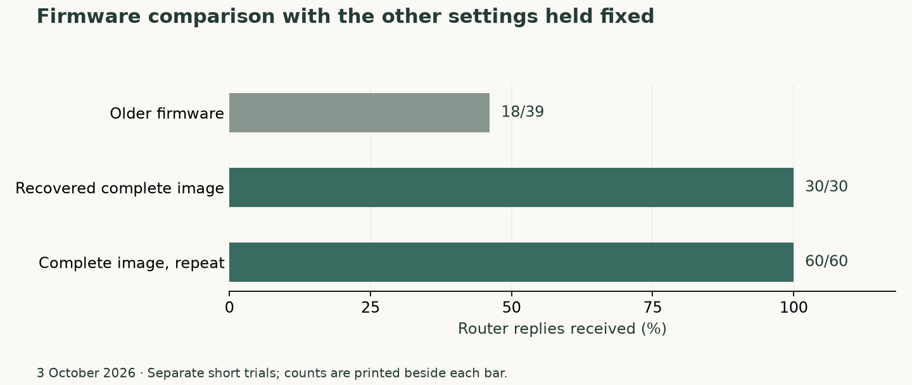

# Recovering the complete Wi-Fi firmware

*3 October 2026. Reconstructed on 4 November 2026 from development and test notes.*

The WLAN investigation initially looked like a driver and firmware-version problem. The Intersil Wi-Fi device communicated over the OMAP's McSPI controller, which supplies the serial peripheral interface (SPI) bus, associated inconsistently, and lost packets. Changing SPI timing, calibration, encryption, and transmit behavior produced enough partial success to make several explanations plausible.

## Testing the transport hypothesis

The initial comparison used USB for maintenance so a failed wireless test would leave a control connection. With firmware, upload chunks, and power-on delay fixed, the short router tests produced the following results:

| SPI and transfer path | Received / sent | Mean RTT of received replies |
|---|---:|---:|
| 6 MHz, forced PIO | 12 / 39 | 34.0 ms |
| 12 MHz, forced PIO | 17 / 39 | 44.6 ms |
| 24 MHz, forced PIO | 27 / 40 | 5.65 ms |
| 24 MHz, DMA | 23 / 40 | 84.7 ms |
| 24 MHz, PIO repeated | 29 / 40 | 5.64 ms |

PIO has the CPU move data through device registers; DMA lets the controller move it directly through memory. RTT is the round-trip time of a ping reply. The faster PIO setting was a useful working point. Packet loss and renewed stalls kept the transport explanation open. The experiments were sequential, and link conditions varied between windows, so the recorded settings and before/after counters mattered as much as the best row.

## Reconstructing calibration

The original `wlan-cal` ARM helper was run under emulation with mocked CAL reads and file writes. Its output supplied in-phase/quadrature (IQ) alignment, power-amplifier (PA) curves, output limits, and received-signal-strength (RSSI) calibration. These values describe the individual radio's analog behavior. The original driver source then established which structures matched the p54 EEPROM records.

An IQ-only candidate changed the channel alignment record and its checksum. A PA-only follow-up substituted the device's six power-curve points per channel. Both associated successfully, and both continued to lose many packets. The PA candidate was rolled back. A later audit checked the apparently unused seventh and eighth slots: their disabled markers and six-point count already matched the original conversion.

CCMP is the encryption scheme used by this Wi-Fi connection. Both hardware and software CCMP produced substantial loss. Request-to-send/clear-to-send (RTS/CTS) coordination, receive dummy reads, sleep suppression, and transmit pacing each received bounded comparisons. One proposed wakeup delay had an especially clear result: its counter stayed at zero throughout the test because READY was present on the first poll. That code path could have no effect in that window.

## Returning to the original operating system

Normal Maemo, using the same access point and physical position, received 30 of 30 router replies twice. Its calibration values matched the independent reconstruction. The next question became whether Debian was using the same complete firmware input.

The firmware comparison exposed a damaged copy of version `2.13.0.0.a.22.8`:

| Part of the suspect file | What the comparison found |
|---|---|
| First 4,096 bytes | These matched the complete firmware, including the version string. |
| Remaining 27,188 bytes | Every byte was zero. |
| Total length | The file still occupied the expected 31,284 bytes. |

This explained why the earlier checks had passed. Reading the version string identified the expected release. Reading back the uploaded firmware confirmed that the device had received the supplied bytes. The supplied file itself had a zero-filled remainder, and both checks had faithfully accepted it.

Three reads from the running Maemo system and an independent extraction from its original initial filesystem, or initfs, agreed on the complete image. We could now compare firmware behavior while holding the kernel, diagnostic module, calibration, and transport settings fixed.

The older firmware received 18 of 39 router replies. The recovered complete image received 30 of 30, followed by 60 of 60. Association and address assignment through DHCP also succeeded. Those results made the complete image the selected firmware input.

*The complete recovered image passed both short comparisons. The older firmware in this chart was a separate test input from the zero-filled copy examined above.*

The test used 24 MHz SPI with PIO, a 300 ms power-on delay, 128-byte upload chunks, device-derived IQ calibration, hardware CCMP, and disabled power saving. We had a working wireless connection under those conditions. Reconnect behavior and longer runs still needed testing.

The [Linux p54 documentation](https://wireless.docs.kernel.org/en/latest/en/users/drivers/p54.html) describes the driver family. The repository's [Wi-Fi service](https://github.com/gordol/n810-revival/blob/main/platform/scripts/n810-wifi-service) and [configuration helper](https://github.com/gordol/n810-revival/blob/main/platform/scripts/n810-wifi-config) cover the userspace side of the working system.

<!-- journal-sources:start -->
## Code, tests and build inputs

| Material | Repository files |
|---|---|
| Implementation | [Maemo helper emulator](../assets/source/journal/platform/maemo/emulate-wlan-cal.py.txt) ([GitHub](https://github.com/gordol/n810-revival/blob/main/platform/maemo/emulate-wlan-cal.py)) [Wi-Fi service](../assets/source/journal/platform/scripts/n810-wifi-service.txt) ([GitHub](https://github.com/gordol/n810-revival/blob/main/platform/scripts/n810-wifi-service)) [Maintained SPI/Wi-Fi changes](../assets/source/journal/platform/kernel/n810-5.15.224.patch.txt) ([GitHub](https://github.com/gordol/n810-revival/blob/main/platform/kernel/n810-5.15.224.patch)) |
| Checks and fixtures | [CAL corruption checks](../assets/source/journal/platform/maemo/test_readers.py.txt) ([GitHub](https://github.com/gordol/n810-revival/blob/main/platform/maemo/test_readers.py)) [Kernel source inventory](../assets/source/journal/platform/kernel/source-files.json.txt) ([GitHub](https://github.com/gordol/n810-revival/blob/main/platform/kernel/source-files.json)) |
| Build inputs | [Emulator dependencies](../assets/source/journal/platform/maemo/requirements.txt.txt) ([GitHub](https://github.com/gordol/n810-revival/blob/main/platform/maemo/requirements.txt)) [Kernel builder](../assets/source/journal/platform/kernel/build.py.txt) ([GitHub](https://github.com/gordol/n810-revival/blob/main/platform/kernel/build.py)) [Wi-Fi configuration](../assets/source/journal/platform/scripts/n810-wifi-config.txt) ([GitHub](https://github.com/gordol/n810-revival/blob/main/platform/scripts/n810-wifi-config)) |

[Build and test instructions](../how-to/test-journal-checkpoints.md) · [Chronological source index](../reference/journal-sources.md#2026-10-03-wifi)

The maintained patch contains p54spi.c and spi-omap2-mcspi.c. The ARM helper emulator requires the hash-identified Maemo executable and the owner's CAL image. The physical association and transfer results are historical device observations.
<!-- journal-sources:end -->

[Journal](../journal.md) | [Current status](../status.md)

[Previous entry](beginnings.md) | [Next entry](2026-10-05-power-display-input.md)
