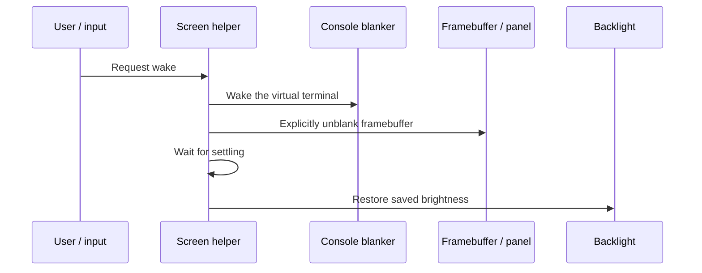
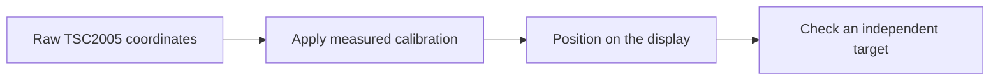

# Bringing up charging, display wake, and input

*4 and 5 October 2026. Reconstructed on 4 November 2026 from development and test notes.*

A booting shell exposed the next set of board problems: charging policy, display lifecycle, and input. Each involved both a Linux driver and the programs using it, and each needed a physical check.

Maemo's BME service provided a reference for charger detection and Tahvo control. The Debian implementation put charger protection and telemetry in the kernel's `power_supply` interface. Userspace selected charge thresholds, displayed status, and handled low-battery shutdown. Pulse-width modulation (PWM) controls the proportion of time a signal is active. The recorded PWM value represented that raw duty request. Current calibration and voltage-derived capacity remained approximate, so the measurements had to be interpreted alongside temperature, voltage, and elapsed charging time.

## Separating the backlight from the display pipeline

A dark panel initially made the Tahvo control path look suspicious. A direct write to the supplier LED returned `EBUSY`. The driver relationship explained it: `led-backlight` owned that LED and deliberately blocked direct supplier control. Charger telemetry was still accessing Tahvo through Linux's register-map interface successfully, which gave an independent observation that CBUS transactions continued.

The supported control was the backlight class. Wake sequencing then became important. Waking the virtual terminal (VT) could itself trigger an unblank, so it had to happen before the final framebuffer unblank and settling delay. Restoring brightness came afterward. Otherwise a second unblank could occur immediately before the brightness write.

The kernel brings up the panel in stages: let the control pins settle, enable the RFBI display interface, wait for the panel to leave sleep, and switch the display on. The userspace helper then waits briefly before restoring the saved brightness.

The [complete screen helper](https://github.com/gordol/n810-revival/blob/main/platform/scripts/n810-screen) shows the surrounding state checks and error handling. The helper records the previous brightness so waking restores the setting the user was using.

*The wake order matters because waking the console can itself request a display transition.*

The display fix corrected RFBI manager disable ordering, balanced the display controller's runtime power references, and released locks on enable errors. Three attended blank/wake cycles returned a readable console.

The 4 October kernel-only installation selected Debian for normal boot. A 5 October readback matched the installed kernel and original bootloader/initfs contents. Later configuration records had changed across boots, so the evidence was recorded at partition level.

## Distinguishing input calibration from display progress

The TSC2005 touchscreen driver produced paired press/release events and usable coordinates. Four visible corner targets supplied an affine fit: a transformation that corrects scale, rotation, and offset between the sensor coordinates and the screen. An independent center target measured about 3.8 pixels of error. Checking a target outside the fitted samples tested how well the calibration generalized across the display.

The pointer trial exposed a separate display problem. SSH remained available while display operations waited on RFBI and console locks. The proposed pointer optimization had used smaller dirty rectangles, but the panel driver expected full-screen updates. Meanwhile, idle policy could initiate display transitions while a graphics VT was active. The correction therefore involved both the update request and the service's understanding of the active session.

The 3.8-pixel error describes how closely the calibration placed the pointer on that tablet. The rendering and input queues determine how far a displayed pointer can lag behind a moving stylus. That later led to separate acquisition, dispatch, and presentation measurements.

## Establishing the coordinate system first

Before a window could follow the stylus, the raw touchscreen readings needed a relationship to display pixels. The [calibration program](https://github.com/gordol/n810-revival/blob/main/platform/scripts/n810-touch-calibrate.c) and [coordinate-fitting tool](https://github.com/gordol/n810-revival/blob/main/platform/scripts/n810-touch-fit.py) preserve that work. An affine transformation allows a raw horizontal or vertical reading to contribute to either screen axis, with an offset for each. This accommodates the sensor's orientation as well as scale and offset.

The corner targets supplied the fit; the separate center measurement checked it. A pointer that reaches the wrong place calls for checking that mapping. A pointer that eventually reaches the right place but arrives late calls for timing the work after acquisition. Keeping those observations separate became essential once the console acquired windows, animated backgrounds, and maps.

This was the starting point for the later [drag and map investigations](2026-10-24-maps-with-an-edge.md#measuring-stylus-lag-separately). Calibration established where a contact belonged. Those later investigations asked when it reached the application and when the corresponding change became visible.

## Following the audio failure into the board description

The first audio obstacle was a persistent probe deferral. The machine driver expected `tlv320aic3x-codec.1-0018`, while ALSA's system-on-chip audio layer (ASoC) registered `tlv320aic3x.1-0018`. Correcting the component name allowed the card to register. The earlier `soc-audio` warning had appeared before the failing registration, which made it a misleading first clue.

The next audio test failed more severely. The corrected machine module registered an ALSA card, but the first playback attempt hard-locked the tablet. McBSP2 is the processor's serial audio interface. Source inspection found a board description for it using FIFO properties and a common interrupt path associated with newer OMAP hardware. A follow-up candidate restored the OMAP2420 TX/RX interrupt arrangement and removed the FIFO-size property. Its next planned checks covered enumeration and idle liveness before another streaming test. The failed playback established why card registration and usable audio required separate acceptance.

The keyboard work added a programmer layer, while the spring-return lock slider needed debounced edge handling. Shared services coordinated the keyboard lamp, display, lock state, LEDs, and power controls across console and graphical sessions.

<!-- journal-sources:start -->
## Code, tests and build inputs

| Material | Repository files |
|---|---|
| Implementation | [Wake and input policy](../assets/source/journal/platform/scripts/n810-wake.c.txt) ([GitHub](https://github.com/gordol/n810-revival/blob/main/platform/scripts/n810-wake.c)) [Screen wake sequence](../assets/source/journal/platform/scripts/n810-screen.txt) ([GitHub](https://github.com/gordol/n810-revival/blob/main/platform/scripts/n810-screen)) [Charging-mode transitions](../assets/source/journal/platform/scripts/n810-mode.txt) ([GitHub](https://github.com/gordol/n810-revival/blob/main/platform/scripts/n810-mode)) [Touch calibration](../assets/source/journal/platform/scripts/n810-touch-calibrate.c.txt) ([GitHub](https://github.com/gordol/n810-revival/blob/main/platform/scripts/n810-touch-calibrate.c)) [Maintained power/display changes](../assets/source/journal/platform/kernel/n810-5.15.224.patch.txt) ([GitHub](https://github.com/gordol/n810-revival/blob/main/platform/kernel/n810-5.15.224.patch)) |
| Checks and fixtures | [Mock input events](../assets/source/journal/platform/scripts/test-n810-wake-input.py.txt) ([GitHub](https://github.com/gordol/n810-revival/blob/main/platform/scripts/test-n810-wake-input.py)) [Charging-mode recovery](../assets/source/journal/platform/scripts/test-n810-mode.py.txt) ([GitHub](https://github.com/gordol/n810-revival/blob/main/platform/scripts/test-n810-mode.py)) [Brightness remapping](../assets/source/journal/platform/scripts/test-n810-brightness-remap.py.txt) ([GitHub](https://github.com/gordol/n810-revival/blob/main/platform/scripts/test-n810-brightness-remap.py)) |
| Build inputs | [ARM helper builder](../assets/source/journal/platform/build-tools.py.txt) ([GitHub](https://github.com/gordol/n810-revival/blob/main/platform/build-tools.py)) [Kernel file inventory](../assets/source/journal/platform/kernel/source-files.json.txt) ([GitHub](https://github.com/gordol/n810-revival/blob/main/platform/kernel/source-files.json)) [Platform test runner](../assets/source/journal/tools/test-platform.py.txt) ([GitHub](https://github.com/gordol/n810-revival/blob/main/tools/test-platform.py)) |

[Build and test instructions](../how-to/test-journal-checkpoints.md) · [Chronological source index](../reference/journal-sources.md#2026-10-05-power-display-input)

The kernel patch retains Retu, Tahvo, board and RFBI changes. The input suites use generated events and mock commands; the display and charging measurements in the post came from the tablet.
<!-- journal-sources:end -->

[Journal](../journal.md) | [Current status](../status.md)

[Previous entry](2026-10-03-wifi.md) | [Next entry](2026-10-05-sidebar-desktop.md)
