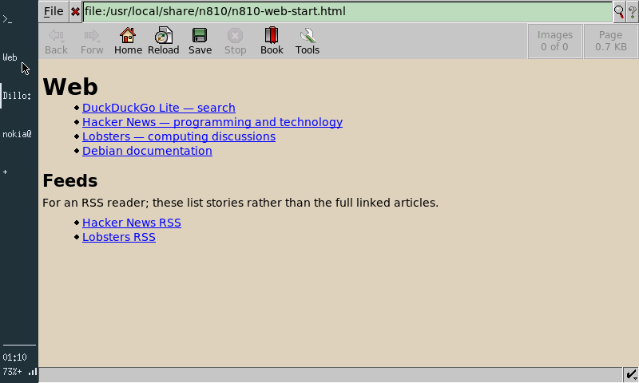
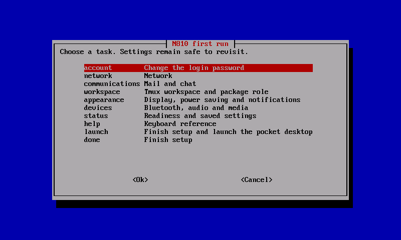

# Building the first sidebar desktop

*5 October 2026. Reconstructed on 4 November 2026 from development and test notes.*

The first graphical desktop used Xorg's framebuffer driver, Matchbox, xterm, and a 48-pixel application rail. The layout followed the N810's proportions: application selection along the side, status at the bottom, and most of the display available to the active window. It carried forward the useful parts of the original Maemo interaction model.

*The original 48-pixel sidebar and Dillo on the N810, 5 October.*

## Making a narrow screen usable

The rail was a persistent application switcher with launch, focus, and close behavior. Its width was a concrete allocation of the 800-pixel display. Hiding it returned that space to the active application. Press-and-hold and right-click exposed the same small action menu, keeping the interaction reachable from both stylus and mouse.

The implementation used existing X clients and a framebuffer X server. The [fbdev manual](https://xorg.freedesktop.org/archive/X11R7.5/doc/man/man4/fbdev.4.html) describes the driver beneath this arrangement, including its shadow framebuffer option. The first useful result was ordinary applications sharing a calibrated touchscreen and the tablet's controls.

*The 4 October first-run menu grouped account, networking, workspace, appearance, and device setup. The sidebar desktop followed on 5 October.*

## Preserving sessions across switches

The local session helper needed to distinguish an ordinary login, a return from graphics, and a request to end the desktop. A shell could outlive its terminal window through tmux. A graphical program could outlive a temporary switch back to the console. Closing X explicitly ended the graphical clients.

The early setup flow recorded completed choices separately from a final completion marker. Cancelling setup preserved choices already made and offered the unfinished steps on the next eligible login. The marker's ownership and session conditions mattered because SSH and maintenance logins also used the same account.

The current [session helper](https://github.com/gordol/n810-revival/blob/main/platform/scripts/n810-session) and [desktop selector](https://github.com/gordol/n810-revival/blob/main/platform/scripts/n810-desktop) preserve the OS-side entry points. The graphical rail, Xorg configuration and XFCE settings are retained in the historical sidebar directory linked below.

Dillo opened a local start page, and terminal windows attached to the existing tmux workspace. The console and graphical session shared the power, brightness, lock, and idle services. This let us test session switching without giving each desktop its own competing hardware controls.

The framebuffer route made X applications usable while GPU work was still at the inventory stage. By 13 October, XFCE 4.18 also ran on the SD installation with compositing disabled. It provided a fuller desktop proof of concept and another workload for memory, touch, and session switching.

The repository preserves the sidebar prototype alongside its virtual-display tests and ARM builder. The terminal desktop described next has a separate launcher and packaging.

<!-- journal-sources:start -->
## Code, tests and build inputs

| Material | Repository files |
|---|---|
| Implementation | [Application rail](../assets/source/journal/historical/sidebar-desktop/n810-rail.c.txt) ([GitHub](https://github.com/gordol/n810-revival/blob/main/historical/sidebar-desktop/n810-rail.c)) [X session](../assets/source/journal/historical/sidebar-desktop/session.sh.txt) ([GitHub](https://github.com/gordol/n810-revival/blob/main/historical/sidebar-desktop/session.sh)) [Touch-to-X mapping](../assets/source/journal/historical/sidebar-desktop/xorg-config.py.txt) ([GitHub](https://github.com/gordol/n810-revival/blob/main/historical/sidebar-desktop/xorg-config.py)) |
| Checks and fixtures | [Virtual-display rail test](../assets/source/journal/historical/sidebar-desktop/test-rail.c.txt) ([GitHub](https://github.com/gordol/n810-revival/blob/main/historical/sidebar-desktop/test-rail.c)) [Isolated X test launcher](../assets/source/journal/historical/sidebar-desktop/test-rail.sh.txt) ([GitHub](https://github.com/gordol/n810-revival/blob/main/historical/sidebar-desktop/test-rail.sh)) [Session restoration](../assets/source/journal/platform/scripts/test-n810-session.py.txt) ([GitHub](https://github.com/gordol/n810-revival/blob/main/platform/scripts/test-n810-session.py)) |
| Build inputs | [Pinned ARM build](../assets/source/journal/historical/sidebar-desktop/build-armel.sh.txt) ([GitHub](https://github.com/gordol/n810-revival/blob/main/historical/sidebar-desktop/build-armel.sh)) [Desktop packages](../assets/source/journal/historical/sidebar-desktop/packages.txt.txt) ([GitHub](https://github.com/gordol/n810-revival/blob/main/historical/sidebar-desktop/packages.txt)) [Xorg configuration](../assets/source/journal/historical/sidebar-desktop/xorg.conf.txt) ([GitHub](https://github.com/gordol/n810-revival/blob/main/historical/sidebar-desktop/xorg.conf)) |

[Build and test instructions](../how-to/test-journal-checkpoints.md) · [Chronological source index](../reference/journal-sources.md#2026-10-05-sidebar-desktop)

The original sidebar and XFCE prototype are retained as historical source. The current terminal desktop has a separate build and launcher.
<!-- journal-sources:end -->

[Journal](../journal.md) | [Current status](../status.md)

[Previous entry](2026-10-05-power-display-input.md) | [Next entry](2026-10-13-sd-bluetooth.md)
