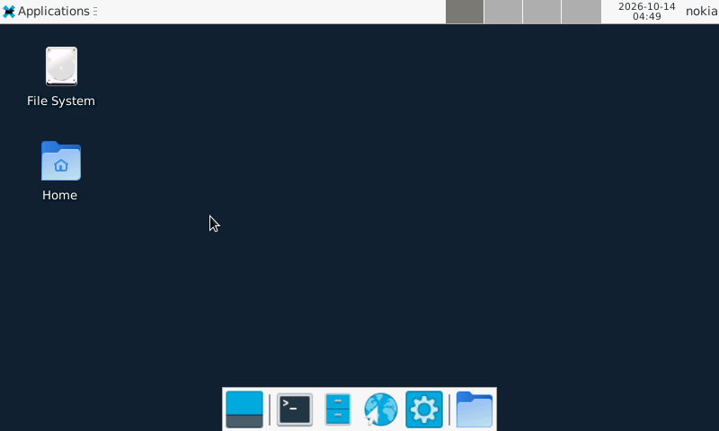

# Moving Debian to SD and connecting peripherals

*13 October 2026. Reconstructed on 4 November 2026 from development and test notes.*

Moving the root filesystem to SD gave Debian room for applications, package caches, and swap. The retained internal installation remained available as a fallback. The selected root used PARTUUID, and the normal-boot checks covered mounts, USB SSH, Wi-Fi DHCP, display/input services, and the swap configuration.

*XFCE on the N810, captured on 13 October Pacific time.*

## Verifying what changed at boot

The SD transition began with a filesystem copy and mount checks. The kernel's forced root argument selected the SD partition by PARTUUID. The previously working device tree and matching module set were carried forward, which kept the storage change narrow enough to diagnose.

The post-boot record checked the mounted root, filesystem options, free space, USB SSH, Wi-Fi DHCP, BlueZ, and display/control services. It also recorded initialization of the kernel's cryptographic random-number generator at 0.414 seconds. These observations established that the new root could support the existing system services after an ordinary boot.

The memory arrangement placed logical zram ahead of SD swap. Compression reduced some pressure on storage, while the SD area provided capacity for workloads that exceeded RAM. Performance still depended on the working set: a desktop that repeatedly faulted pages could consume time even while another program was doing the visible work.

The tested configuration assigned zram priority 100 and SD swap priority 10. The zram device had a logical capacity of 128 MiB; compressed pages consumed physical RAM according to their contents. The [kernel zram documentation](https://docs.kernel.org/admin-guide/blockdev/zram.html) explains these accounting fields. Later graphics tests showed why this distinction mattered: background major faults could change foreground timing even when the visible workload stayed constant.

## Building Bluetooth against the actual kernel

Earlier Bluetooth preparation had exposed a build-configuration problem. `CONFIG_TRIM_UNUSED_KSYMS` removes exported kernel symbols that the configured modules do not use. A separately built driver can still need one of those symbols. A driver built for another checkpoint had imports that the retained symbol metadata could not resolve. The module build stopped at `modpost`, Kbuild's module post-processing and symbol-checking stage. The next useful build therefore needed a coherent kernel/module export set before a new controller image could be evaluated.

That failure connects a routine build check to an observable hardware symptom. A module file existing on disk says little about whether its symbols match the running kernel. The later working Bluetooth transport combined the board binding, firmware, sleep/wake behavior, and a matching kernel build.

Classic Bluetooth required Nokia's H4+ transport and CSR BC4 initialization. Original board source and firmware helped recover the startup and sleep/wake behavior. Keyboard pairing, reconnect, and input wake were demonstrated. The controller's classic serial profile later carried the packet-radio connection.

Xorg used the framebuffer. Matchbox and XFCE supplied alternative graphical sessions, with shared idle, lock, and brightness handling. Touch calibration made pointer placement usable. Keeping GUI processes alive while returning to the console required an explicit distinction between switching sessions and ending them.

This checkpoint established the platform on which Pocket and the radio applications could run: persistent storage, a maintenance link, wireless networking, keyboard and touch input, and a usable display lifecycle. The later RGB kernel extended the console presentation path.

<!-- journal-sources:start -->
## Code, tests and build inputs

| Material | Repository files |
|---|---|
| Implementation | [SD image assembly](../assets/source/journal/platform/scripts/assemble-n810-minisd-inplace.py.txt) ([GitHub](https://github.com/gordol/n810-revival/blob/main/platform/scripts/assemble-n810-minisd-inplace.py)) [Bluetooth control](../assets/source/journal/platform/scripts/n810-bluetooth.txt) ([GitHub](https://github.com/gordol/n810-revival/blob/main/platform/scripts/n810-bluetooth)) [Maintained Bluetooth driver changes](../assets/source/journal/platform/kernel/n810-5.15.224.patch.txt) ([GitHub](https://github.com/gordol/n810-revival/blob/main/platform/kernel/n810-5.15.224.patch)) |
| Checks and fixtures | [Swap preservation](../assets/source/journal/platform/scripts/test-n810-zram.py.txt) ([GitHub](https://github.com/gordol/n810-revival/blob/main/platform/scripts/test-n810-zram.py)) [Bluetooth fallback](../assets/source/journal/pocket/tests/test_bluetooth_hardware_fallback.py.txt) ([GitHub](https://github.com/gordol/n810-revival/blob/main/pocket/tests/test_bluetooth_hardware_fallback.py)) |
| Build inputs | [zram service](../assets/source/journal/platform/device/n810-zram.init.txt) ([GitHub](https://github.com/gordol/n810-revival/blob/main/platform/device/n810-zram.init)) [SD package-cache settings](../assets/source/journal/platform/config/n810-apt-sd.conf.txt) ([GitHub](https://github.com/gordol/n810-revival/blob/main/platform/config/n810-apt-sd.conf)) [Kernel configuration](../assets/source/journal/platform/kernel/n810.config.txt) ([GitHub](https://github.com/gordol/n810-revival/blob/main/platform/kernel/n810.config)) |

[Build and test instructions](../how-to/test-journal-checkpoints.md) · [Chronological source index](../reference/journal-sources.md#2026-10-13-sd-bluetooth)

The maintained source includes hci_nokia.c. A complete historical SD installation additionally requires its root-filesystem and owner-specific firmware inputs. The current kernel build is documented separately.
<!-- journal-sources:end -->

[Journal](../journal.md) | [Current status](../status.md)

[Previous entry](2026-10-05-sidebar-desktop.md) | [Next entry](2026-10-14-aprs.md)
