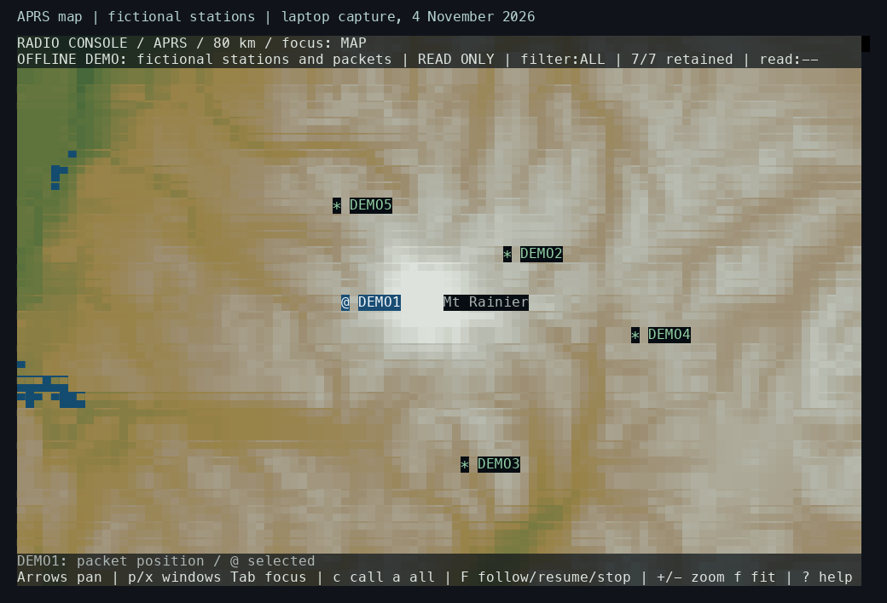
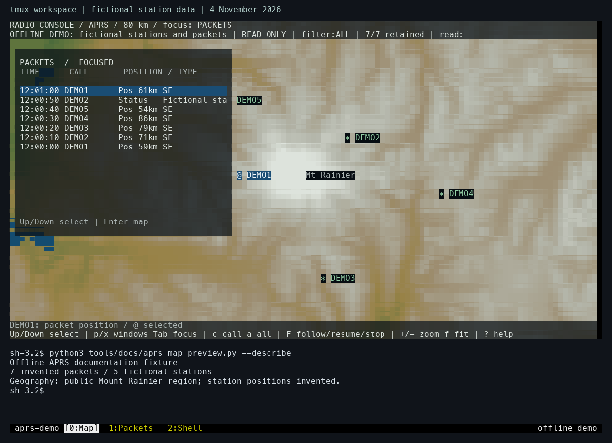
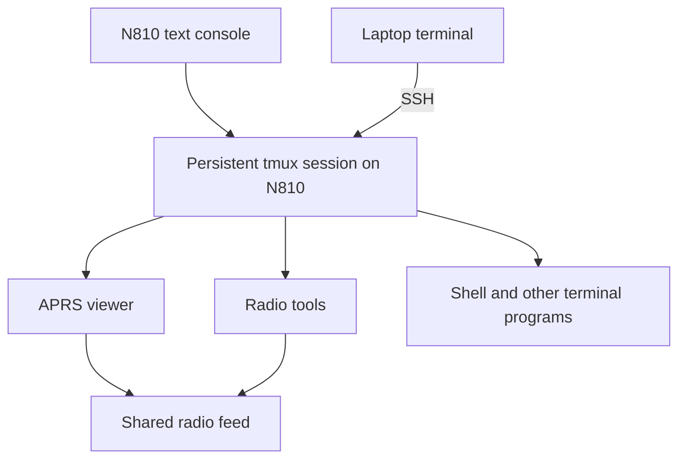
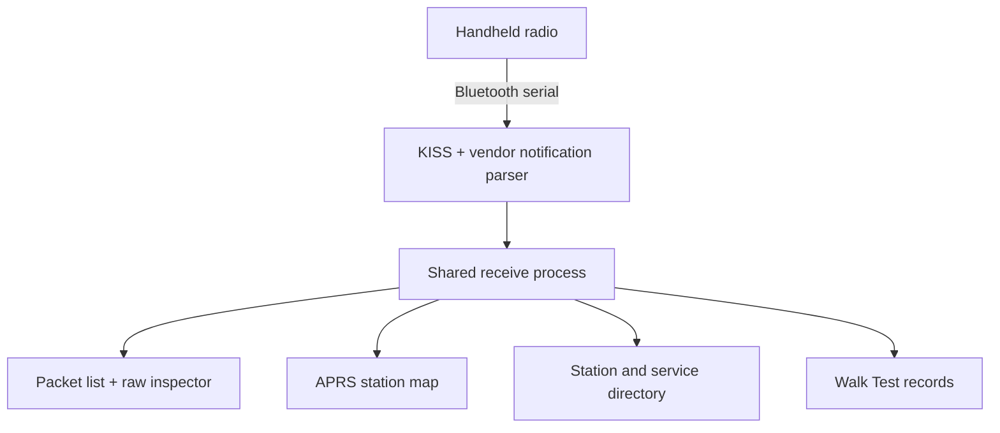
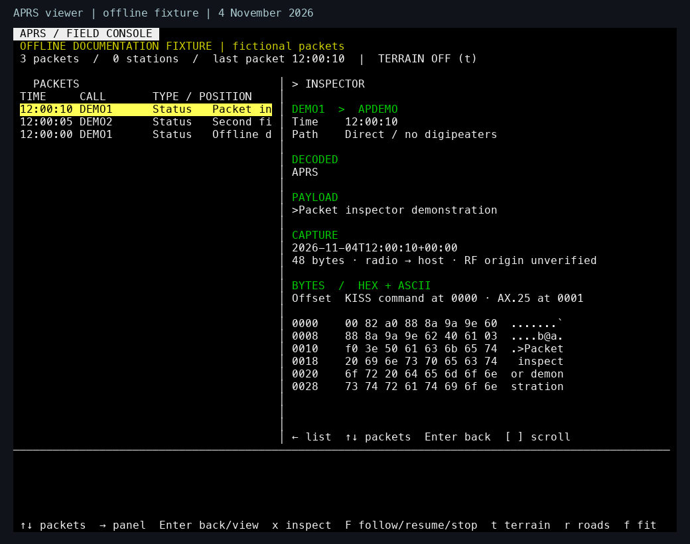

# Starting with APRS and the handheld radio

*Early to mid-October work, with dated interface captures by 14 October 2026. Reconstructed on 4 November from the packet-radio notes and source. The surviving records leave the exact first radio-test date uncertain.*

The first radio applications grew around the Automatic Packet Reporting System (APRS) and a Bluetooth connection to the handheld radio. They preceded the Pocket window manager and the later Reticulum work. We already had a useful problem for the revived tablet: receive packets, inspect what they contained, put stations on an offline map, and browse the radio's state from its keyboard.

*New laptop capture, 4 November 2026: the retained APRS map application renders public Mount Rainier geography with five invented stations. The `@` marker identifies the selected packet's position; the other stations use `*`. Terrain colors show elevation bands. This demonstration uses the later RGB renderer described in the [console-color entry](2026-10-16-16-bit-console.md).*

The geography comes from the project's prepared public map packs, which combine OpenStreetMap, USGS, Natural Earth, and NOAA data. Map data © [OpenStreetMap contributors](https://www.openstreetmap.org/copyright). The station labels, positions, timestamps, and packet contents in these new captures are fictional.

APRS carries information such as station positions, status, and short messages. Our radio path used AX.25 packet frames, carried between the radio and host in KISS framing. The radio handled the over-the-air signal; the N810 interpreted the bytes coming from its serial connection. The [APRS protocol reference](https://www.aprs.org/doc/APRS101.PDF) describes the packet formats, including Mic-E in chapter 10. The original [KISS protocol description](https://www.ax25.net/kiss.aspx) explains host-to-modem framing.

## The first interface was a tmux workspace

The initial interface put terminal programs into a persistent tmux session. tmux supplies named windows, splits a window into panes, and keeps programs running when a terminal disconnects. The tablet's console and a laptop connected over SSH could attach to that workspace. The APRS viewer was a curses application, using a terminal library to manage characters, colors, and input.

The status line showed named tools, the selected window, battery information, and the time. The small keyboard influenced the bindings: backtick and Ctrl-B served as command prefixes, arrow bindings selected or resized panes, and the tablet's hardware keys switched or zoomed windows. This gave the radio tools a usable shell before we built Pocket's own movable windows.

*New laptop capture, 4 November 2026, from an isolated tmux server. Its navigation and appearance come from the project's tmux configuration. The demonstration uses an “offline demo” status label in place of tablet battery and clock readings.*

The large upper pane runs the APRS viewer. Its packet panel and map belong to the same application: selecting a packet identifies the corresponding position on the map. The horizontal divider below it is a tmux pane boundary. The lower pane is a real shell displaying the fixture's packet inventory. At the bottom, `[0:Map]` is the active tmux window; `1:Packets` and `2:Shell` are separate running windows in the same session.

These are two levels of navigation. Inside the APRS viewer, `p` shows the packet panel, `x` opens the inspector, and Tab changes focus between panels. The tmux prefix, Ctrl-B or backtick, addresses the enclosing workspace. For example, Ctrl-B followed by `1` selects the Packets window. Keeping those controls separate let us inspect a packet and return to the map while the surrounding workspace remained open.

The [tmux configuration](https://github.com/gordol/n810-revival/blob/main/platform/config/tmux-n810.conf) contains the bindings and status-line setup. The [tmux manual](https://man.openbsd.org/tmux.1) explains sessions, windows, panes, and attachment. The graphical sidebar and XFCE work provided other interfaces to the same tablet during this period; the radio applications were already useful in the terminal workspace.

## Watch the map and workspace in use

<video controls playsinline preload="none" poster="../../assets/demos/aprs-tmux-tour-20261106-poster.png" aria-label="Selecting APRS packets, inspecting bytes, navigating the map, and switching tmux windows"><source src="../../assets/demos/aprs-tmux-tour-20261106.mp4" type="video/mp4"><track kind="captions" src="../../assets/demos/aprs-tmux-tour-20261106.vtt" srclang="en" label="English actions">[Watch the recording](../../assets/demos/aprs-tmux-tour-20261106.mp4).</video>

*67-second laptop recording made on 6 November 2026. It uses the same public geography and fictional station reports as the screenshots. The recording follows real input through the APRS viewer and tmux, with elapsed time preserved at ten captured frames per second.*

| Time | What happens |
|---|---|
| 0:04 | Down selects older reports; the selected station marker changes with the packet. |
| 0:14 | `x` opens the selected report's decoded fields and raw-byte inspector. |
| 0:24 | The packet panel closes and the map takes focus. |
| 0:28 | Two zoom steps reduce the displayed span from 80 km to about 36 km. |
| 0:36 | Arrow keys pan the map, then return to the previous center. |
| 0:45 | The view zooms out and the packet panel returns. |
| 0:53 | Ctrl-B followed by `1`, `2`, and `0` visits Packets, Shell, and the retained Map workspace. |

The tmux window keeps its application state while another window is selected. Returning to Map brings back the same view and selection. The separate [Pocket overview tour](../tutorials/overview-and-backgrounds.md) shows the desktop and window previews that developed later.

## Getting one reliable stream out of the radio

The Bluetooth link supplied a byte stream. A read could end halfway through a frame, or contain several frames at once. The parser therefore had to keep incomplete input between reads and identify complete messages itself.

The UV-PRO connection also carried vendor notifications. Those could contain fragments of received data alongside ordinary KISS frames. The receive code reassembled vendor fragments and identified the origin of each packet. A packet seen in both formats needed careful duplicate handling: suppressing the second representation should still preserve a genuinely repeated reception in the same format.

The current [UV-PRO stream parser](https://github.com/gordol/n810-revival/blob/main/pocket/shell/vendor/packet-console/uvpro-stream.py) shows that distinction. Its recent-packet list matches one copy with the same bytes and a different origin. It removes that matching entry when suppressing the duplicate. This is a current-code explanation of the receive problem; the historical notes place this radio work before the desktop integration.

The feed became the single owner of that connection. Viewers subscribed to its local sockets, so opening another application could use the existing stream. Read-only monitors received packets; a separate duplex interface admitted one writer and serialized its output. This arrangement later supplied the services used by Pocket and the laptop interface.

## Looking at the packet before trusting the map

The APRS viewer combined a packet list, a map, and an inspector showing raw hexadecimal and ASCII bytes. Selecting a packet linked those views. That gave us a way to compare an attractive marker with the actual information that produced it.

*Fresh laptop capture, 4 November 2026, using the standalone APRS viewer and fictional packets. The selected row on the left supplies the decoded text and bytes on the right. The fixture contains three status packets, so the positioned-station count is zero. The capture illustrates the interface described here using the retained viewer source.*

In the capture above, the payload starts with `>`, which identifies an APRS status report. The inspector shows a KISS command byte at offset `0000`, followed by the AX.25 frame at `0001`. The decoded addresses and payload provide a readable view of the same data. This made it possible to trace a mistaken label back to the received bytes.

The [offline inspector fixture](https://github.com/gordol/n810-revival/blob/main/tools/docs/aprs_preview.py) supplies every byte used in this example. It calls the real viewer's drawing functions directly with invented station labels and a fixed timestamp. Run it with `python3 tools/docs/aprs_preview.py` from a terminal at least 100 columns by 40 rows; press any key to close it.

Mic-E made that especially useful. Its compressed position information uses both the AX.25 destination and the payload. Decoding the payload alone loses information needed to recover the coordinates and symbol. The [APRS decoder](https://github.com/gordol/n810-revival/blob/main/pocket/shell/vendor/packet-console/n810-aprs-decode.py) accepts the destination separately and records decoding errors alongside the packet's other facts.

Relay paths needed similar care. A packet can request a path through digipeaters, stations that retransmit packet traffic. A requested path and the observed path answer different questions. We kept those observations alongside the raw packet so a displayed symbol or path label could be checked.

A received station position also describes that station. The location where our tablet heard it is separate data. Walk Test needed both if we wanted to relate reception to our own movement.

## Preparing maps on the laptop

The map work began with a regional overview and more detailed local coverage. The laptop prepared geography and elevation data; the tablet loaded the resulting packs. APRS and Walk Test shared the map engine while keeping their own layouts and saved views.

The data could load quickly and still take a long time to draw. An instrumented view at a 5 km span took roughly 15 seconds for a full draw, with road processing a substantial cost. A later prepared-cache read of 0.15–0.30 seconds measured only one part of that path. These observations led toward the renderer and input investigations later in the journal.

Colors also became a practical problem. Terrain bands used numbered terminal palette entries. Their appearance depended on how each terminal defined those entries. The [console-color entry](2026-10-16-16-bit-console.md) shows the difference and follows the change to explicit RGB colors.

## Browsing radio memories and schedules

Radio Preview added a snapshot of six banks containing 180 memory slots. The interface could browse those memories while showing separately observed live status. A saved memory and the radio's current selected channel were different things, so selecting a row needed to remain distinct from an explicit tuning action.

Nets organized published schedules and received announcements. A net is a scheduled amateur-radio gathering on a frequency or channel. Source labels helped explain where an entry came from. Weekly schedules required manual confirmation, and reminders began disabled. Reliable receive dates and replay labels were still needed before announcement age could drive automatic expiry.

These applications exposed the need for shared station context: choosing a station in one view should make it available to the map, directory, and packet inspector. They also exposed the limits of the small screen, which helped motivate the later window manager.

## Recording a walk and checking delivery

Walk Test saved outings with trail and probe records, then reopened them for inspection. For two probes, user-supplied Internet reports matched the saved local payloads. That supported delivery through an RF-to-Internet gateway for those particular packets.

The evidence had several stages. A completed local write showed that bytes reached the local transport. The radio could also echo its own transmitted packet. A matching report from a gateway supplied evidence farther along the path. Keeping these stages separate prevented a local echo from being counted as a successful radio return. The supplied reports were checked against the local payloads; the historical Internet archive itself was not independently fetched.

Reopening a saved walk restored the recording for inspection while leaving transmission unarmed. The [receive-history guide](../pocket/receive-history.md) describes the current history controls, and the [radio explanation](../explanation/radio.md) connects these early tools to today's applications.

## Run the local demonstration

The [map fixture](https://github.com/gordol/n810-revival/blob/main/tools/docs/aprs_map_preview.py) supplies the invented packets to the real viewer and map renderer. The [tmux launcher](https://github.com/gordol/n810-revival/blob/main/tools/docs/tmux_preview.py) opens the three windows and split shell in a temporary, separate server. Both use locally prepared public geography packs; the [map build guide](../how-to/build-map-data.md) gives the download and build steps. The [APRS demo guide](../how-to/aprs-demo.md) gives the commands and controls.

<!-- journal-sources:start -->
## Code, tests and build inputs

| Material | Repository files |
|---|---|
| Implementation | [APRS decoder](../assets/source/journal/pocket/shell/vendor/packet-console/n810-aprs-decode.py.txt) ([GitHub](https://github.com/gordol/n810-revival/blob/main/pocket/shell/vendor/packet-console/n810-aprs-decode.py)) [Packet viewer](../assets/source/journal/pocket/shell/vendor/packet-console/n810-aprs-view.py.txt) ([GitHub](https://github.com/gordol/n810-revival/blob/main/pocket/shell/vendor/packet-console/n810-aprs-view.py)) [Radio owner](../assets/source/journal/pocket/shell/vendor/packet-console/n810-aprs-services.py.txt) ([GitHub](https://github.com/gordol/n810-revival/blob/main/pocket/shell/vendor/packet-console/n810-aprs-services.py)) [Map demonstration](../assets/source/journal/tools/docs/aprs_map_preview.py.txt) ([GitHub](https://github.com/gordol/n810-revival/blob/main/tools/docs/aprs_map_preview.py)) [tmux demonstration](../assets/source/journal/tools/docs/tmux_preview.py.txt) ([GitHub](https://github.com/gordol/n810-revival/blob/main/tools/docs/tmux_preview.py)) |
| Checks and fixtures | [Packet decoding](../assets/source/journal/pocket/shell/vendor/packet-console/test-aprs-decode.py.txt) ([GitHub](https://github.com/gordol/n810-revival/blob/main/pocket/shell/vendor/packet-console/test-aprs-decode.py)) [Workspace selection](../assets/source/journal/pocket/shell/vendor/packet-console/test-packet-workspace-tui.py.txt) ([GitHub](https://github.com/gordol/n810-revival/blob/main/pocket/shell/vendor/packet-console/test-packet-workspace-tui.py)) [Radio banks](../assets/source/journal/pocket/shell/vendor/packet-console/test-radio-banks.py.txt) ([GitHub](https://github.com/gordol/n810-revival/blob/main/pocket/shell/vendor/packet-console/test-radio-banks.py)) [Walk history](../assets/source/journal/pocket/shell/vendor/packet-console/test-walk-history.py.txt) ([GitHub](https://github.com/gordol/n810-revival/blob/main/pocket/shell/vendor/packet-console/test-walk-history.py)) |
| Build inputs | [Workspace contract](../assets/source/journal/pocket/shell/vendor/packet-console/fixtures/tui-window-contract.json.txt) ([GitHub](https://github.com/gordol/n810-revival/blob/main/pocket/shell/vendor/packet-console/fixtures/tui-window-contract.json)) [Map build targets](../assets/source/journal/pocket/maps.mk.txt) ([GitHub](https://github.com/gordol/n810-revival/blob/main/pocket/maps.mk)) [tmux configuration](../assets/source/journal/platform/config/tmux-n810.conf.txt) ([GitHub](https://github.com/gordol/n810-revival/blob/main/platform/config/tmux-n810.conf)) |

[Build and test instructions](../how-to/build-map-data.md) · [Chronological source index](../reference/journal-sources.md#2026-10-14-aprs)

The demonstrations use generated packets and reviewed public map data. The original personal walk recordings remain private; synthetic fixtures preserve the protocol and history tests.
<!-- journal-sources:end -->

[Journal](../journal.md) | [Radio applications](../reference/applications.md)

[Previous entry](2026-10-13-sd-bluetooth.md) | [Next entry](2026-10-16-radio-ssh.md)
