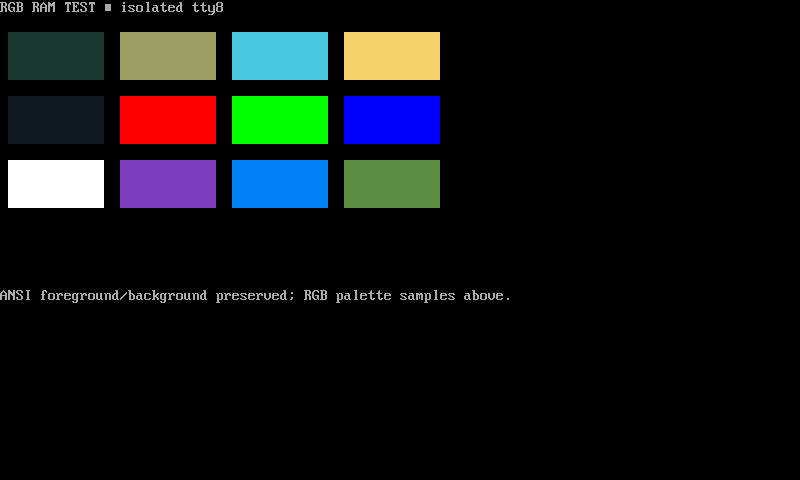
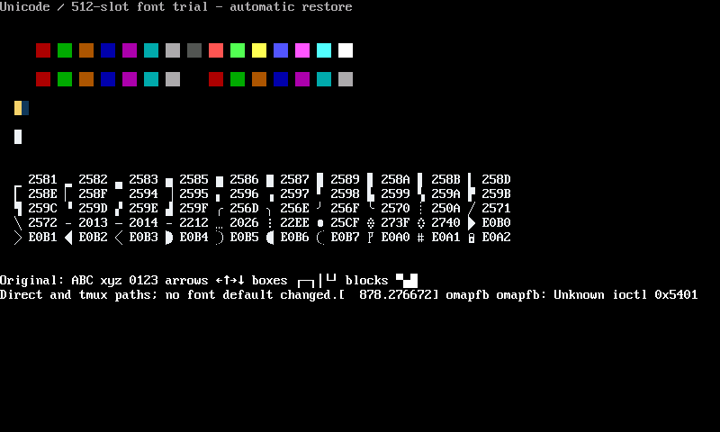

# Extending the Linux console to RGB565

*16 October 2026. Revised from the recorded console tests on 4 November 2026.*

The framebuffer already stored 16-bit RGB565 pixels. The color limitation was in the Linux virtual terminal and framebuffer text renderer, where application colors were reduced to the console's small palette. Earlier map code selected numbered ANSI palette entries. Reassigning those entries supplied terrain colors on one terminal; another terminal could interpret the same numbers through its own palette.

## See the color mismatch

<iframe class="palette-comparison" src="../../assets/demos/palette-comparison.html" title="The same synthetic terrain rendered with indexed ANSI colors and explicit RGB terrain colors" loading="lazy"></iframe>

The two views contain exactly the same cells. The left uses the source's indexed terrain mapping with a conventional ANSI palette. The right uses the RGB terrain values from `n810-map-rgb.py`. This reconstruction uses synthetic geography to show how the two color mappings render the same cells.

For example, the indexed map assigns its third terrain band to slot 1. With the conventional palette used here, that slot is red (`#aa0000`). The corresponding explicit terrain color is green (`#566941`). SSH carries the application's escape sequences; the terminal at the receiving end decides what a palette index means.

Compare the [indexed map mapping](https://github.com/gordol/n810-revival/blob/main/pocket/shell/vendor/packet-console/n810-map-style.py) with the [explicit RGB palette](https://github.com/gordol/n810-revival/blob/main/pocket/shell/vendor/packet-console/n810-map-rgb.py). The kernel change below allowed the physical console to preserve the requested RGB values through to RGB565 pixels.

## Locating where color information was lost

The map could show a blue sea with red, yellow, and magenta terrain when its numbered slots used the ordinary terminal palette. The application depended on reassigned ANSI palette entries. Changing terminal declarations and adding theme/palette machinery could alter the appearance, but each client then needed to reproduce those hidden assumptions.

The framebuffer already stored RGB565 pixels. The Linux virtual terminal (VT) reduced the application's requested colors before the framebuffer console renderer, fbcon, drew the characters. Our [RGB console patch](../reference/console-rgb-patch.md) adds foreground and background colors alongside each character. You can [download the exact patch here](../assets/patches/console-rgb.patch) or [read its four-file diff on GitHub](https://github.com/gordol/n810-revival/blob/main/platform/patches/console-rgb.patch).

The foreground and background handlers kept the requested red, green, and blue components with each character cell. Preserving the color during ordinary typing was the first step. Scrolling, erasing, inserting, deleting, selection inversion, and resizing also had to update those stored colors alongside the characters. Otherwise, moving text could leave it with the colors of the cells it had replaced. A resize copied the overlapping rows and columns and initialized the newly exposed cells with the active colors.

The [fbcon documentation](https://docs.kernel.org/fb/fbcon.html) explains the relationship between a text console and the framebuffer underneath it. Our patch extends the color information carried across that relationship. The [kernel reference](../reference/kernels.md) identifies the tested build and current source availability.

## Checking terminal output against framebuffer pixels

An RGB escape sequence can be exercised from a shell:

```sh
printf '\033[48;2;64;128;192m  \033[0m\n'
```

This illustrative command asks the terminal for a background color. The device test went further by comparing framebuffer pixels to the expected quantized values. Testing both RGB-off and RGB-on builds also exercised the compatibility switch before the selected image became the stored default.

In these terminal control sequences, `38` selects the foreground and `48` selects the background. The following `2` introduces explicit red, green, and blue components. The renderer rounds each component to the framebuffer's five red bits, six green bits, and five blue bits. The corresponding `38;5` and `48;5` forms select an indexed color; ordinary ANSI colors remain available as well.



The physical test compared twelve swatches with their expected RGB565 pixel values. Every comparison matched. Both RGB-disabled and RGB-enabled candidates passed RAM boots. The selected `5.15.86-n810-console-rgb1+` build was installed as the default, its 199 paired modules matched their manifest, and a normal power cycle was verified on 16 October.

The font trial used an 8 by 16 cell with 512 glyph slots. Fifty added glyphs passed direct-console and tmux checks. Rounded corners and partial blocks gave the window system more useful shapes within the existing cell grid.



A native compositor trial reached the same device. In its recorded workload, first-data output took 9.14 seconds, worst input-to-present was 427 ms, and unchanged idle CPU was approximately 0.2 percent of one core. Peak RSS was 15,224 KiB. Those measurements covered the early retained-cell application; later desktop workloads required their own measurements.

The console work supplied a common color interface for the tablet and laptop terminals. It also established a useful division of responsibility: application code selects colors, the terminal carries them, and the physical framebuffer determines their final precision.

<!-- journal-sources:start -->
## Code, tests and build inputs

| Material | Repository files |
|---|---|
| Implementation | [October console patch](../assets/source/journal/platform/patches/console-rgb.patch.txt) ([GitHub](https://github.com/gordol/n810-revival/blob/main/platform/patches/console-rgb.patch))<br>[Retained VT source](../assets/source/journal/platform/console-rgb/after/drivers/tty/vt/vt.c.txt) ([GitHub](https://github.com/gordol/n810-revival/blob/main/platform/console-rgb/after/drivers/tty/vt/vt.c))<br>[Retained framebuffer-console source](../assets/source/journal/platform/console-rgb/after/drivers/video/fbdev/core/fbcon.c.txt) ([GitHub](https://github.com/gordol/n810-revival/blob/main/platform/console-rgb/after/drivers/video/fbdev/core/fbcon.c)) |
| Checks and fixtures | [C regression harness](../assets/source/journal/platform/console-rgb/tests/test.c.txt) ([GitHub](https://github.com/gordol/n810-revival/blob/main/platform/console-rgb/tests/test.c))<br>[Extract-and-compile runner](../assets/source/journal/platform/console-rgb/tests/run.py.txt) ([GitHub](https://github.com/gordol/n810-revival/blob/main/platform/console-rgb/tests/run.py))<br>[Console cleanup](../assets/source/journal/platform/console-rgb/acceptance/test_console_accept.py.txt) ([GitHub](https://github.com/gordol/n810-revival/blob/main/platform/console-rgb/acceptance/test_console_accept.py)) |
| Build inputs | [Console acceptance program](../assets/source/journal/platform/console-rgb/acceptance/console_accept.py.txt) ([GitHub](https://github.com/gordol/n810-revival/blob/main/platform/console-rgb/acceptance/console_accept.py))<br>[Maintained kernel configuration](../assets/source/journal/platform/kernel/n810.config.txt) ([GitHub](https://github.com/gordol/n810-revival/blob/main/platform/kernel/n810.config)) |

[Build and test instructions](../how-to/test-journal-checkpoints.md#check-the-rgb-console-patch) · [Chronological source index](../reference/journal-sources.md#2026-10-16-16-bit-console)
<!-- journal-sources:end -->

[Journal](../journal.md) | [Rendering architecture](../explanation/rendering.md)

[Previous entry](2026-10-16-radio-ssh.md) | [Next entry](2026-10-16-pocket-desktop.md)
