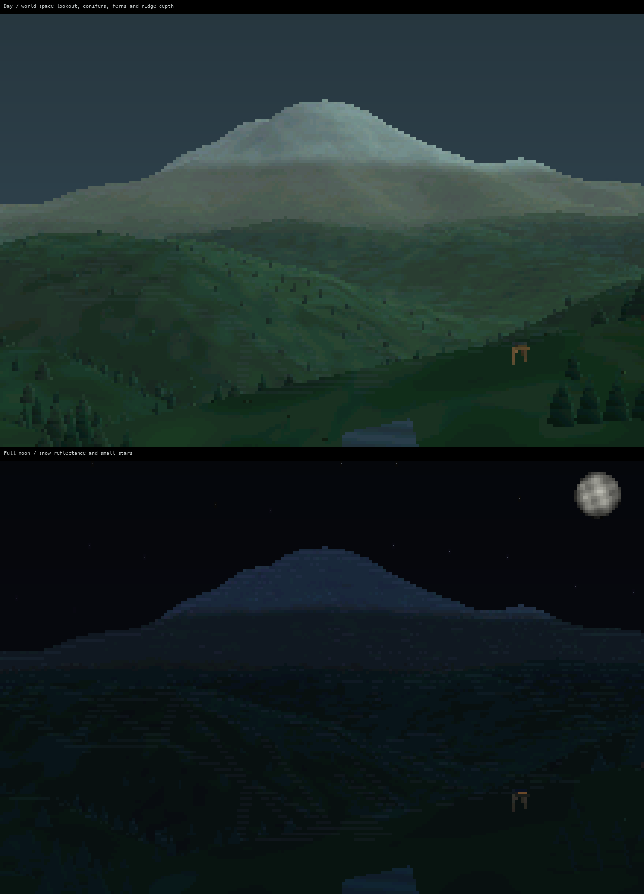

# TADA: a 16-bit Linux console

N810 REVIVAL · RELEASE NOTES FROM THE SMALL MACHINE · 16 OCT 2026

65,536 COLORS. ONE LINUX VT.

128 MB of RAM. An 800 × 480 screen. A real keyboard. A pocket Linux computer with a few new tricks.

<i></i><i></i><i></i><i></i><i></i><i></i><i></i><i></i>

RGB565 / ARMv6 / LINUX / SMALL CODE / BIG PIXELS

The N810 now boots a **16-bit-color Linux console** as its normal default.
The color lives in the kernel's virtual terminal and framebuffer text renderer.
Apps send RGB escape sequences; the console carries foreground and background
colors with the characters and draws them into RGB565.

The richer palette gives maps, selection, depth and status more room to breathe.
The goal is still a general-purpose Linux handheld. Radio tools happen to be a
good workout for its Bluetooth, networking, storage and UI.

## 01 / The pixels are real

*Physical N810 capture, 800 × 480. Twelve test swatches matched their expected
RGB565 pixel values exactly. This frame came from the RGB-ON RAM test.*

RGB565 gives red and blue five bits each and green six: **65,536 possible
colors**. Applications can request 24-bit RGB with `38;2` and `48;2`; the
framebuffer quantizes it to the screen's format. Indexed `38;5` / `48;5` colors
work too. Existing ANSI colors remain available.

Both RGB-OFF and RGB-ON kernels passed RAM boots. The selected RGB-ON image was
then installed with a kernel-only write and verified after a normal power cycle.
The paired **199 modules** matched their manifest. NOLO and the Maemo filesystems
remain preserved, along with the previous working kernel for rollback.

## 02 / More shapes, same terminal

*Physical N810 capture through tmux. All 50 added glyphs matched in direct-console
and tmux tests. The trial restores the original console fonts on exit.*

The experimental UI uses an **8 × 16, 512-slot console font**. Rounded corners,
partial blocks and a few purpose-built shapes give text windows better edges
without loading a graphical desktop. Its explicit Unicode coverage keeps the
small glyph budget predictable.

This is still the Linux text console. tmux remains useful. Existing terminal
apps remain useful. The experimental font is a trial, not a new system default.

## 03 / Roll the intro

LAPTOP TERMINAL CAPTURE · VISUAL PROTOTYPE · NOT N810 FRAME-RATE EVIDENCE

<video class="demo-video" controls playsinline preload="none" poster="../../assets/demos/terrain-day-poster.png" aria-label="Daytime terminal terrain formation demo recorded on the laptop">
<source src="../../assets/demos/terrain-day.mp4" type="video/mp4">
<a href="../../assets/demos/terrain-day.mp4">Watch the daytime terminal demo</a>
</video>

*Day: geometry assembles into a landscape. Eight-second silent clip, recorded
from the laptop terminal prototype and encoded for the web. Press Play.*

<video class="demo-video" controls playsinline preload="none" poster="../../assets/demos/terrain-night-poster.png" aria-label="Night terminal terrain formation demo recorded on the laptop">
<source src="../../assets/demos/terrain-night.mp4" type="video/mp4">
<a href="../../assets/demos/terrain-night.mp4">Watch the nighttime terminal demo</a>
</video>

*Night: the same idea with stars, moonlight and a darker palette. Also recorded
on the laptop.*

The scene renderer builds a terrain mesh, projects it into terminal cells and
uses their foreground/background colors for shading. Vegetation is procedural;
the moon is an analytical sphere with authored crater detail. The landscape uses
[USGS 3DEP elevation data](https://elevation.nationalmap.gov/arcgis/rest/services/3DEPElevation/ImageServer)
around Tahoma / Mount Rainier. It is a visual scene,
not a navigation display or an astronomical simulation.

*Development render on the laptop. Terrain elevation: USGS 3DEP; vegetation,
lighting and moon treatment: project code.*

Work with the grid. Reuse the buffers. Make the constraints visible. The
decoration stays optional: the rich graphics trial still missed its bounded
N810 startup gate. Laptop previews let us explore the look while the device
work concentrates on startup, input and rendering cost.

## 04 / The fast path is C

The native cell compositor has now **run on the N810**. Python owns application
state and interaction; C retains compact planes, compares damaged regions and
emits changed terminal spans. No GPU or DSP acceleration is involved.

| Actual N810 measurement | Python retest | Native retest |
|---|---:|---:|
| Unchanged idle CPU | ~0.2% of one core | ~0.2% of one core |
| First real-data output | 10.1 s | 9.14 s |
| Worst input-to-present | 1.55 s | 427 ms |
| Peak RSS | 15,040 KiB | 15,224 KiB |

These were separate runs, not a controlled speedup ratio. The native run used
about 74 KB of retained native buffers. Startup is still dominated by imports;
the two-second startup and 250-ms interaction targets are still ahead of us.
Output-arrival timing also stops short of measuring the physical first pixel.

## 05 / Old apps, new windows

An unchanged curses APRS viewer can now run inside a framework window in local
PTY trials. Focus, resizing, retained-data replay and child exit passed locally.
While focused, the app keeps its own keys; `Ctrl-]` hands control back to the
host and `F6` switches windows. Tablet acceptance is the next gate.

Touch is progressing separately. The revised app calibration collects repeated
taps and checks separate targets before saving. The revised flow still needs physical acceptance. The original console and
Xorg touch paths have their own calibration and acceptance history.

A read-only LAN web companion can also present the existing packet history,
directory, Nets and radio snapshots on a phone or laptop. It uses the shared
data owner; it does not need a competing Bluetooth session. That companion is
a local authenticated service, not a public endpoint or fresh-RF guarantee.

## 06 / The next trick

We also recovered an open C55x assembler and checked two tiny DSP kernels with
an independent encoder and exhaustive 16-bit input models. That is code-generation
work on the laptop. **Neither routine has executed on the N810 DSP yet.**
The MBX graphics runtime remains unresolved. The screenshots and numbers above
come from the CPU and console work we actually have.

A useful handheld first. A tiny machine worth making things for. And, occasionally,
a reason to put color bars on hardware that has been sitting in a drawer for years.

[Current status](../status.md) · [Source tree](../source.md) ·
[Journal](../journal.md)

END OF INTRO / RETURN TO PROMPT █

