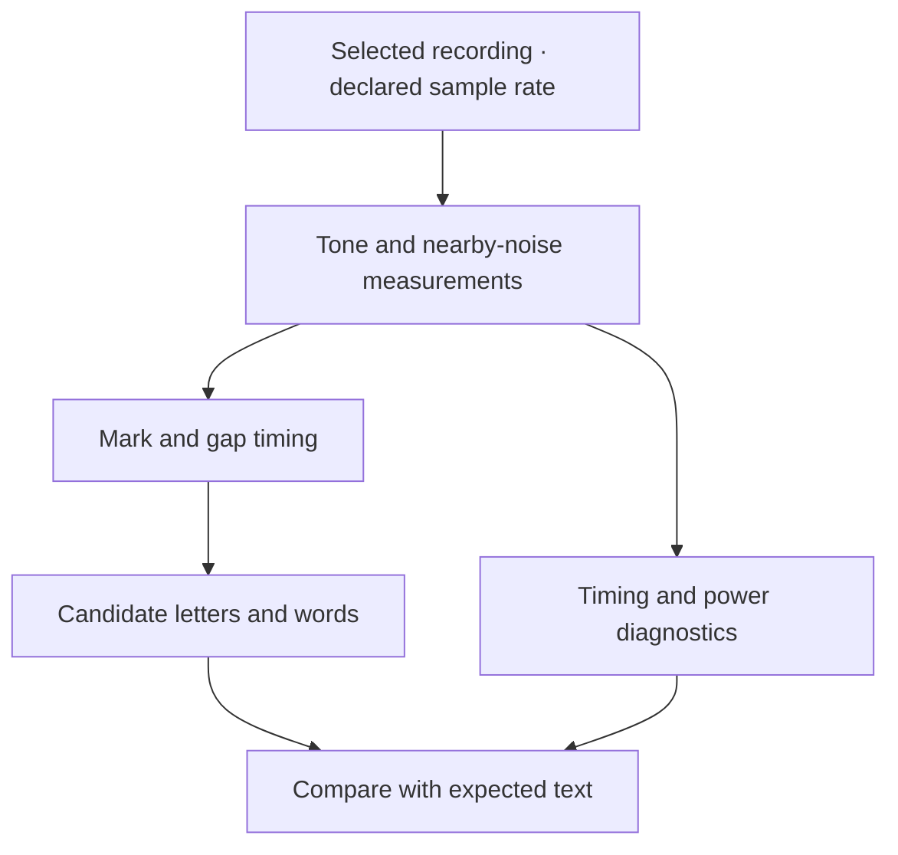

# Decoding Morse recordings and preparing an audio input

*Mid-October research and the replay work that followed. Reconstructed on 4 November 2026 from the decoder, corpus, and input-adapter notes.*

Alongside packet radio, we investigated receiving Morse code. In radio usage, CW refers to transmitting a carrier switched on and off in the timing patterns of Morse. A receiver turns that into audible tones. Our first job was to turn a recording of those tones into tentative text while keeping enough timing information to inspect mistakes.

## Starting with a signal we understood

The first reference accepted mono audio at 8,000 samples per second. It measured energy around a chosen tone, initially 700 Hz, using a Goertzel calculation, which evaluates the energy at a selected frequency. Nearby measurements at 550 and 850 Hz supplied a local comparison for noise or interference.

We retained the tone power, neighboring power, and a continuous score before deciding whether a tone was present. This let us inspect marginal detections. Turning the signal into a yes/no decision too early would discard information needed to understand a missed or false mark.

The initial windows were 20 ms long. At 20 words per minute, a dit lasts 60 ms, so one dit covered only three analysis windows. That gave a concrete limit on transition timing. The recording-to-text version used 10 ms windows and accumulated mark and gap durations before assembling characters.

## Testing ambiguity and the end of a recording

Synthetic audio gave us exact expected text, speed, tone, and noise. Tests covered letters and digits at several fixed speeds, silence, seeded noise, malformed marks, and the final character at end-of-file. The decoder emitted `?` for unsupported or ambiguous patterns.

Ending the recording needed explicit handling because a decoder often waits for a following gap before completing a character. The file decoder padded its final partial analysis window and flushed the pending mark or character. The streaming work later kept synthetic tail samples separate from the timestamps attributed to real input.

The amplitude floor also needed a plain explanation. The default threshold suppressed the tested low-level noise, but it would discard sufficiently weak tones as well. A plausible string from a noisy recording remained a candidate to inspect. The corpus and replay reports helped compare algorithms under known conditions; they did not supply a general weak-signal accuracy figure.

The current [reference detector](https://github.com/gordol/n810-revival/blob/main/pocket/shell/vendor/apps/cw-reference/reference.py) and [recording decoder](https://github.com/gordol/n810-revival/blob/main/pocket/shell/vendor/apps/cw-reference/decode.py) show those stages separately.

## Preserving the audio's real sample rate

A later adapter accepted declared PCM events at 8, 16, 32, or 48 kHz. PCM stores successive amplitude samples. Interpreting 32 kHz samples as though they were 8 kHz would change both pitch and timing, so conversion had to be explicit.

The adapter applied a low-pass filter before integer downsampling. This suppresses frequencies that would fold into the retained frequency range during conversion, an effect called aliasing. The implementation used a 193-tap Blackman-windowed sinc filter with a 3,200 Hz cutoff. Tests checked passage of a 700 Hz tone and rejection of a 5,700 Hz tone at each supported conversion rate.

Input events carried a stream identity, sequence number, first-sample index, sample count, and format. A gap or reconnect ended the current segment. Otherwise, samples on opposite sides of an interruption could be joined into a Morse mark that had never occurred. The [PCM adapter](https://github.com/gordol/n810-revival/blob/main/pocket/shell/vendor/apps/cw-reference/pcm_input.py) and [streaming decoder](https://github.com/gordol/n810-revival/blob/main/pocket/shell/vendor/apps/cw-reference/stream_cw.py) implement the current path.

## Making replay usable from the desktop

Workbench later wrapped selected-file inspection, decoding, progress, cancellation, and saved result history. A replay ran in a child process with time and output limits. Cancelling it terminated and reaped the process. Reopening a saved result restored the report for inspection, while a new decode required another explicit action.

The [Workbench model](https://github.com/gordol/n810-revival/blob/main/pocket/shell/vendor/apps/domains/workbench/model.py) and [CW view](https://github.com/gordol/n810-revival/blob/main/pocket/shell/native_cw.py) connect the experiments to the current desktop. The [application guide](../pocket/apps-and-services.md) places them alongside the other local tools.

## Establishing the remaining hardware step

We had a laptop replay path and an interface for an existing audio stream. The live HF trial still needed an identified receiver audio source. At the recorded inventory check, the X6100's USB audio device was absent and the N810 had no registered ALSA sound card. The UV-PRO packet-radio connection served a different radio role.

That left a specific next experiment: establish the HF receiver's actual audio format, demonstrate samples arriving, then run a short decode while comparing the candidate text with the audible signal. The source and replay results described the decoder work completed before that hardware trial.

<!-- journal-sources:start -->
## Code, tests and build inputs

| Material | Repository files |
|---|---|
| Implementation | [Tone detector](../assets/source/journal/pocket/shell/vendor/apps/cw-reference/reference.py.txt) ([GitHub](https://github.com/gordol/n810-revival/blob/main/pocket/shell/vendor/apps/cw-reference/reference.py)) [Recording decoder](../assets/source/journal/pocket/shell/vendor/apps/cw-reference/decode.py.txt) ([GitHub](https://github.com/gordol/n810-revival/blob/main/pocket/shell/vendor/apps/cw-reference/decode.py)) [PCM adapter](../assets/source/journal/pocket/shell/vendor/apps/cw-reference/pcm_input.py.txt) ([GitHub](https://github.com/gordol/n810-revival/blob/main/pocket/shell/vendor/apps/cw-reference/pcm_input.py)) [Stream decoder](../assets/source/journal/pocket/shell/vendor/apps/cw-reference/stream_cw.py.txt) ([GitHub](https://github.com/gordol/n810-revival/blob/main/pocket/shell/vendor/apps/cw-reference/stream_cw.py)) [Replay process](../assets/source/journal/pocket/shell/vendor/apps/domains/workbench/runner.py.txt) ([GitHub](https://github.com/gordol/n810-revival/blob/main/pocket/shell/vendor/apps/domains/workbench/runner.py)) |
| Checks and fixtures | [Generated Morse fixtures](../assets/source/journal/pocket/shell/vendor/apps/cw-reference/test_decode.py.txt) ([GitHub](https://github.com/gordol/n810-revival/blob/main/pocket/shell/vendor/apps/cw-reference/test_decode.py)) [Stream boundary checks](../assets/source/journal/pocket/shell/vendor/apps/cw-reference/test_stream_cw.py.txt) ([GitHub](https://github.com/gordol/n810-revival/blob/main/pocket/shell/vendor/apps/cw-reference/test_stream_cw.py)) [Resampling and noise rejection](../assets/source/journal/pocket/shell/vendor/apps/cw-reference/test_pcm_input.py.txt) ([GitHub](https://github.com/gordol/n810-revival/blob/main/pocket/shell/vendor/apps/cw-reference/test_pcm_input.py)) |
| Build inputs | [Synthetic tone generator](../assets/source/journal/pocket/shell/vendor/apps/cw-reference/test_reference.py.txt) ([GitHub](https://github.com/gordol/n810-revival/blob/main/pocket/shell/vendor/apps/cw-reference/test_reference.py)) [Replay application model](../assets/source/journal/pocket/shell/vendor/apps/domains/workbench/model.py.txt) ([GitHub](https://github.com/gordol/n810-revival/blob/main/pocket/shell/vendor/apps/domains/workbench/model.py)) |

[Build and test instructions](../how-to/test-journal-checkpoints.md) · [Chronological source index](../reference/journal-sources.md#2026-10-16-cw)

The restored suites generate their audio and expected text. Personal recordings and the separate annotated recording corpus are outside this reproducible synthetic test set.
<!-- journal-sources:end -->

[Journal](../journal.md) | [Application reference](../reference/applications.md)

[Previous entry](2026-10-16-pocket-desktop.md) | [Next entry](2026-10-18-cpu-acceleration.md)
