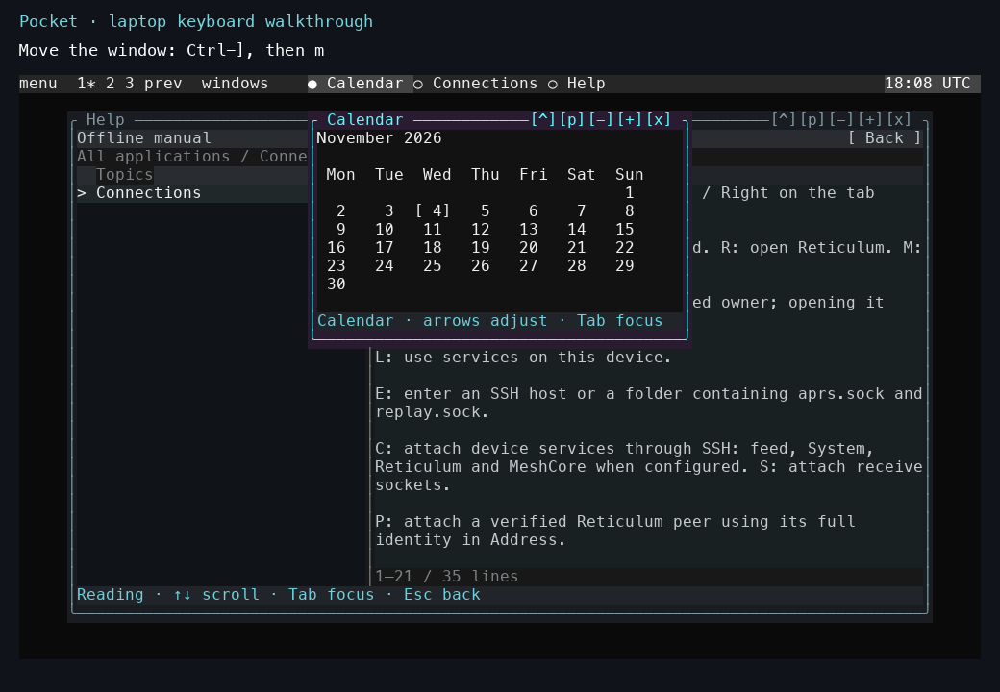

# Moving the desktop into the terminal

*Mid-October 2026. Reconstructed on 4 November 2026 from development and test notes.*

The graphical sidebar proved that the tablet could support a small desktop, while the tmux and SSH workflows showed how useful the same applications could be from a larger keyboard and screen. Pocket developed around a terminal display interface that both environments could present.

Python owns application state, windows, focus, menus, and saved layouts. Views provide character cells with foreground and background colors. On the N810, the patched Linux console converts those colors to RGB565. A laptop terminal displays the corresponding escape sequences. The host can also embed a conventional terminal application through a pseudo-terminal, preserving that application's own input handling.

This gives two practical SSH workflows. A terminal client can attach to a workspace running on the tablet. Alternatively, Pocket can run on the laptop, draw locally, and attach to tablet services through forwarded Unix sockets. The service contract carries snapshots, events, and commands; the desktop owns its local layout and interaction state.

## Watch the current window controls



*The current desktop, captured on a laptop on 4 November. Calendar has the active border; Help remains visible underneath. Ctrl-], then m enters window movement. The [recording](../tutorials/laptop-tour.md) shows the move and the following resize.*

The [laptop keyboard walkthrough](../tutorials/laptop-tour.md) shows Help, the application menu, moving and resizing a window, maximizing it, changing desktops, and switching focus. It was recorded from the current source on 4 November, after the development described here.

The [overview and backgrounds recording](../tutorials/overview-and-backgrounds.md) also shows desktop miniatures, larger window previews, choosing a window across desktops, and the animated effects. It uses a fresh local session recorded on 4 November.

## Making instance state explicit

The laptop introduced a new lifetime: several shells could consume the same services while keeping independent layouts. The launcher therefore gives each instance a separate desktop state, application-state directory, and station database. The current command construction is visible in the [launcher source](https://github.com/gordol/n810-revival/blob/main/pocket/shell/launch.py).

```sh
make -C pocket n810 INSTANCE=laptop
make -C pocket n810 INSTANCE=layout-test
```

These examples run the local source with two named state namespaces. A connection is selected inside each instance. Separating state also made it possible to compare a new layout without overwriting the everyday desktop.

## Keeping cell composition compact

The current compositor stores three arrays for a window's cells:

| Array | Information per cell | Storage per cell |
|---|---|---:|
| Glyph | The character to draw. | 4 bytes |
| Ink | Foreground, background, and color attributes. | 8 bytes |
| Validity | Whether the stored cell can be reused. | 1 byte |

The [surface allocator](https://github.com/gordol/n810-revival/blob/main/pocket/shell/native/cell_engine.c#L12) creates those arrays and releases them together if allocation fails.

The arrays account for 13 bytes per cell before the surface structure and output capacity. The representation makes unchanged-cell comparisons and retained planes relatively cheap. Application models and scene preparation still have their own memory and execution costs.

The window and the service feeding it have different lifetimes. Closing a window can discard its plane and view workers. The acquisition owner continues to hold the radio or shared data store, so another window can open against the same source.

The renderer experiments deliberately exercised expensive paths: overlapping windows, geometry, terrain, water, shadows, and changing scenes. They exposed startup cost, repeated serialization, blending, and input delays that ordinary static panels could hide. Subsequent posts trace the measurements that came out of those workloads.

<!-- journal-sources:start -->
## Code, tests and build inputs

| Material | Repository files |
|---|---|
| Implementation | [Desktop launcher](../assets/source/journal/pocket/shell/launch.py.txt) ([GitHub](https://github.com/gordol/n810-revival/blob/main/pocket/shell/launch.py))<br>[Native compositor](../assets/source/journal/pocket/shell/native/cell_engine.c.txt) ([GitHub](https://github.com/gordol/n810-revival/blob/main/pocket/shell/native/cell_engine.c))<br>[Native windows](../assets/source/journal/pocket/shell/native/window_host.c.txt) ([GitHub](https://github.com/gordol/n810-revival/blob/main/pocket/shell/native/window_host.c)) |
| Checks and fixtures | [Window composition](../assets/source/journal/pocket/tests/test_native_window_host.py.txt) ([GitHub](https://github.com/gordol/n810-revival/blob/main/pocket/tests/test_native_window_host.py))<br>[Keyboard navigation](../assets/source/journal/pocket/tests/test_native_navigation.py.txt) ([GitHub](https://github.com/gordol/n810-revival/blob/main/pocket/tests/test_native_navigation.py))<br>[Desktop control](../assets/source/journal/pocket/tests/test_desktop_control.py.txt) ([GitHub](https://github.com/gordol/n810-revival/blob/main/pocket/tests/test_desktop_control.py)) |
| Build inputs | [Native build helper](../assets/source/journal/pocket/tools/build_native.py.txt) ([GitHub](https://github.com/gordol/n810-revival/blob/main/pocket/tools/build_native.py))<br>[Pocket build targets](../assets/source/journal/pocket/Makefile.txt) ([GitHub](https://github.com/gordol/n810-revival/blob/main/pocket/Makefile)) |

[Build and test instructions](../how-to/build-native.md) · [Chronological source index](../reference/journal-sources.md#2026-10-16-pocket-desktop)
<!-- journal-sources:end -->

[Journal](../journal.md) | [Current status](../status.md)

[Previous entry](2026-10-16-16-bit-console.md) | [Next entry](2026-10-16-cw.md)
