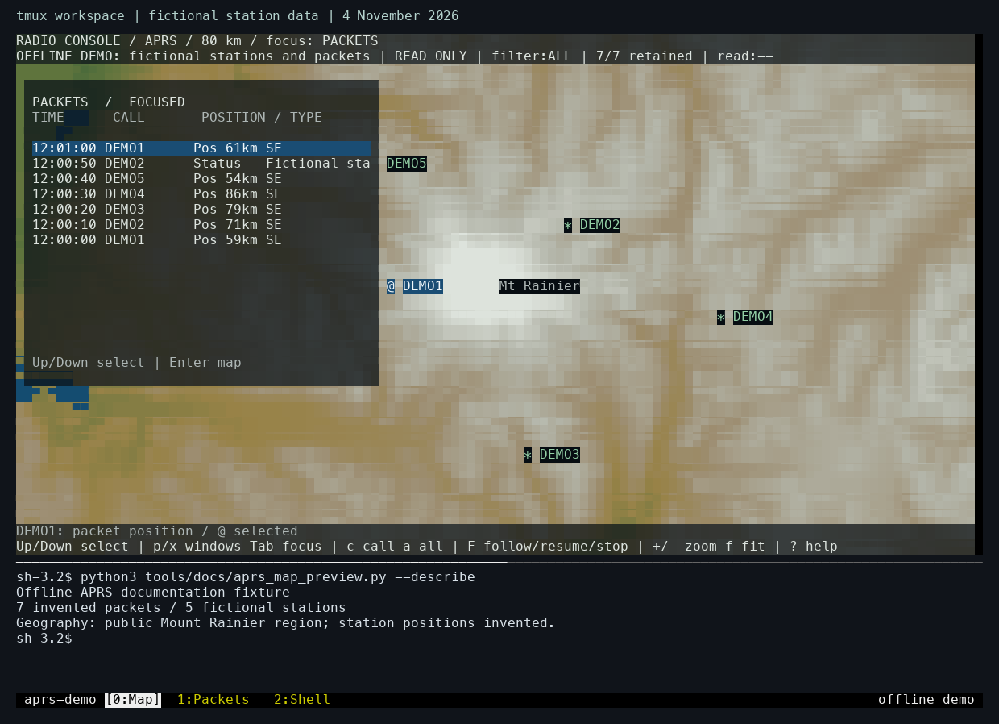
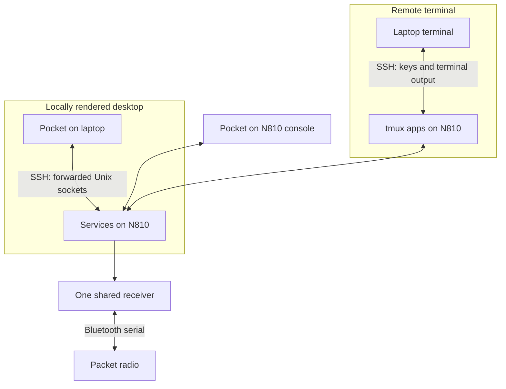
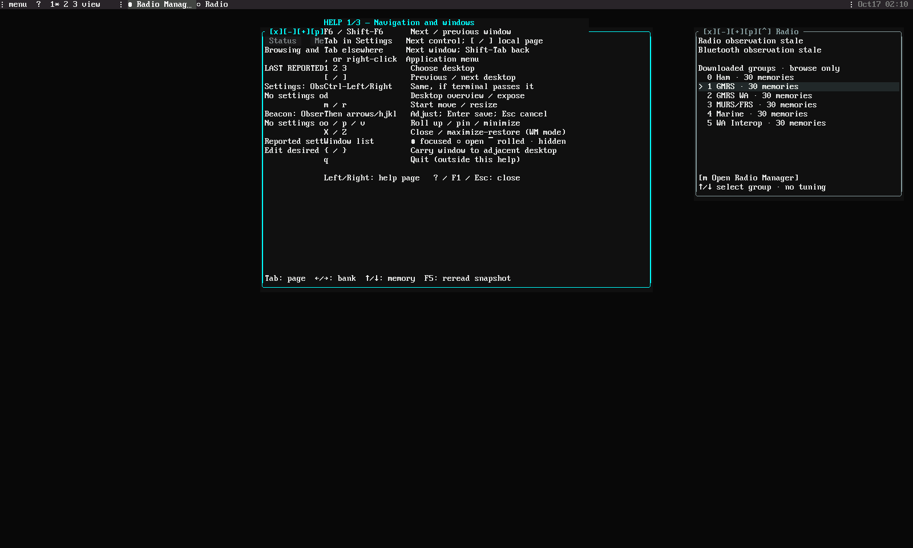

# One radio receiver, several terminal views

*14 to 16 October 2026. Reconstructed on 4 November 2026 from development and test notes.*

The [first APRS applications](2026-10-14-aprs.md) had already established one shared Bluetooth serial connection. Opening a map, a packet inspector, and a station directory could otherwise create competing readers. The feed process became the connection owner. It received KISS traffic, retained bounded history, and exposed events and snapshots to clients through local sockets.

That arrangement also made the laptop useful. SSH and tmux exposed the tablet's terminal workspace remotely, while later Pocket clients could run their own UI locally and forward the owner's Unix sockets through SSH. The first arrangement shares a terminal session; the second shares application services. Keeping those paths explicit explains which machine draws the UI and which machine owns the radio.

*The tmux arrangement reproduced locally on 4 November using public geography and fictional packets. An SSH attachment would display this tablet-hosted workspace in the laptop terminal. This capture itself runs on the laptop; the [earlier APRS entry](2026-10-14-aprs.md#the-first-interface-was-a-tmux-workspace) explains its windows, panes, and controls.*

## Reading the current SSH attachment code

The later locally rendered Pocket interface extends the earlier tmux workflow. Its attachment code uses OpenSSH's existing Unix-socket forwarding. The tablet catalogue advertises its available owners, and the laptop creates local endpoints for them. The current attachment code validates remote paths before forwarding and records which remote endpoint owns each local socket.

A useful diagnostic question is where a delay originates. In a tmux attachment, the tablet produces the terminal output and the network carries it. In a locally rendered Pocket session, the tablet supplies service data while the laptop performs UI preparation and composition. Both can use the same owner, but their CPU and output paths differ.

The [ssh manual's forwarding options](https://man.openbsd.org/ssh#L) and [tmux manual](https://man.openbsd.org/tmux.1) describe the transport mechanisms. The [current device attachment code](https://github.com/gordol/n810-revival/blob/main/pocket/shell/device_connection.py) implements the Pocket-specific catalogue and socket mapping.

## Checking the visible workspace

The retained-packet test initially raced a redraw: a filter assertion ran before the expected filtered state had been painted. Repeating the selection/filter/back sequence with waits for the actual painted state resolved the ambiguity. This mattered because a successful key dispatch only established that the application received input; the test needed to observe the resulting view.

The final save/restart check compared camera center, span, and selected record against the baseline. It also preserved the independent receiver. The workspace restored the expected view from saved packets while the receiver continued in its own process.

The 16 October checks also compared physical-console and SSH output. Both clients displayed the expected RGB layout for the map, packet panel, and inspector.

*The 17 October wide-terminal UI review shows the radio bank browser beside Help. The Help text visibly overlaps its underlying window in this revision. This capture illustrates the interface under development; its “stale” labels identify the available radio observations.*

Radio memory browsing grew alongside the packet tools. It exposed banks, memory slots, receive frequencies, offsets, tone modes, and observed device state. Selecting a row changed the browser's selection. Hardware operations used their own explicit controls and results.

A phone-facing terminal bridge also retrieved real SSH/tmux output through an authenticated web service. Its fixed terminal dimensions and tmux sizing policy preserved the tablet's pane geometry. Browser transport and authentication checks completed; physical phone interaction still needed an attended check.

The same ownership rule carries into current Pocket: each view consumes a service, and the receiver lifetime follows the service owner. The [SSH guide](../how-to/ssh.md) describes the current attachment path.

<!-- journal-sources:start -->
## Code, tests and build inputs

| Material | Repository files |
|---|---|
| Implementation | [SSH service attachment](../assets/source/journal/pocket/shell/device_connection.py.txt) ([GitHub](https://github.com/gordol/n810-revival/blob/main/pocket/shell/device_connection.py)) [Phone bridge](../assets/source/journal/historical/phone-terminal/server.cjs.txt) ([GitHub](https://github.com/gordol/n810-revival/blob/main/historical/phone-terminal/server.cjs)) [tmux session validation](../assets/source/journal/historical/phone-terminal/workspace.cjs.txt) ([GitHub](https://github.com/gordol/n810-revival/blob/main/historical/phone-terminal/workspace.cjs)) |
| Checks and fixtures | [SSH attachment](../assets/source/journal/pocket/tests/test_device_connection.py.txt) ([GitHub](https://github.com/gordol/n810-revival/blob/main/pocket/tests/test_device_connection.py)) [Browser reconnects](../assets/source/journal/historical/phone-terminal/test-client.cjs.txt) ([GitHub](https://github.com/gordol/n810-revival/blob/main/historical/phone-terminal/test-client.cjs)) [Phone keys](../assets/source/journal/historical/phone-terminal/test-device-input.cjs.txt) ([GitHub](https://github.com/gordol/n810-revival/blob/main/historical/phone-terminal/test-device-input.cjs)) [Session selection](../assets/source/journal/historical/phone-terminal/test-workspace.cjs.txt) ([GitHub](https://github.com/gordol/n810-revival/blob/main/historical/phone-terminal/test-workspace.cjs)) |
| Build inputs | [Phone dependencies](../assets/source/journal/historical/phone-terminal/runtime/package-lock.json.txt) ([GitHub](https://github.com/gordol/n810-revival/blob/main/historical/phone-terminal/runtime/package-lock.json)) [Private configuration generator](../assets/source/journal/historical/phone-terminal/setup.py.txt) ([GitHub](https://github.com/gordol/n810-revival/blob/main/historical/phone-terminal/setup.py)) [Service attachment fixtures](../assets/source/journal/pocket/tests/test_owner_attachments.py.txt) ([GitHub](https://github.com/gordol/n810-revival/blob/main/pocket/tests/test_owner_attachments.py)) |

[Build and test instructions](../how-to/test-journal-checkpoints.md) · [Chronological source index](../reference/journal-sources.md#2026-10-16-radio-ssh)
<!-- journal-sources:end -->

[Journal](../journal.md) | [Current status](../status.md)

[Previous entry](2026-10-14-aprs.md) | [Next entry](2026-10-16-16-bit-console.md)
