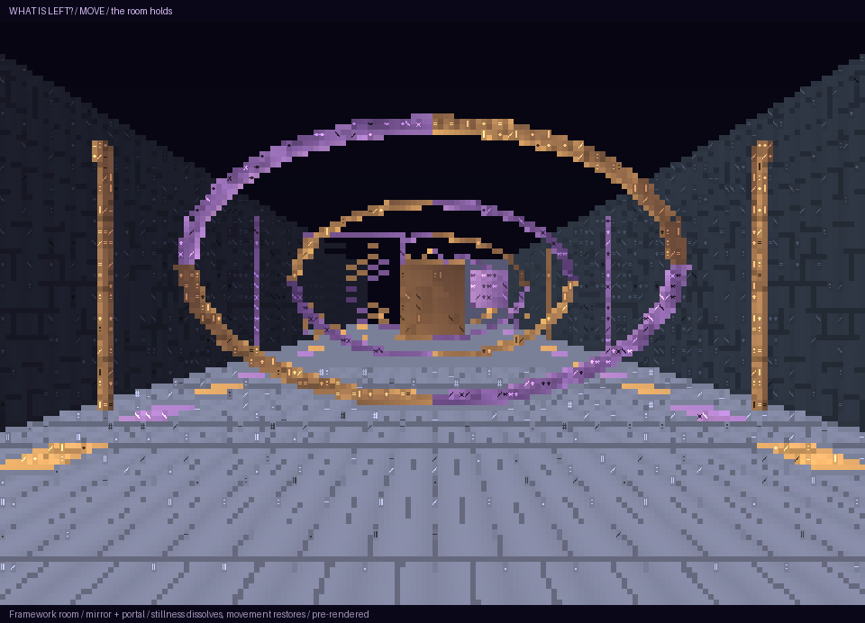
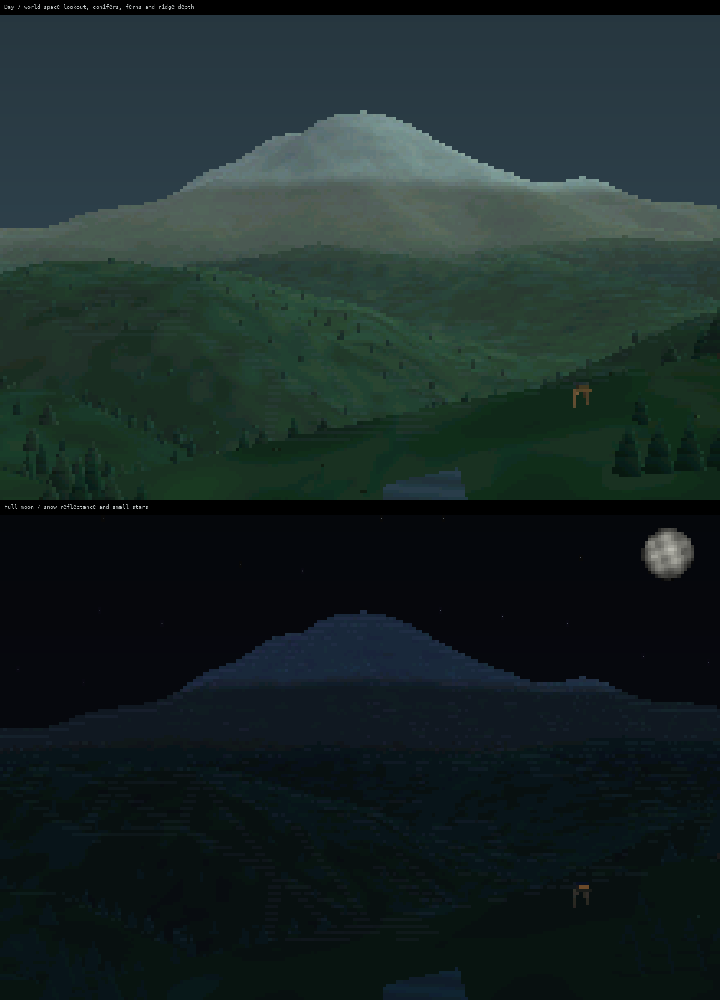

# Measuring the ARM CPU before moving work elsewhere

*18 October 2026. Reconstructed on 4 November 2026 from development and test notes.*

The N810's ARM1136 has a VFP floating-point unit. Using it required checking the generated code and calling convention, then measuring the actual workload on the tablet.

The saved numerical tests compared software floating point with scalar and short-vector VFP. For 4,096 float additions, the recorded software-to-VFP time ratios were 3.49 for scalar VFP and 12.47 for the short-vector variant. Float and double matrix workloads at count 2,048 measured ratios of 6.90 and 7.31. Each ratio used medians of three timings. Correctness and register/status preservation had separate checks.

## Preserving arithmetic and the calling convention

The scalar and short-vector experiments were separate implementations of the retained workloads. Each needed numerical comparison and register/status preservation checks before timing was useful. Otherwise a faster routine could appear to win by changing arithmetic or violating a caller assumption.

The compiler has to agree with the caller about how arguments and return values pass between functions. It also has to generate instructions the processor supports. Those are separate choices: using the VFP unit for arithmetic can preserve the calling convention used by Debian armel. The [GCC ARM options](https://gcc.gnu.org/onlinedocs/gcc/ARM-Options.html) describe those choices.

## Measuring the work around the primitive

The scene pipeline had to gather Python data, arrange native inputs, transform geometry, clip, resolve coverage, shade, choose glyphs, compose windows, and emit terminal output. Accelerating one stage changed the proportion of time spent in the others. We therefore measured a complete Room preparation step as well as the arithmetic routines.

The renderer workloads also varied in what they stressed. Water exercised changing geometry, Room exercised material surfaces and overlap, and terrain views exercised height fields, projection, and detail selection. Keeping the scene dimensions and camera fixed made repeated comparisons interpretable.

*The Room study, saved on 20 October, shows the kind of geometry and material workload used by these experiments. This is an authored, pre-rendered laptop view. The numerical comparisons above used their separately measured fixtures.*

The Room component comparison reproduced all 2,080 output cells and reduced mean preparation time by 15.8% in its two-run comparison. The smaller application-level improvement identified the cost outside the numerical primitive.

The native cell compositor used retained glyph, ink, and validity arrays. It compared damaged regions and emitted changed spans, allowing unchanged windows to reuse existing cells. Mixed blending and scene preparation still had their own execution paths.

C55x DSP work proceeded through an assembler, instruction encoding checks, and numerical models. Physical DSP execution remained a future milestone. The GPU investigation had a separate reset, clock, memory, and command-submission problem. Measuring these components independently kept their costs visible.

*Laptop terminal scene study using public Tahoma elevation data and authored vegetation, lighting, and sky.*

<video controls playsinline preload="none" poster="../../assets/demos/terrain-day-poster.png"><source src="../../assets/demos/terrain-day.mp4" type="video/mp4"></video>

*Eight-second laptop terminal animation showing scene construction.*

<video controls playsinline preload="none" poster="../../assets/demos/terrain-night-poster.png"><source src="../../assets/demos/terrain-night.mp4" type="video/mp4"></video>

*The corresponding nighttime laptop scene study.*

<!-- journal-sources:start -->
## Code, tests and build inputs

| Material | Repository files |
|---|---|
| Implementation | [Scalar workload](../assets/source/journal/historical/compute/vfp/kernel.c.txt) ([GitHub](https://github.com/gordol/n810-revival/blob/main/historical/compute/vfp/kernel.c)) [Short-vector assembly](../assets/source/journal/historical/compute/vfp/shortvec.S.txt) ([GitHub](https://github.com/gordol/n810-revival/blob/main/historical/compute/vfp/shortvec.S)) [Timing workload](../assets/source/journal/historical/compute/vfp/benchmark.c.txt) ([GitHub](https://github.com/gordol/n810-revival/blob/main/historical/compute/vfp/benchmark.c)) [DSP instruction encoder](../assets/source/journal/historical/compute/open-c55x/subset.py.txt) ([GitHub](https://github.com/gordol/n810-revival/blob/main/historical/compute/open-c55x/subset.py)) [FIR model](../assets/source/journal/historical/compute/open-c55x/fir_model.py.txt) ([GitHub](https://github.com/gordol/n810-revival/blob/main/historical/compute/open-c55x/fir_model.py)) |
| Checks and fixtures | [VFP scalar/ABI probe](../assets/source/journal/historical/compute/vfp/build_probe.py.txt) ([GitHub](https://github.com/gordol/n810-revival/blob/main/historical/compute/vfp/build_probe.py)) [Vector/context negative controls](../assets/source/journal/historical/compute/vfp/build_shortvec.py.txt) ([GitHub](https://github.com/gordol/n810-revival/blob/main/historical/compute/vfp/build_shortvec.py)) [DSP FIR comparisons](../assets/source/journal/historical/compute/open-c55x/test_fir8.py.txt) ([GitHub](https://github.com/gordol/n810-revival/blob/main/historical/compute/open-c55x/test_fir8.py)) [DSP context checks](../assets/source/journal/historical/compute/open-c55x/test_wrapper.py.txt) ([GitHub](https://github.com/gordol/n810-revival/blob/main/historical/compute/open-c55x/test_wrapper.py)) |
| Build inputs | [Assembler source pins](../assets/source/journal/historical/compute/open-c55x/artifacts.json.txt) ([GitHub](https://github.com/gordol/n810-revival/blob/main/historical/compute/open-c55x/artifacts.json)) [Assembler builder](../assets/source/journal/historical/compute/open-c55x/build.py.txt) ([GitHub](https://github.com/gordol/n810-revival/blob/main/historical/compute/open-c55x/build.py)) [Independent C reference](../assets/source/journal/historical/compute/fir_q15.c.txt) ([GitHub](https://github.com/gordol/n810-revival/blob/main/historical/compute/fir_q15.c)) |

[Build and test instructions](../how-to/test-journal-checkpoints.md) · [Chronological source index](../reference/journal-sources.md#2026-10-18-cpu-acceleration)

The imported source comes from the retained 18 October checkpoint. ARM emulation and host numerical tests reproduce correctness checks. The speed ratios quoted in the post remain physical-device measurements.
<!-- journal-sources:end -->

[Journal](../journal.md) | [Current status](../status.md)

[Previous entry](2026-10-16-cw.md) | [Next entry](2026-10-20-water-and-idle.md)
