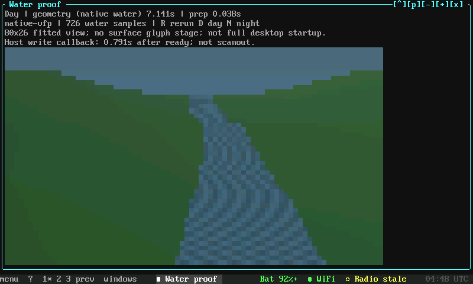

# Water in the terminal

N810 REVIVAL · FIELD NOTES 002 · 20 OCT 2026

SMALL MACHINE. REAL PIXELS.

A native water render on a Linux console. And a reminder that doing nothing should be cheap.

<i></i><i></i><i></i><i></i><i></i><i></i><i></i><i></i>

ARMv6 / VFP / RGB565 / NO GPU REQUIRED FOR THIS DEMO

The [RGB console](2026-10-16-16-bit-console.md) has grown a workspace around it.
Pocket is an experimental terminal desktop: windows, menus, saved layouts,
application views and a native cell compositor. It runs alongside the existing
tmux and Xorg options. The N810 remains a general-purpose handheld; maps and
communications are useful workloads for finding its rough edges.

## 01 / A river, on the actual tablet

*Actual 800 × 480 N810 framebuffer capture, 20 October. This is the completed
view from one attended run, launched through the normal console path.*

The geometry stage used our native C/VFP implementation and sampled 726 water
points. The resulting landscape is drawn as colored terminal cells. This run
did not use the MBX GPU, DSP or a graphical desktop.

| What we measured | Result |
|---|---:|
| Fixture preparation | 0.038 s |
| Water geometry | 7.141 s |
| First coherent app output after launch | 65.218 s |

Seven seconds is the geometry cost, **not the complete startup time**. The full
launch is plainly too slow. Framebuffer captures also took 9–13 seconds each
and competed for the machine. The earlier isolated, roughly three-second result
did not reproduce through this app launch. We kept the slower result and restored
the normal build and saved layout after the test.

This is a still capture, not a frame-rate demonstration. It proves the native
water path reached the real console. Now the work is making the whole path
pleasant to use.

## 02 / Make idle mean idle

Station Map is running again on the restored normal build with native drawing.
An idle profile found something more actionable than “old CPU, probably slow”:
52 desktop-state captures consumed **4.91 seconds of wall time in a 29.46-second
observation**, with no new output frames between the samples.

That timer covers session-state capture, not flash writes. It also isn't a
percentage of total CPU usage. But repeatedly asking every app to serialize
its state is unnecessary work when nothing changed.

The replacement saves in response to state changes. Background packet updates
must still be saved, hidden apps must not be drawn merely to save them, and
failed writes must leave changes pending. Local tests and source review cover
those cases. The actual development and packaged laptop launches have now passed, along
with 54 packaged integration checks. The Nokia trial and easy installed-version
switching remain delivery gates. **No faster Nokia pan/zoom result is claimed.**

There is a separate laptop issue: the development launcher can select Python
without NumPy and quietly lose an accelerated path. A runtime-selection helper
is tested but not yet integrated. Frame-preparation timings from a laptop are
not tablet frame rates.

## 03 / Pocket beyond the pocket

The companion work now includes a Termux bootstrap/update path and optional
larger touch controls: **Menu / Windows / Actions / Next**. The touch setting
belongs to each device, defaults off, and survives updates separately from the
saved desktop layout. The package and channel files were verified on the Nokia's
local download endpoint; hands-on phone ergonomics still need feedback.

That local distribution is not a public OS release. It doesn't mean the N810
image, firmware or personal data are available for download.

On the N810, the app-specific repeated-tap calibration also saved successfully.
Two independent targets measured about 1.25 and 2.39 pixels of error. That's a
useful check, not a whole-screen accuracy guarantee. The existing Xorg
calibration is a separate path.

## 04 / Archaeology with a purpose

GPU work has moved beyond guessing register values. Historical N8x0 access and
display components and a same-chip N95 implementation supplied concrete leads
for reset, power and completion handling. An original bounded Linux reset/status
test now compiles against the accepted tablet kernel and passes host lifecycle
tests. It has not been loaded on the tablet.

**MBX/VGP execution is still unproven here.** A completed power notification,
reset completion and GPU readiness are separate observations. Recovering a
wrapper does not recover the missing vendor runtime, either.

Recovered binaries stay out of the public site. Further binary analysis is
paused while its isolated runner completes review. The next hardware test is a
separate reviewed job, not something implied by this post.

## Next on the bench

Take the frozen event-driven save candidate through the Nokia launch, measure
idle cost and map interaction separately, and verify installed-version switching. After that: integrate the
laptop runtime selector and predictable app-menu grouping. GPU initialization
research continues independently.

The older [console showcase](2026-10-16-16-bit-console.md) has the color tests,
font captures and laptop terrain clips. [Current status](../status.md)
records the later checkpoints and their limits.

*Later on 20 October: the Nokia idle/save audit and installed accepted ↔ persistence
selection passed. Real pan/zoom was still slow. The later
[status page](../status.md) separates that checkpoint from current source.*
