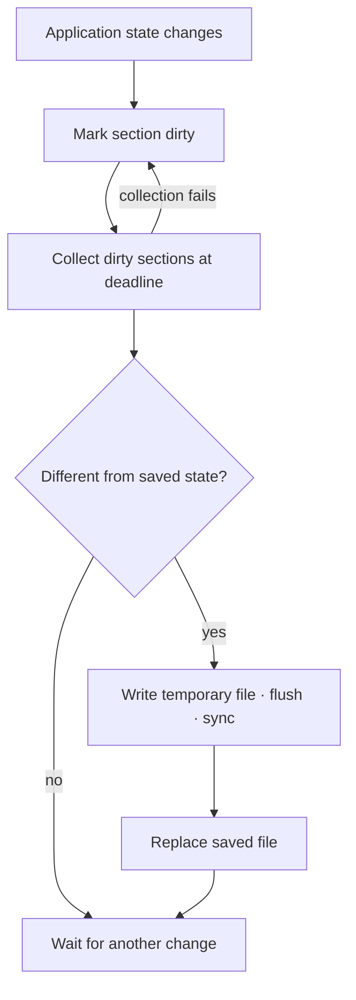

# Rendering water and measuring idle work

*20 October 2026. Revised from the recorded device run and persistence tests on 4 November 2026.*

The water scene exercised native geometry, terminal-cell rendering, and the complete Pocket launch path on the N810. Its C/VFP implementation sampled 726 water points. Fixture preparation took 0.038 seconds, water geometry took 7.141 seconds, and first coherent application output arrived after 65.218 seconds.

This capture records the completed view from the attended run. The difference between geometry time and total launch time directed attention to imports, application preparation, and presentation. Framebuffer captures themselves took 9 to 13 seconds and competed for the machine, so capture overhead also belonged in the interpretation.

The scene experiments had already exercised terrain meshes, projection, material shading, water, and terminal glyph selection on the laptop. They supplied repeatable workloads for the compositor and adapters. Moving one of them onto the tablet made the cost of the whole application visible.

A separate idle profile found repeated session serialization. During a 29.46-second observation, 52 state captures consumed 4.91 seconds of wall time while the displayed frame remained unchanged. The timer measured state collection. Storage writes were a separate stage.

## Finding serialization in an idle desktop

An unchanged framebuffer still allowed work to happen elsewhere. The measured idle loop repeatedly asked applications to capture their state. Profiling attributed the cost to that collection stage, which meant reducing write frequency alone would leave much of the work in place.

The replacement records which sections changed and collects only those sections when their deadline arrives. A collection batch is detached from the pending dirty set so changes reported during collection can remain queued. If collection raises an error, the failed batch is merged back into the pending set.

The [current collection code](https://github.com/gordol/n810-revival/blob/main/pocket/shell/session.py#L288) implements this ordering.

The write path then serializes the collected state into a temporary file, flushes and synchronizes it, and atomically replaces the destination. The current implementation disables automatic saving after an OS write error and exposes that error. The separate dirty state and saved-state comparison make the failure visible rather than silently treating the write as complete.

The [full session implementation](https://github.com/gordol/n810-revival/blob/main/pocket/shell/session.py) includes the exit audit and migration behavior. These implementation details describe the current source; the timings above belong to the 20 October observation.

Change-driven saving replaced repeated full snapshots. Background source changes still needed persistence, hidden views needed model updates, and a failed save needed to leave its changes pending. Later that day, the Nokia idle/save check and installed-version selection passed. Map pan and zoom remained slow.

The same period brought app-specific repeated-tap calibration. Two independent check targets measured about 1.25 and 2.39 pixels of error. Pointer acquisition, calibration, window handling, and rendering latency each had a distinct role in how the stylus felt.

<!-- journal-sources:start -->
## Code, tests and build inputs

| Material | Repository files |
|---|---|
| Implementation | [Session persistence](../assets/source/journal/pocket/shell/session.py.txt) ([GitHub](https://github.com/gordol/n810-revival/blob/main/pocket/shell/session.py)) [Native scene preparation](../assets/source/journal/pocket/shell/native/scene_host.c.txt) ([GitHub](https://github.com/gordol/n810-revival/blob/main/pocket/shell/native/scene_host.c)) [Cell composition](../assets/source/journal/pocket/shell/native/cell_engine.c.txt) ([GitHub](https://github.com/gordol/n810-revival/blob/main/pocket/shell/native/cell_engine.c)) |
| Checks and fixtures | [Saved-session migration](../assets/source/journal/pocket/tests/test_desktop_session_migration.py.txt) ([GitHub](https://github.com/gordol/n810-revival/blob/main/pocket/tests/test_desktop_session_migration.py)) [Scene output](../assets/source/journal/pocket/tests/test_native_scene_host.py.txt) ([GitHub](https://github.com/gordol/n810-revival/blob/main/pocket/tests/test_native_scene_host.py)) [Retained rendering](../assets/source/journal/pocket/tests/test_render_pass_reuse.py.txt) ([GitHub](https://github.com/gordol/n810-revival/blob/main/pocket/tests/test_render_pass_reuse.py)) |
| Build inputs | [Native build helper](../assets/source/journal/pocket/tools/build_native.py.txt) ([GitHub](https://github.com/gordol/n810-revival/blob/main/pocket/tools/build_native.py)) [Scene data preparation](../assets/source/journal/pocket/tools/prepare_loader_ambient.py.txt) ([GitHub](https://github.com/gordol/n810-revival/blob/main/pocket/tools/prepare_loader_ambient.py)) |

[Build and test instructions](../how-to/build-native.md) · [Chronological source index](../reference/journal-sources.md#2026-10-20-water-and-idle)

These links identify the integrated implementation and its tests. The post's idle and 726-point water measurements describe the earlier physical runs.
<!-- journal-sources:end -->

[Journal](../journal.md) | [Rendering architecture](../explanation/rendering.md)

[Previous entry](2026-10-18-cpu-acceleration.md) | [Next entry](2026-10-24-maps-with-an-edge.md)
