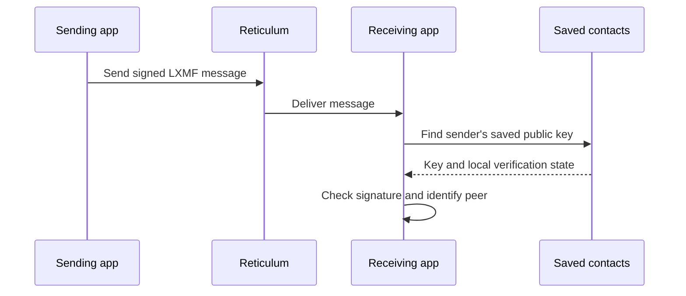

# Sending LXMF messages through the terminal interface

*24 October 2026. Reconstructed on 4 November 2026 from development and test notes.*

The APRS work had already given us a shared receiver and several ways to view its packets. We next wanted to use Pocket for Reticulum messaging. Reticulum provides a network stack that can run over different links, including LoRa radios. LXMF is the messaging format and delivery layer used here. A message has a sender identity and a signature that the receiving application can verify. The [Reticulum manual](https://reticulum.network/manual/) introduces destinations, identities, links, and interfaces.

## Getting a saved contact to verify correctly

Three kinds of state were involved. The transport knew whether its interface was connected. The message verifier needed the sender's public key. The contact store knew whether the user had already checked that peer's identity. A connected radio alone could tell us very little about the last two.

The failure was in how the verifier found a key. A previously verified contact already had a saved key, but signature validation needed access to it even when the peer had made no fresh announcement. An announcement is a Reticulum packet that advertises a destination and information needed to reach it. We changed the lookup so the saved, verified key could be used for the received message.

This gave us a direct test through the ordinary interface: one application send from the Nokia to the Mac, followed by one reply from the Mac to the Nokia. Each receiving application checked the signature and recognized the expected verified peer. We also compared the received content with the sent content. Reticulum still exchanged its normal control and delivery packets during those sends.

*The saved-key repair belongs at the receiving application. Interface connectivity and signature checking happen at different stages.*

## Checking what happened after delivery

Disconnect completed at both ends in this trial. The Mac client exited, and the Nokia returned to an idle Pocket session. The APRS receiver continued in its separate service process. That was useful evidence that closing a messaging view and ending its connection could coexist with another radio service.

We also worked on Heard, the view of received destination announcements. A later passive test opened the saved announcement view, displayed contextual Help, and cancelled a nickname edit. Message history and the verified contact survived installation. The test had no new live announcements, so discovering a new peer and saving its nickname remained work for a later physical test.

These exchanges took place at the desk. A range test, a changing route, or an interrupted connection introduces different conditions. Earlier shutdown trouble also meant that the successful disconnect here needed repeating over longer sessions.

## Following the implementation today

The [messaging guide](../pocket/messaging.md) describes the current interface. The [radio explanation](../explanation/radio.md) relates APRS, Reticulum, and the shared services. Pocket's [Reticulum domain source](https://github.com/gordol/n810-revival/tree/main/pocket/shell/vendor/apps/domains/reticulum) contains the service integration; the [native backend guide](../pocket/native-reticulum.md) explains the later microReticulum and microLXMF implementation introduced in the next part of the journal.

<!-- journal-sources:start -->
## Code, tests and build inputs

| Material | Repository files |
|---|---|
| Implementation | [Contact key storage](../assets/source/journal/pocket/shell/vendor/apps/domains/reticulum/contacts.py.txt) ([GitHub](https://github.com/gordol/n810-revival/blob/main/pocket/shell/vendor/apps/domains/reticulum/contacts.py)) [LXMF owner](../assets/source/journal/pocket/shell/vendor/apps/domains/reticulum/lxmf_owner.py.txt) ([GitHub](https://github.com/gordol/n810-revival/blob/main/pocket/shell/vendor/apps/domains/reticulum/lxmf_owner.py)) [Saved peer restart probe](../assets/source/journal/pocket/shell/vendor/apps/domains/reticulum/tests/private_contact_restart.py.txt) ([GitHub](https://github.com/gordol/n810-revival/blob/main/pocket/shell/vendor/apps/domains/reticulum/tests/private_contact_restart.py)) |
| Checks and fixtures | [Message behavior](../assets/source/journal/pocket/tests/test_chat.py.txt) ([GitHub](https://github.com/gordol/n810-revival/blob/main/pocket/tests/test_chat.py)) [Session recovery](../assets/source/journal/pocket/tests/test_connection_recovery.py.txt) ([GitHub](https://github.com/gordol/n810-revival/blob/main/pocket/tests/test_connection_recovery.py)) [Reticulum controls](../assets/source/journal/pocket/tests/test_reticulum_controls.py.txt) ([GitHub](https://github.com/gordol/n810-revival/blob/main/pocket/tests/test_reticulum_controls.py)) |
| Build inputs | [Native dependency revisions](../assets/source/journal/pocket/shell/native/reticulum/dependencies.lock.txt) ([GitHub](https://github.com/gordol/n810-revival/blob/main/pocket/shell/native/reticulum/dependencies.lock)) [Native preparation](../assets/source/journal/pocket/shell/native/reticulum/prepare.py.txt) ([GitHub](https://github.com/gordol/n810-revival/blob/main/pocket/shell/native/reticulum/prepare.py)) |

[Build and test instructions](../pocket/native-reticulum.md) · [Chronological source index](../reference/journal-sources.md#2026-10-24-lxmf)

The links follow the current integrated implementation. The October bidirectional signed exchange is a recorded hardware result; repeating it requires two configured identities and an explicitly selected transport.
<!-- journal-sources:end -->

[Journal](../journal.md) | [Current status](../status.md)

[Previous entry](2026-10-24-maps-with-an-edge.md) | [Next entry](2026-10-29-htit.md)
