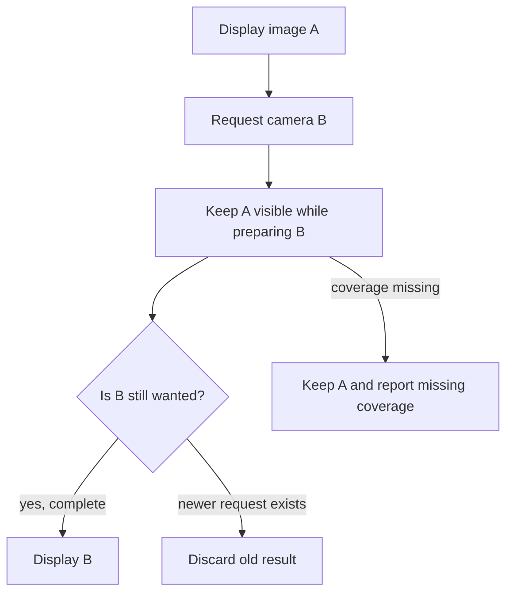
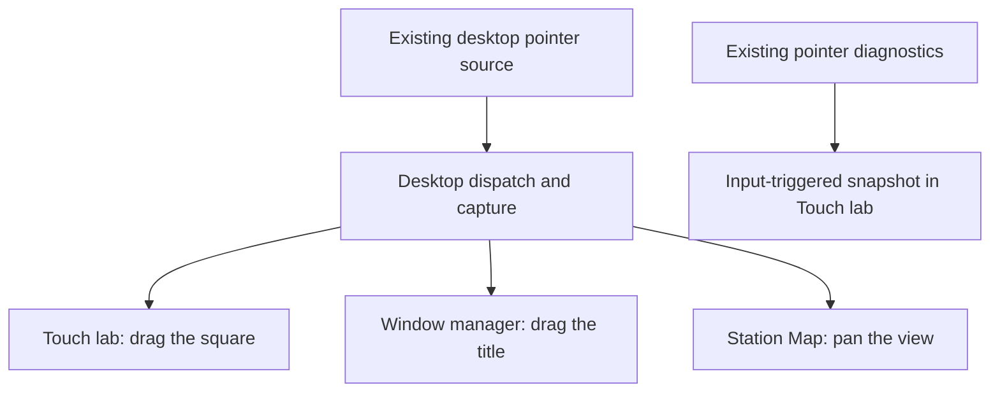

# Preparing maps and preserving the last usable view

*20 to 24 October 2026. Reconstructed on 4 November from the regional-map and interaction records.*

Prepared regional map packs moved expensive data preparation onto the laptop. The tablet could then open overview and detail views from a finite local coverage area. Navigation had to account for the available region and level of detail.

When a request exceeded prepared coverage, the application retained the last supported image and reported the missing coverage. This made the map's state understandable while a new view was being requested. Camera position, selected station, and layer choices also needed to survive switching installed versions and reopening the application.

The recorded regional trial measured scripted settling at 2.37 to 4.26 seconds, cold detail at 5.58 seconds, and confirmed relaunch output at 77.84 seconds. Physical pan and zoom still felt slow. These timings covered different parts of the path, so they were recorded separately from stylus latency.

## Separating a requested camera from an available image

Panning can produce another request before the previous view has finished. The renderer therefore tracks a wanted key, pending work, completed frames, and failures. A result belongs to the request and provider selection that produced it. An older worker completing later must preserve the newer request's state.

The current [offline renderer](https://github.com/gordol/n810-revival/blob/main/pocket/shell/offline_map.py) checks for a superseded request during preparation and records failures against the corresponding key. That gives the host a way to keep displaying the last usable image while reporting progress or missing coverage for the requested view.

A simplified state model explains the relationship:

This diagram is explanatory. The implementation also handles provider changes, caching, cancellation, and worker completion. Those details matter when changing data packs or closing the window during a request.

## Measuring stylus lag separately

The input process experiment addressed event acquisition during a main-process stall. Its generation field also distinguishes old events from a resized or reset input session. The [touch process adapter](https://github.com/gordol/n810-revival/blob/main/pocket/shell/touch_process.py) rejects older generations and emits cancellation when a newer generation replaces an active interaction.

A drained input queue still leaves work in the UI thread: applying the camera, preparing the map, composing windows, encoding output, and presenting it. The working drag version and the later input-process experiments therefore needed separate measurements. The [touch architecture notes](../pocket/touch-acquisition.md) describe that ownership boundary.

The broader map work added station selection, packet inspection, directory lookup, radio details, and retained observations. Shared context let a selected station appear across views while the acquisition service continued independently. Later source work added terrain profiles, line-of-sight estimates, and repeater information.

We retained the working drag checkpoint while continuing the process and renderer experiments. Acceptance still depended on physically panning and zooming the map through the complete display path.

## From calibration to a controlled drag comparison

The [early calibration work](2026-10-05-power-display-input.md#establishing-the-coordinate-system-first) supplied the coordinate mapping. As the desktop grew, an inaccurate coordinate, a lost release, and a delayed redraw could all feel like a broken drag. We needed a small interaction whose behavior was easy to inspect alongside the actual map.

The retained [Touch lab application](https://github.com/gordol/n810-revival/blob/main/pocket/shell/apps/nokia-touch-lab-v1/app.py) provides that comparison. Its [registration](https://github.com/gordol/n810-revival/blob/main/pocket/shell/apps/nokia-touch-lab-v1/registration.py) identifies it as an optional experiment. This is a description of the retained diagnostic implementation; its introduction date still needs confirmation from the development record.

First, the user drags a five-character-wide square inside the application. A press inside the square stores the contact's offset from its origin. Motion applies that offset to the new coordinates, and release clears capture. The app counts presses, movement, releases, and cancellations. Next, the user drags the window title to exercise window-manager capture. Finally, the real Station Map supplies the heavier interaction workload.

Touch lab obtains input through the desktop and reads its existing diagnostics. Its snapshots show raw bounds, mapped contact state, dropped-event and cancellation counters, window/application capture, and the last dispatch route. Space refreshes the snapshot; R resets the square. Because snapshots update on input or explicit refresh, their age matters when interpreting a displayed contact state.

The later [touch-acquisition record](../pocket/touch-acquisition.md) follows the investigation into the native reader. It records both the successful preservation of events under load and the remaining visible lag. That distinction keeps a queue-handling fix from becoming an unsupported claim that dragging was fully repaired.

<!-- journal-sources:start -->
## Code, tests and build inputs

| Material | Repository files |
|---|---|
| Implementation | [Offline renderer](../assets/source/journal/pocket/shell/offline_map.py.txt) ([GitHub](https://github.com/gordol/n810-revival/blob/main/pocket/shell/offline_map.py)) [Touch process](../assets/source/journal/pocket/shell/touch_process.py.txt) ([GitHub](https://github.com/gordol/n810-revival/blob/main/pocket/shell/touch_process.py)) [Geography builder](../assets/source/journal/pocket/tools/build_map_geography.py.txt) ([GitHub](https://github.com/gordol/n810-revival/blob/main/pocket/tools/build_map_geography.py)) [Shoreline builder](../assets/source/journal/pocket/tools/build_desktop_shoreline.py.txt) ([GitHub](https://github.com/gordol/n810-revival/blob/main/pocket/tools/build_desktop_shoreline.py)) |
| Checks and fixtures | [Geographic fixtures](../assets/source/journal/pocket/tests/test_map_geography.py.txt) ([GitHub](https://github.com/gordol/n810-revival/blob/main/pocket/tests/test_map_geography.py)) [Drag scheduling](../assets/source/journal/pocket/tests/test_drag_model_schedule.py.txt) ([GitHub](https://github.com/gordol/n810-revival/blob/main/pocket/tests/test_drag_model_schedule.py)) [Terrain worker lifecycle](../assets/source/journal/pocket/tests/test_terrain_worker.py.txt) ([GitHub](https://github.com/gordol/n810-revival/blob/main/pocket/tests/test_terrain_worker.py)) [Input generations](../assets/source/journal/pocket/tests/test_touch_worker.py.txt) ([GitHub](https://github.com/gordol/n810-revival/blob/main/pocket/tests/test_touch_worker.py)) [Real map builds](../assets/source/journal/tools/test-map-builds.py.txt) ([GitHub](https://github.com/gordol/n810-revival/blob/main/tools/test-map-builds.py)) |
| Build inputs | [Map dependency pins](../assets/source/journal/requirements-maps.txt.txt) ([GitHub](https://github.com/gordol/n810-revival/blob/main/requirements-maps.txt)) [Map build targets](../assets/source/journal/pocket/maps.mk.txt) ([GitHub](https://github.com/gordol/n810-revival/blob/main/pocket/maps.mk)) |

[Build and test instructions](../how-to/build-map-data.md) · [Chronological source index](../reference/journal-sources.md#2026-10-24-maps-with-an-edge)

Reviewed OSM and elevation inputs are included. The original 15 October local TIFF remains an archival gap; the guide rebuilds local terrain from the retained 2 November export.
<!-- journal-sources:end -->

[Journal](../journal.md) | [Radio and application architecture](../explanation/radio.md)

[Previous entry](2026-10-20-water-and-idle.md) | [Next entry](2026-10-24-lxmf.md)

The [map build guide](../how-to/build-map-data.md) now covers the retained geography, elevation exports, prepared previews and conversion tools. The [shoreline builder](https://github.com/gordol/n810-revival/blob/main/pocket/tools/build_desktop_shoreline.py) shows how water polygons determine the land mask.
