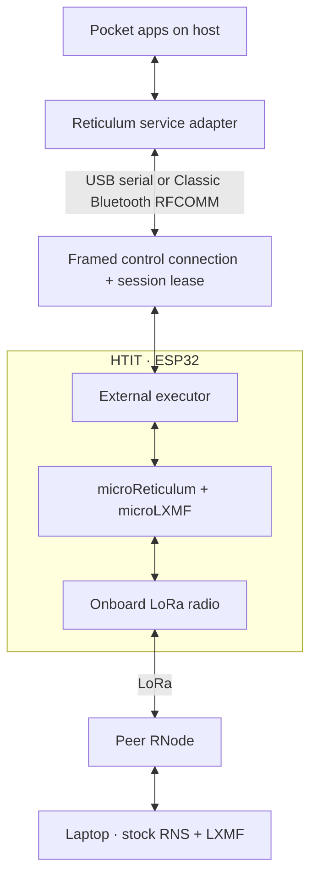

# Moving Reticulum execution onto the HTIT

*29 October 2026. Reconstructed on 4 November 2026 from development and test notes.*

The next experiment moved Reticulum work onto the Heltec HTIT board, an ESP32 board with a LoRa radio. We used microReticulum, a C++ implementation of Reticulum, and microLXMF, its companion messaging implementation. Pocket kept the interface and saved application identity on the host. The ESP32 handled links, resource transfers, and messaging over its onboard radio.

An RNode normally acts as a radio modem for a stack running on the host. This experiment gave the board more work: the host asked it to establish links, transfer resources, and handle LXMF operations. We called that board-side role the external executor. A resource is Reticulum's mechanism for transferring a larger block of data in parts.

## Building the host connection

USB serial and Classic Bluetooth RFCOMM carried the control protocol. RFCOMM provides a serial-style connection over Bluetooth; SPP, the Serial Port Profile, uses it. Both paths carried framed binary messages. KISS framing marked message boundaries, and MessagePack encoded provisioning requests as an operation, a sequence number, and data.

Pocket checked the board's advertised features and remembered its identity. It also renewed a short lease: permission for the host to keep using the current execution session. If the host disappeared, the lease could expire. This gave the firmware a way to release abandoned work. Changing backends required ending outstanding work and reconnecting the application's subscriptions to the new runtime.

The early USB tests exercised eight simultaneous operations in 151 ms and cancelled a stamp calculation in 53 ms. A stamp is computational work attached to an LXMF message when required by its recipient. We also tried fragmented commands and lease expiry. Those tests checked the control path before sending a large resource over radio.

## Finding where Bluetooth bytes changed

The Bluetooth failure initially looked like a framing problem. Incoming data was correct at the controller's ACL boundary, then changed before the SPP reader saw it. ACL is the Bluetooth controller's asynchronous data transport. HCI, the Host Controller Interface, is the boundary between that controller and the host stack.

Capturing the same stream at successive boundaries narrowed the corruption to buffer handling. Moving HCI receive and reassembly buffers into internal RAM fixed one stage. Moving the 4 KB SPP queue and its control block out of external PSRAM fixed the next. A diagnostic stream then matched all 6,698 bytes at the controller, SPP, and reader, with ten decoded frames.

| Observation boundary | Before the buffer changes | After the changes |
|---|---|---|
| Controller ACL input | The incoming diagnostic bytes were correct. | The same reference bytes were retained. |
| SPP reader | The stream had changed during local buffering. | All 6,698 bytes matched the controller input. |
| Decoded control frames | The damaged stream made framing suspect. | Ten frames decoded from the matching stream. |

Comparing these boundaries kept the investigation local to the board's Bluetooth receive path.

PSRAM adds capacity through an external memory interface. Some ESP32 code and buffers need internal memory because of timing, cache, or hardware-access requirements. Espressif's [external RAM guide](https://docs.espressif.com/projects/esp-idf/en/v4.4.7/esp32/api-guides/external-ram.html) explains the memory regions and restrictions. The practical lesson here came from comparing the same bytes at each stage rather than adjusting radio settings to compensate for a local buffer problem.

## Comparing serial transfers with radio transfers

Unpaced binary checks covered 3, 8, 16, and 30 KB. The 30 KB serial case took 0.658 seconds. The radio test used a separate laptop running stock RNS 1.5.7 and LXMF 1.2.1 through an RNode. Its receiver checked the reconstructed resource bytes. Three consecutive 30 KB LoRa transfers took 54.8, 61.984, and 66.04 seconds. Signed message tests also checked delivery receipts and the reply.

The timings answer different questions. Serial checks exercised host-to-board framing and buffering. The LoRa transfers added radio airtime, resource negotiation, and retransmission behavior. Keeping those measurements separate made a slow control path easier to distinguish from a slow radio transfer.

A parallel Wi-Fi experiment used an encrypted ad hoc network, also called IBSS, with `wpa_supplicant` and Nokia kernel changes. It exchanged UDP data and basic address-resolution and ping traffic with a configured peer. Joining it used the tablet's one Wi-Fi interface, which made the USB and Bluetooth control paths useful during testing.

## Reading the current protocol

The [external executor guide](../pocket/external-node.md) describes the current options and wire format. The [fragment assembler](https://github.com/gordol/n810-revival/blob/main/pocket/shell/vendor/apps/domains/reticulum/node_transport.py#L10) shows how the host checks fragment sizes, offsets, timeouts, and the number of incomplete messages. It dispatches a command after the complete message has arrived. These are current implementation links; the results above describe the October tests.

<!-- journal-sources:start -->
## Code, tests and build inputs

| Material | Repository files |
|---|---|
| Implementation | [Executor framing](../assets/source/journal/hardware/htit/microreticulum/executor/Transport.cpp.txt) ([GitHub](https://github.com/gordol/n810-revival/blob/main/hardware/htit/microreticulum/executor/Transport.cpp)) [Host reassembly](../assets/source/journal/pocket/shell/vendor/apps/domains/reticulum/node_transport.py.txt) ([GitHub](https://github.com/gordol/n810-revival/blob/main/pocket/shell/vendor/apps/domains/reticulum/node_transport.py)) [Bluetooth buffers](../assets/source/journal/hardware/htit/microreticulum/Bluetooth.h.txt) ([GitHub](https://github.com/gordol/n810-revival/blob/main/hardware/htit/microreticulum/Bluetooth.h)) |
| Checks and fixtures | [Host executor protocol](../assets/source/journal/pocket/tests/test_external_node.py.txt) ([GitHub](https://github.com/gordol/n810-revival/blob/main/pocket/tests/test_external_node.py)) [Shared HTIT transport](../assets/source/journal/pocket/tests/test_htit_shared_link.py.txt) ([GitHub](https://github.com/gordol/n810-revival/blob/main/pocket/tests/test_htit_shared_link.py)) [Encrypted Wi-Fi frames](../assets/source/journal/hardware/htit/experiments/ibss-rsn/test_ccmp.py.txt) ([GitHub](https://github.com/gordol/n810-revival/blob/main/hardware/htit/experiments/ibss-rsn/test_ccmp.py)) |
| Build inputs | [Firmware builder](../assets/source/journal/hardware/htit/build.py.txt) ([GitHub](https://github.com/gordol/n810-revival/blob/main/hardware/htit/build.py)) [PlatformIO targets](../assets/source/journal/hardware/htit/microreticulum/platformio.ini.txt) ([GitHub](https://github.com/gordol/n810-revival/blob/main/hardware/htit/microreticulum/platformio.ini)) [IBSS upstream pins](../assets/source/journal/hardware/htit/experiments/ibss-rsn/rsn-port/upstream_adapter.py.txt) ([GitHub](https://github.com/gordol/n810-revival/blob/main/hardware/htit/experiments/ibss-rsn/rsn-port/upstream_adapter.py)) |

[Build and test instructions](../how-to/build-htit.md) · [Chronological source index](../reference/journal-sources.md#2026-10-29-htit)

Firmware, vendored libraries and protocol tests are included. Pairing credentials are generated per build. The transfer times in this entry remain associated with their October device trials.
<!-- journal-sources:end -->

[Journal](../journal.md) | [Current status](../status.md)

[Previous entry](2026-10-24-lxmf.md) | [Next entry](2026-10-30-htit-recovery.md)

[Build the HTIT firmware](../how-to/build-htit.md), inspect the [firmware source inputs](../reference/htit-inputs.md), or read the [executor implementation](https://github.com/gordol/n810-revival/tree/main/hardware/htit/microreticulum/executor).
