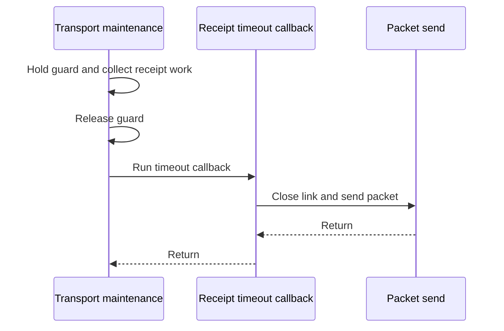

# Debugging HTIT reconnects and internal RAM pressure

*30 October 2026. Reconstructed on 4 November 2026 from development and test notes.*

Short exchanges established that the host and HTIT could communicate. Longer runs exposed failures in reconnects, callbacks, and memory allocation. One diagnostic firmware completed ten consecutive 30 KB LoRa transfers, signed messages, receipts, a reply, and reconnect. Other builds still reset during interruption tests. We therefore kept each result associated with the firmware that produced it.

## Reusing a link after its peer had restarted

After a peer restarted, the router still considered its old LXMF link ACTIVE. Delivery failed, but the next send reused that link's identifier. A link identifier belongs to one established connection; retaining it after that connection has died leaves the application trying to use stale state.

The repair cleared the failed link only when the failure referred to its current generation. A generation distinguishes successive uses of the same logical slot. This matters when callbacks arrive late: a callback from an old connection could otherwise clear a replacement that has already started. The failed message reported failure once. A subsequent application send established a fresh link.

A separate handshake problem consumed retry attempts too quickly. One-second polling was being counted against attempts while the connection still had a longer deadline. Delaying the proof by six seconds helped reproduce that difference. The repair made the retry logic respect the time allowed for the handshake.

## Calling back into transport while transport was busy

The reconnect repair exposed a deadlock. Transport housekeeping held a cooperative guard, `_jobs_running`, while invoking receipt-timeout callbacks. A callback closed a link. Closing the link sent a packet, and sending waited for that same guard to clear. The code holding the guard was waiting for the callback to return.

The task stayed stuck until the watchdog reset it. A watchdog is a timer that detects a task failing to make progress. We changed maintenance to collect a snapshot of receipts while holding the guard, release the guard, and then invoke their callbacks. A callback could create another receipt; the next maintenance pass would examine it.

*The repaired order releases the guard before calling code that may send another packet.*

## Running out of the particular memory an allocation needed

Another interrupted transfer failed to allocate 16 bytes of internal RAM while roughly 4 MB of PSRAM was free. The allocator request specified internal, byte-addressable memory. Free external memory could therefore coexist with this failure.

We had already moved large payloads into PSRAM. The remaining pressure came from prebuilt Packet objects for resource parts. Their reference-counted bookkeeping still occupied internal RAM. A resource could keep many of those objects alive at once, even though the ciphertext bytes themselves lived elsewhere.

The revised resource representation kept ciphertext chunks and send flags. It constructed a Packet when a requested chunk was sent, then released the packet's bookkeeping. This reduced the internal memory retained for parts waiting to be sent or requested again.

## Repeating the failures after the changes

The peer-restart test recovered a new encrypted link, transferred a checked 30 KB resource, and delivered a fresh signed message. An interrupted resource test also recovered after a 45-second disruption while lease renewals continued. Those runs exercised the specific failures we had repaired. A watchdog failure remained in the broader suite, so longer-session reliability still needed investigation.

The [current executor guide](../pocket/external-node.md) explains how Pocket reports interrupted operations and reconnects. The [ESP32 memory guide](https://docs.espressif.com/projects/esp-idf/en/v4.4.7/esp32/api-guides/external-ram.html) explains why allocation requirements matter as much as total free memory.

<!-- journal-sources:start -->
## Code, tests and build inputs

| Material | Repository files |
|---|---|
| Implementation | [LXMF router lifetime](../assets/source/journal/hardware/htit/microreticulum/executor-libs/microLXMF/src/LXMF/LXMRouter.cpp.txt) ([GitHub](https://github.com/gordol/n810-revival/blob/main/hardware/htit/microreticulum/executor-libs/microLXMF/src/LXMF/LXMRouter.cpp)) [Transport callbacks](../assets/source/journal/hardware/htit/microreticulum/executor-libs/microReticulum/src/microReticulum/Transport.cpp.txt) ([GitHub](https://github.com/gordol/n810-revival/blob/main/hardware/htit/microreticulum/executor-libs/microReticulum/src/microReticulum/Transport.cpp)) [Resource storage](../assets/source/journal/hardware/htit/microreticulum/executor-libs/microReticulum/src/microReticulum/Resource.cpp.txt) ([GitHub](https://github.com/gordol/n810-revival/blob/main/hardware/htit/microreticulum/executor-libs/microReticulum/src/microReticulum/Resource.cpp)) |
| Checks and fixtures | [Recovery and resource regression](../assets/source/journal/hardware/htit/tests/native/lxmf_recovery.cpp.txt) ([GitHub](https://github.com/gordol/n810-revival/blob/main/hardware/htit/tests/native/lxmf_recovery.cpp)) [Host reconnect behavior](../assets/source/journal/pocket/tests/test_connection_recovery.py.txt) ([GitHub](https://github.com/gordol/n810-revival/blob/main/pocket/tests/test_connection_recovery.py)) |
| Build inputs | [Native test build](../assets/source/journal/hardware/htit/tests/native/CMakeLists.txt.txt) ([GitHub](https://github.com/gordol/n810-revival/blob/main/hardware/htit/tests/native/CMakeLists.txt)) [Firmware build](../assets/source/journal/hardware/htit/build.py.txt) ([GitHub](https://github.com/gordol/n810-revival/blob/main/hardware/htit/build.py)) |

[Build and test instructions](../how-to/test-journal-checkpoints.md#build-the-microlxmf-reproductions) · [Chronological source index](../reference/journal-sources.md#2026-10-30-htit-recovery)
<!-- journal-sources:end -->

[Journal](../journal.md) | [Current status](../status.md)

[Previous entry](2026-10-29-htit.md) | [Next entry](2026-10-31-gpu-clocks.md)

The imported firmware includes the [UART internal-buffer changes](https://github.com/gordol/n810-revival/tree/main/hardware/htit/microreticulum/executor-libs/EspIdfUartIram) and the [Bluetooth implementation](https://github.com/gordol/n810-revival/blob/main/hardware/htit/microreticulum/Bluetooth.h). The [build guide](../how-to/build-htit.md) explains the selected target and its private PIN input.
