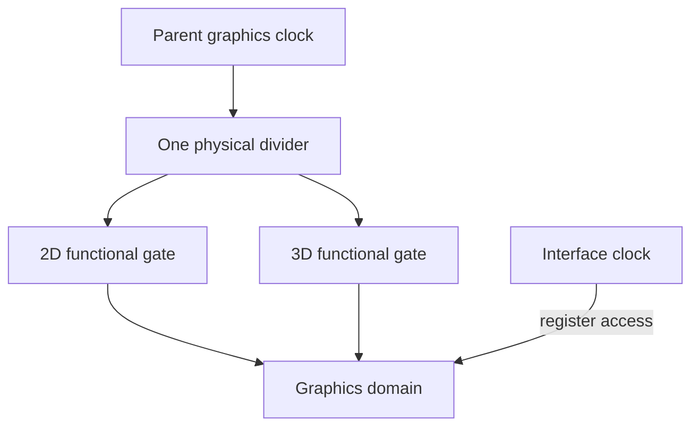

# Bringing up the graphics clock domain

*October GPU investigation through 1 November 2026. Reconstructed on 4 November 2026 from development and test notes.*

The OMAP2420 contains a PowerVR MBX graphics core. Before it could draw anything, we needed to power its graphics domain, supply the clocks, reset it, and determine when it was ready for commands. A clock domain is a group of hardware whose timing and power controls have to be coordinated.

The first probe completed the reset handshake and then timed out after 1,000 readiness checks. It restored the reset and clock state during cleanup. This narrowed the failure to the startup sequence after reset, but left several possible causes: clock rate, clock gates, or the meaning of the ready bits we were reading.

## Following the shared divider

Code from the Nokia N95 provided a useful comparison because that phone also used OMAP2420. Its graphics startup selected divider 2. Our initial N810 probe had retained divider 1. A divider reduces a parent clock's rate before passing it to the consuming hardware.

Linux's description of the clocks complicated that experiment. Separate 2D and 3D composite clocks described what was physically one shared divider. We changed the experimental provider to represent one divider feeding the functional clock gates. A gate enables or stops a clock without changing its rate. The [Linux clock framework documentation](https://docs.kernel.org/driver-api/clk.html) describes these objects and the driver callbacks that control them.

*Linux needed to represent the shared divider once, then account for the gates using it. The interface clock serves a different role from the functional clocks.*

On 31 October, a temporary `5.15.86-n810-mbx-clock-v1` boot reached a working display, keyboard, and USB SSH. The requested divider change still left the hardware selector at its original value. Because cleanup could not establish the expected state, the test kept its resources reserved. An ordinary recovery returned the tablet to the stored RGB kernel and Pocket.

## Committing the hardware configuration

On 1 November, a guarded write to PRCM's `VALID_CONFIG` committed divider 2. PRCM is the processor's power, reset, and clock management hardware. In this sequence, changing the requested setting and committing that setting were separate operations.

After the commit, the shared clock and its children agreed at about 54.9 MHz. Reversing the change restored about 109.7 MHz at divider 1. We checked both the registers and Linux's reported rates, since software could otherwise remember a requested value that hardware had never adopted.

Reset completed again, but readiness still timed out. Source review then showed that the generic companion-clock lookup assumed a relationship between bit positions that did not fit these GFX clocks: the interface gate used bit 0, while the functional gates used bits 1 and 2. The interface clock supports register access; functional clocks run the engine. That difference gave us a more specific startup problem to investigate.

At this point we had demonstrated a reversible clock change and a completed reset. The next entry follows the command path from those startup conditions toward an image.

<!-- journal-sources:start -->
## Code, tests and build inputs

| Material | Repository files |
|---|---|
| Implementation | [Clock commit](../assets/source/journal/graphics/mbx/kernel/clock_commit.c.txt) ([GitHub](https://github.com/gordol/n810-revival/blob/main/graphics/mbx/kernel/clock_commit.c)) [Clock lifecycle](../assets/source/journal/platform/kernel/clock-module/mbx_clock_lifecycle.c.txt) ([GitHub](https://github.com/gordol/n810-revival/blob/main/platform/kernel/clock-module/mbx_clock_lifecycle.c)) [Maintained clock-provider changes](../assets/source/journal/platform/kernel/n810-5.15.224.patch.txt) ([GitHub](https://github.com/gordol/n810-revival/blob/main/platform/kernel/n810-5.15.224.patch)) |
| Checks and fixtures | [Kernel/module verification](../assets/source/journal/platform/kernel/verification.json.txt) ([GitHub](https://github.com/gordol/n810-revival/blob/main/platform/kernel/verification.json)) [Kernel source hashes](../assets/source/journal/platform/kernel/source-files.json.txt) ([GitHub](https://github.com/gordol/n810-revival/blob/main/platform/kernel/source-files.json)) |
| Build inputs | [Clock module makefile](../assets/source/journal/platform/kernel/clock-module/Makefile.txt) ([GitHub](https://github.com/gordol/n810-revival/blob/main/platform/kernel/clock-module/Makefile)) [Kernel builder](../assets/source/journal/platform/kernel/build.py.txt) ([GitHub](https://github.com/gordol/n810-revival/blob/main/platform/kernel/build.py)) |

[Build and test instructions](../how-to/build-kernel.md) · [Chronological source index](../reference/journal-sources.md#2026-10-31-gpu-clocks)

These clock sources accompany the maintained 5.15.224 kernel inputs. The temporary 5.15.86 clock experiment is documented as a historical boot result.
<!-- journal-sources:end -->

[Journal](../journal.md) | [Current status](../status.md)

[Previous entry](2026-10-30-htit-recovery.md) | [Next entry](2026-11-02-gpu-command-stream.md)
