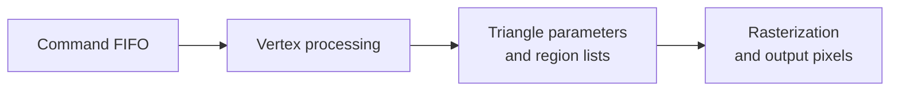

# Reconstructing the MBX command stream

*2 November 2026. Reconstructed on 4 November from the static audits and physical probe records.*

With clock and reset behavior under investigation, we worked on the command stream the MBX consumes. A driver has to describe the drawing state, provide geometry, identify writable memory, submit commands in the expected order, and wait for completion. A register write succeeding only tells us that the CPU issued the write. Useful output requires the whole sequence to make sense to the graphics core.

The reference was a Nokia N95 Symbian ROM for the same OMAP2420 chip. We studied its call sites and data structures to understand the hardware. The Linux implementation used original encoders and its own allocation, submission, and cleanup code.

## Correcting the first interpretations

One helper initially looked like initialization code. Its surrounding callers showed that it actually ran while retiring a surface context, just before freeing the allocations behind it. Using it at startup would have put an operation in the wrong part of the resource's lifetime.

Another correction separated the parameter-buffer base from the free-list base. The parameter buffer holds data generated for later rendering; a free list tracks storage the engine can allocate. Both contain addresses, but using one where the other is expected changes what the hardware reads or writes.

The vertex-format word needed more than a mask saying which sections were present. It also encoded the first enabled attribute. An attribute is one field of a vertex, such as its position or color. A correct mask with the wrong starting attribute still describes the stream incorrectly.

We also separated the polygon-end sideband from the frame-end FIFO word. A FIFO is a first-in, first-out command queue. The sideband marked a polygon boundary; the frame-end word completed a different part of submission. A physical trace showed the queue backing up after the first polygon boundary, which focused the next tests on vertex startup and nearby context state.

*The investigation progressed from accepted writes, to generated parameters, to a completed render with black pixels. Each observation narrowed the next test.*

## Making a failed submission recoverable

The GPU could retain addresses of buffers after a failed command. Freeing those buffers while it still owned them would let later hardware writes damage memory that Linux had reused. Recovery therefore had to stop the engine before reclaiming its memory.

The recovery sequence reset the whole graphics domain, checked fresh reset completion, disabled the graphics memory-management unit, and cleared its table bases. Once those checks passed, the driver reclaimed the DMA allocations, restored clocks and the original divider, released its resources, and unloaded. DMA lets a device access memory directly; the [Linux DMA guide](https://docs.kernel.org/5.15/core-api/dma-api-howto.html) explains the distinct CPU and device addresses involved.

This let us inspect and recover a failed submission within the same boot. It also made the next test less ambiguous because it began after a checked cleanup.

## Getting work through the pipeline

The full-context candidate completed 44 command writes without producing triangle parameters. Even two triangles placed inside the viewport, with opposite windings so that each faced a different way, left the parameter buffer empty. The FIFO trace gave us a better place to look. After the first polygon, 18 words were still queued. Changing vertex startup drained the queue and produced parameter writes. When we inspected the coordinates in those parameters, some were infinite. Supplying the clipping constants gave us finite coordinates at the intended positions.

The region lists now pointed to geometry, and the rasterizer signalled completion. The captured pixels were black. At that point we had two questions we could test independently. Could the rasterizer put a chosen color at a chosen address? And could it read the color attached to a triangle?

## Reading the first colors out of GPU memory

We could test the first question with a background object. The MBX can sample a texture for the background of a region, so this test could exercise the color and output paths independently of vertex startup. We used a 32 × 32 offscreen target. Each RGB565 pixel takes two bytes. The allocator filled the target page with the recognizable byte `0x3c`, so an untouched pixel would read back as `0x3c3c`.

One capture came back with all 1,024 pixels red (`0xf800`). The GPU had overwritten every pixel, but we had asked for four colors. In the passing version, each of the four 16 × 16 regions had its own background description on a separate 4 KiB page and its own solid-color texture. The code placed the descriptions at GPU addresses starting at `0x10000` and textures at `0x18000`, spaced 8 KiB apart. Giving each texture a single color meant that any sample within it returned the same value.

Follow the bottom-left pixel group through the code. Its region number is 2, its background is at `0x12000`, and its blue texture is at `0x1c000`. The texture descriptor stores the address shifted right seven bits. The region word is `0xe2000100`, with tile coordinates (0, 1). The driver selects that region, submits its background, and waits for completion. Pixel (0, 16) should now be blue (`0x001f`) at byte offset 1,024 in the target. You can follow those values through `gpu_service_baseline` in the [render service source](../assets/source/journal/graphics/mbx/kernel/mbx_render_service.h.txt).

We checked every position. The top half was red on the left and green on the right. The bottom half was blue on the left and white on the right. All 1,024 pixels matched in two runs. The remaining 2,048 bytes of the target page still held `0x3c`, the separate guard page still held `0xa5`, and the GPU page tables matched their expected contents. We could now use this pattern as a startup check before submitting a scene.

## Following one triangle into the rasterizer

For the first saved gears frames, Mesa supplied triangles after transformation and clipping. Our driver used the parameter layout we had seen the MBX generate to construct objects for the rasterizer directly. This gave us working geometry without depending on every part of the experimental vertex command stream. The frozen driver's 32 × 32 path, `gpu_service_scene`, shows exactly what crossed that boundary. [Render service source](../assets/source/journal/graphics/mbx/kernel/mbx_render_service.h.txt)

Each triangle takes 17 words (68 bytes). The first two describe the object and its drawing state. The next six contain the three pairs of x and y coordinates, followed by three z values, three w values, and three vertex colors. The first object begins 4,096 bytes into the parameter buffer. A region list refers to it with the word `0x40800400`. The low part, `0x400`, is that offset in four-byte words. The driver ends the list with `0xf0000000`. The rasterizer can now find the triangle and determine which pixels it covers in that region.

One detail mattered even with the right geometry. The FIFO convention put red in the low byte of the packed color word, while the native rasterizer object expected blue there. For opaque red, the encoder had to turn `0xff0000ff` into `0xffff0000`, preserving alpha and green. The four-color background test sampled textures and could pass with this vertex-color bug still present. Replaying the saved gears geometry exercised both paths. With the color conversion in place, the tiled run matched Mesa's RGB565 reference exactly at 159,922 of 160,000 pixels, with matching coverage and at most one quantization step per channel elsewhere. The [whole-frame rendering entry](2026-11-03-mbx-rendering.md#replacing-hundreds-of-small-submissions-with-one-frame) follows the change from those 169 tile jobs to a single submission.

The [source availability page](../reference/source-links.md) identifies the code included in this repository and the separate graphics work. The [hardware page](../reference/hardware.md) provides a map of the processor and display path.

<!-- journal-sources:start -->
## Code, tests and build inputs

| Material | Repository files |
|---|---|
| Implementation | [Command encoding](../assets/source/journal/graphics/mbx/common/mbx_packets.c.txt) ([GitHub](https://github.com/gordol/n810-revival/blob/main/graphics/mbx/common/mbx_packets.c)) [Context setup](../assets/source/journal/graphics/mbx/common/mbx_context.c.txt) ([GitHub](https://github.com/gordol/n810-revival/blob/main/graphics/mbx/common/mbx_context.c)) [Geometry stream](../assets/source/journal/graphics/mbx/common/mbx_vgp_stream.c.txt) ([GitHub](https://github.com/gordol/n810-revival/blob/main/graphics/mbx/common/mbx_vgp_stream.c)) [DMA lifecycle](../assets/source/journal/graphics/mbx/kernel/mbx_dma.c.txt) ([GitHub](https://github.com/gordol/n810-revival/blob/main/graphics/mbx/kernel/mbx_dma.c)) [Render service and pixel checks](../assets/source/journal/graphics/mbx/kernel/mbx_render_service.h.txt) ([GitHub](https://github.com/gordol/n810-revival/blob/main/graphics/mbx/kernel/mbx_render_service.h)) |
| Checks and fixtures | [Packet fields](../assets/source/journal/graphics/mbx/tests/test_packets.c.txt) ([GitHub](https://github.com/gordol/n810-revival/blob/main/graphics/mbx/tests/test_packets.c)) [Context protocol](../assets/source/journal/graphics/mbx/tests/test_context_protocol.c.txt) ([GitHub](https://github.com/gordol/n810-revival/blob/main/graphics/mbx/tests/test_context_protocol.c)) [DMA checks](../assets/source/journal/graphics/mbx/tests/test_dma_verification.py.txt) ([GitHub](https://github.com/gordol/n810-revival/blob/main/graphics/mbx/tests/test_dma_verification.py)) |
| Build inputs | [Graphics input pins](../assets/source/journal/graphics/mbx/dependencies.lock.json.txt) ([GitHub](https://github.com/gordol/n810-revival/blob/main/graphics/mbx/dependencies.lock.json)) [Graphics builder](../assets/source/journal/graphics/mbx/build.py.txt) ([GitHub](https://github.com/gordol/n810-revival/blob/main/graphics/mbx/build.py)) [Test runner](../assets/source/journal/graphics/mbx/test.py.txt) ([GitHub](https://github.com/gordol/n810-revival/blob/main/graphics/mbx/test.py)) |

[Build and test instructions](../how-to/build-graphics.md) · [Chronological source index](../reference/journal-sources.md#2026-11-02-gpu-command-stream)

Links use the existing imported graphics checkpoint. The Symbian ROM used for research remains an external historical reference; the repository contains the authored encoders and tests.
<!-- journal-sources:end -->

[Journal](../journal.md) | [Acceleration reference](../reference/acceleration.md)

[Previous entry](2026-10-31-gpu-clocks.md) | [Next entry](2026-11-02-microlxmf.md)
