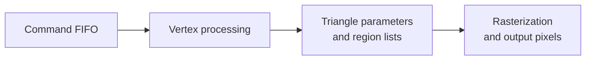

# Reconstructing the MBX command stream

*2 November 2026. Reconstructed on 4 November from the static audits and physical probe records.*

With clock and reset behavior under investigation, we worked on the command stream the MBX consumes. A driver has to describe the drawing state, provide geometry, identify writable memory, submit commands in the expected order, and wait for completion. A register write succeeding only tells us that the CPU issued the write. Useful output requires the whole sequence to make sense to the graphics core.

The reference was a Nokia N95 Symbian ROM for the same OMAP2420 chip. We studied its call sites and data structures to understand the hardware. The Linux implementation used original encoders and its own allocation, submission, and cleanup code.

## Correcting the first interpretations

One helper initially looked like initialization code. Its surrounding callers showed that it actually ran while retiring a surface context, just before freeing the allocations behind it. Using it at startup would have put an operation in the wrong part of the resource's lifetime.

Another correction separated the parameter-buffer base from the free-list base. The parameter buffer holds data generated for later rendering; a free list tracks storage the engine can allocate. Both contain addresses, but using one where the other is expected changes what the hardware reads or writes.

The vertex-format word needed more than a mask saying which sections were present. It also encoded the first enabled attribute. An attribute is one field of a vertex, such as its position or color. A correct mask with the wrong starting attribute still describes the stream incorrectly.

We also separated the polygon-end sideband from the frame-end FIFO word. A FIFO is a first-in, first-out command queue. The sideband marked a polygon boundary; the frame-end word completed a different part of submission. A physical trace showed the queue backing up after the first polygon boundary, which focused the next tests on vertex startup and nearby context state.

*The investigation progressed from accepted writes, to generated parameters, to a completed render with black pixels. Each observation narrowed the next test.*

## Making a failed submission recoverable

The GPU could retain addresses of buffers after a failed command. Freeing those buffers while it still owned them would let later hardware writes damage memory that Linux had reused. Recovery therefore had to stop the engine before reclaiming its memory.

The recovery sequence reset the whole graphics domain, checked fresh reset completion, disabled the graphics memory-management unit, and cleared its table bases. Once those checks passed, the driver reclaimed the DMA allocations, restored clocks and the original divider, released its resources, and unloaded. DMA lets a device access memory directly; the [Linux DMA guide](https://docs.kernel.org/5.15/core-api/dma-api-howto.html) explains the distinct CPU and device addresses involved.

This let us inspect and recover a failed submission within the same boot. It also made the next test less ambiguous because it began after a checked cleanup.

## Getting work through the pipeline

The full-context candidate initially completed 44 command writes while producing no triangle parameters. Later startup changes and explicit clipping constants drained the FIFO, produced finite parameters and region lists, and completed a render. Region lists organize work for parts of the image. The output pixels were still black.

That progression mattered. We now had evidence that geometry reached later stages of the engine, so surface, background, and color handling became useful next targets. The following rendering entry describes the saved-image comparisons that finally showed the expected pixels.

The [source availability page](../reference/source-links.md) identifies the code included in this repository and the separate graphics work. The [hardware page](../reference/hardware.md) provides a map of the processor and display path.

<!-- journal-sources:start -->
## Code, tests and build inputs

| Material | Repository files |
|---|---|
| Implementation | [Command encoding](../assets/source/journal/graphics/mbx/common/mbx_packets.c.txt) ([GitHub](https://github.com/gordol/n810-revival/blob/main/graphics/mbx/common/mbx_packets.c)) [Context setup](../assets/source/journal/graphics/mbx/common/mbx_context.c.txt) ([GitHub](https://github.com/gordol/n810-revival/blob/main/graphics/mbx/common/mbx_context.c)) [Geometry stream](../assets/source/journal/graphics/mbx/common/mbx_vgp_stream.c.txt) ([GitHub](https://github.com/gordol/n810-revival/blob/main/graphics/mbx/common/mbx_vgp_stream.c)) [DMA lifecycle](../assets/source/journal/graphics/mbx/kernel/mbx_dma.c.txt) ([GitHub](https://github.com/gordol/n810-revival/blob/main/graphics/mbx/kernel/mbx_dma.c)) |
| Checks and fixtures | [Packet fields](../assets/source/journal/graphics/mbx/tests/test_packets.c.txt) ([GitHub](https://github.com/gordol/n810-revival/blob/main/graphics/mbx/tests/test_packets.c)) [Context protocol](../assets/source/journal/graphics/mbx/tests/test_context_protocol.c.txt) ([GitHub](https://github.com/gordol/n810-revival/blob/main/graphics/mbx/tests/test_context_protocol.c)) [DMA checks](../assets/source/journal/graphics/mbx/tests/test_dma_verification.py.txt) ([GitHub](https://github.com/gordol/n810-revival/blob/main/graphics/mbx/tests/test_dma_verification.py)) |
| Build inputs | [Graphics input pins](../assets/source/journal/graphics/mbx/dependencies.lock.json.txt) ([GitHub](https://github.com/gordol/n810-revival/blob/main/graphics/mbx/dependencies.lock.json)) [Graphics builder](../assets/source/journal/graphics/mbx/build.py.txt) ([GitHub](https://github.com/gordol/n810-revival/blob/main/graphics/mbx/build.py)) [Test runner](../assets/source/journal/graphics/mbx/test.py.txt) ([GitHub](https://github.com/gordol/n810-revival/blob/main/graphics/mbx/test.py)) |

[Build and test instructions](../how-to/build-graphics.md) · [Chronological source index](../reference/journal-sources.md#2026-11-02-gpu-command-stream)

Links use the existing imported graphics checkpoint. The Symbian ROM used for research remains an external historical reference; the repository contains the authored encoders and tests.
<!-- journal-sources:end -->

[Journal](../journal.md) | [Acceleration reference](../reference/acceleration.md)

[Previous entry](2026-10-31-gpu-clocks.md) | [Next entry](2026-11-02-microlxmf.md)
