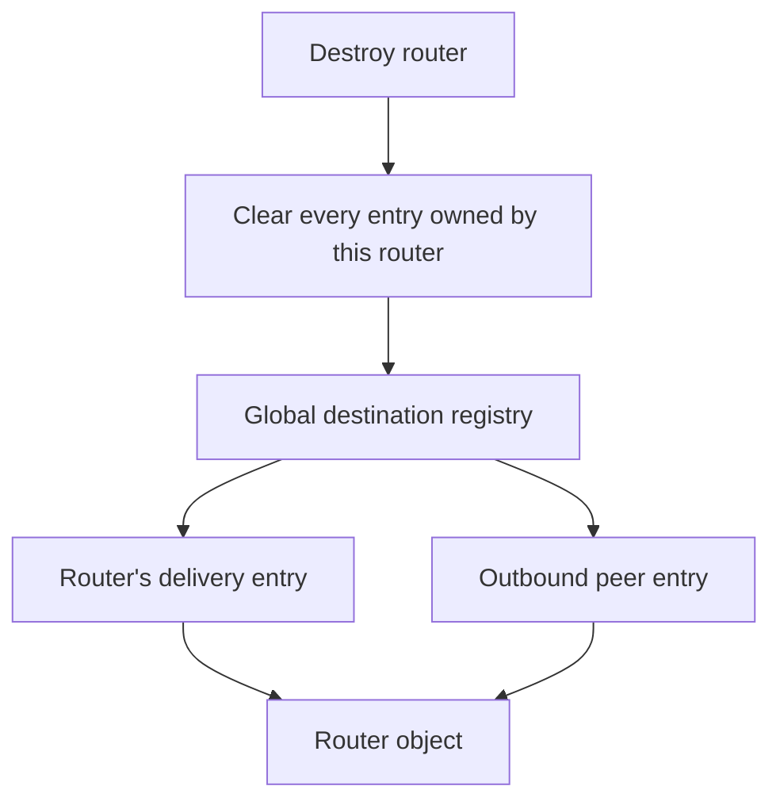

# Repairing microLXMF parsing and object lifetime

*2 November 2026. Reconstructed on 4 November 2026 from development and test notes.*

The HTIT integration repeatedly created and destroyed Reticulum sessions. It also parsed messages on a processor with much less stack and internal RAM than a laptop. Those conditions exposed defects in microLXMF and its bundled MessagePack decoder. Before moving to a newer upstream tree, we kept small reproductions for each defect and ran them against both versions.

## A router pointer survived the router

microLXMF kept a global registry that associated destinations with router objects. Destroying a router removed the entry for its own delivery destination, but outbound peer entries could still point to it. A later proof callback walked the registry and dereferenced one of those stale pointers.

This is a use-after-free: code accesses an object after its storage has been released. AddressSanitizer, which instruments memory accesses in a test build, reported a freed-object read in the native reproduction. A second reproduction passed an ordinary proof signed by the expected peer through the Reticulum packet ingress path. Signature validation succeeded, then the callback reached the stale router. Authentication of the packet and lifetime of the object were separate requirements.

The repair removed every registry entry owned by the router during destruction. Reusing a peer slot updated its owner, and destruction also cleared the active propagation-sync pointer. Another test retained an outbound link, destroyed its router, and closed the link; it exercised a second callback that could reach the stale owner.

The tested setup created the stale state through a local session reset while the process and registry remained alive. The signed-packet test established that a valid incoming proof could reach it afterward. Establishing a remotely induced reset or attacker-controlled execution would require additional evidence. The ESP32 crash trace suggested a related callback failure, but its proof path differed from the native reproduction, so we kept that distinction in the diagnosis.

*The original destructor cleared the delivery entry while peer entries could survive. The repair removes all entries whose owner is the destroyed router.*

## Nested fields exhausted the parser stack

MessagePack can represent arrays inside arrays. The LXMF field walker used recursion to skip or decode those values, consuming stack for each nesting level. On an ESP32 task with a 16 KiB stack, a depth-64 input completed repeated parses. A depth-128, 241-byte LXMF input triggered the stack-canary watchpoint and reset the board. A canary detects execution crossing the stack's allowed region.

The first repair imposed a nesting limit and threw a C++ exception when it was exceeded. That still aborted the embedded build. The successful repair limited nesting to 32 levels, checked cursor movement against the remaining input, and returned an empty message for invalid input. The same hardware input then returned safely 32 times.

This was a local invocation of the real parser on the HTIT. It demonstrated a parser-triggered denial of service on that build. Delivering the same condition through the complete radio receive path remained a separate test. A host sanitizer test with depth 4,000 also returned safely with the bounded parser while the compared upstream version exhausted its stack.

## A fixed-size array accepted a larger binary value

The bundled decoder also accepted a binary length from the input when decoding into a fixed-size C++ array. Its BIN8, BIN16, and BIN32 forms differ in the width of the length field. The affected copy routines used that input length without comparing it with the destination capacity.

A five-byte value decoded into a four-byte array produced a one-byte stack-buffer-overflow write under AddressSanitizer. Regression checks covered both an accepted four-byte value and a rejected five-byte value for all three encodings. The source search found no peer-input call site using that fixed-array API in the integrations examined, so this finding established an API defect and a preventive repair. The radio reachability of that API remained unestablished.

Metadata-cache lookups had a related requirement: validate the supplied hash length before comparing or copying a fixed number of bytes. Tests included a short hash after the cache had been populated, because a warm cache follows a different path from an empty one.

## Carrying the repairs through the upstream refresh

We moved the vendored source to the newer upstream microLXMF tree and retained the lifetime and parsing repairs. The newer tree already included the empty-fields cursor guard, so we used that implementation. The preparation adapter also changed to match the newer receipt interfaces.

Sanitizer tests exercised the refreshed libraries. The ESP32 build reported 93,484 bytes of RAM and 2,202,197 bytes of flash. The test HTIT received the firmware and answered a provisioning probe after reset. A separately built native library loaded on the Nokia with application binary interface version 2, the contract between Pocket and that library. Fresh end-to-end radio messaging for this exact refresh was still pending in the deployment notes.

The [native build guide](../pocket/native-reticulum.md) describes today's integration. The repository includes the [dependency pins](https://github.com/gordol/n810-revival/blob/main/pocket/shell/native/reticulum/dependencies.lock) and [source preparation code](https://github.com/gordol/n810-revival/blob/main/pocket/shell/native/reticulum/prepare.py). The findings above refer to the tested revisions and paths; those links identify the source used by the published Pocket build.

<!-- journal-sources:start -->
## Code, tests and build inputs

| Material | Repository files |
|---|---|
| Implementation | [Router repair](../assets/source/journal/hardware/htit/microreticulum/executor-libs/microLXMF/src/LXMF/LXMRouter.cpp.txt) ([GitHub](https://github.com/gordol/n810-revival/blob/main/hardware/htit/microreticulum/executor-libs/microLXMF/src/LXMF/LXMRouter.cpp)) [Bounded LXMF parser](../assets/source/journal/hardware/htit/microreticulum/executor-libs/microLXMF/src/LXMF/LXMessage.cpp.txt) ([GitHub](https://github.com/gordol/n810-revival/blob/main/hardware/htit/microreticulum/executor-libs/microLXMF/src/LXMF/LXMessage.cpp)) [MessagePack bounds](../assets/source/journal/hardware/htit/microreticulum/executor-libs/MsgPack/MsgPack/Unpacker.h.txt) ([GitHub](https://github.com/gordol/n810-revival/blob/main/hardware/htit/microreticulum/executor-libs/MsgPack/MsgPack/Unpacker.h)) |
| Checks and fixtures | [Signed proof after destruction](../assets/source/journal/hardware/htit/tests/upstream/lxmf_signed_proof_uaf.cpp.txt) ([GitHub](https://github.com/gordol/n810-revival/blob/main/hardware/htit/tests/upstream/lxmf_signed_proof_uaf.cpp)) [Nested-field input](../assets/source/journal/hardware/htit/tests/upstream/lxmf_nested_fields.cpp.txt) ([GitHub](https://github.com/gordol/n810-revival/blob/main/hardware/htit/tests/upstream/lxmf_nested_fields.cpp)) [Fixed-array bounds](../assets/source/journal/hardware/htit/tests/native/msgpack_fixed_array.cpp.txt) ([GitHub](https://github.com/gordol/n810-revival/blob/main/hardware/htit/tests/native/msgpack_fixed_array.cpp)) [Lifetime and cache regression](../assets/source/journal/hardware/htit/tests/native/lxmf_recovery.cpp.txt) ([GitHub](https://github.com/gordol/n810-revival/blob/main/hardware/htit/tests/native/lxmf_recovery.cpp)) |
| Build inputs | [Sanitizer build](../assets/source/journal/hardware/htit/tests/native/CMakeLists.txt.txt) ([GitHub](https://github.com/gordol/n810-revival/blob/main/hardware/htit/tests/native/CMakeLists.txt)) [Firmware header preparation](../assets/source/journal/hardware/htit/microreticulum/executor/prepare_native.py.txt) ([GitHub](https://github.com/gordol/n810-revival/blob/main/hardware/htit/microreticulum/executor/prepare_native.py)) |

[Build and test instructions](../how-to/test-journal-checkpoints.md#build-the-microlxmf-reproductions) · [Chronological source index](../reference/journal-sources.md#2026-11-02-microlxmf)

The restored host reproductions use the imported, repaired libraries. Synthetic messages and an in-memory transport exercise the actual parser and callback paths. The recorded ESP32 resets and later provisioning check are separate hardware results.
<!-- journal-sources:end -->

[Journal](../journal.md) | [Current status](../status.md)

[Previous entry](2026-11-02-gpu-command-stream.md) | [Next entry](2026-11-03-kernel.md)

The imported [microLXMF source](https://github.com/gordol/n810-revival/tree/main/hardware/htit/microreticulum/executor-libs/microLXMF) preserves the reviewed library changes. Use the [HTIT build guide](../how-to/build-htit.md) to build the executor with those sources.
