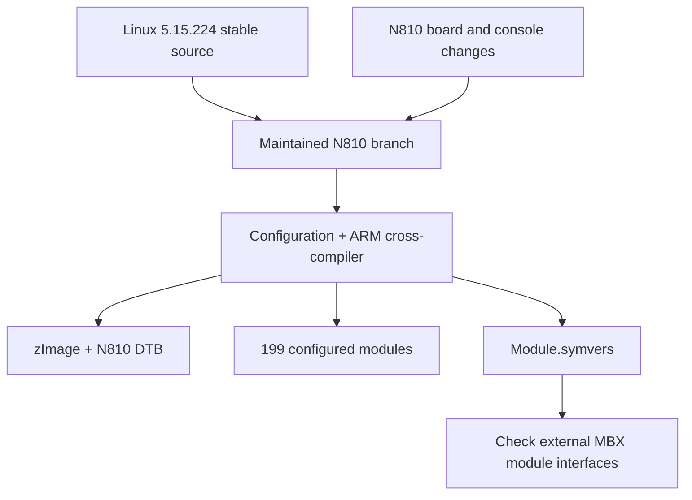

# Maintaining the N810 changes on Linux 5.15.224

*Kernel build and device use recorded by 3 November 2026. Reconstructed on 4 November 2026 from development and test notes.*

The working RGB-console system used Linux 5.15.86. We brought the N810 changes forward to Linux 5.15.224 and built a release named `5.15.224-n810-mbx-clock-wip1`. This meant preserving the board support while incorporating the stable kernel's changes.

Earlier build machinery substituted frozen source files through a compiler wrapper. The maintained branch put the RGB console, CSR Bluetooth, USB, graphics clocks, device tree, and related headers directly under source control. The compiler could then build the checked-out files, and the N810 device tree was generated from the same tree as the kernel.

## Understanding the Wi-Fi merge conflict

The merge had one conflict, in `p54spi.c`, the SPI transport driver for the Intersil wireless device discussed in the [Wi-Fi entry](2026-10-03-wifi.md). We needed to preserve the transport changes that worked on this tablet while adopting stable's interrupt setup behavior.

An interrupt is a hardware signal asking the CPU to handle an event. A driver registers a function, called an interrupt handler, for the signal. Linux normally enables the interrupt as part of registering it. `IRQF_NO_AUTOEN` tells Linux to register the handler while leaving the interrupt disabled. The driver later calls `enable_irq()` when it is ready to handle events.

The ordering matters during initialization. Requesting an interrupt and then immediately disabling it leaves a small interval in which the handler can run. Requesting it with automatic enabling disabled removes that interval. The merge retained this stable-kernel behavior alongside our N810 transport changes.

The [kernel interrupt API](https://docs.kernel.org/core-api/genericirq.html) documents handler registration and enabling. The upstream [interrupt setup implementation](https://linux.googlesource.com/linux/kernel/git/torvalds/linux/+/refs/heads/master/kernel/irq/manage.c) shows where `IRQF_NO_AUTOEN` controls startup. Those links let readers follow the symbol beyond this particular merge.

*The image, device tree, modules, and symbol-version records come from the same build.*

## Checking the image and its modules

NOLO's image budget made size a build result we had to check. The combined kernel and appended device tree occupied 2,077,948 bytes against the 2,095,104-byte limit used by this build. That left 17,156 bytes. A change can compile successfully and still exceed the boot image's available space.

The build produced 199 configured modules. We also built the experimental MBX clock module against that same output and checked all 35 of its symbol-version records. A symbol-version checksum describes the interface a module expects from the kernel. Matching the release name helps identify a build; checking these records catches interface mismatches as well.

The initial build note ended with an unbooted candidate. The later GPU tests identify this exact release running on the physical Nokia on 3 and 4 November. Reading those records in order shows the progression from a successful build to actual device execution.

## Packaging the build for another checkout

On 4 November, we packaged the complete maintained kernel-source delta, a reviewed
configuration, the export whitelist and the external clock module alongside a
portable builder. An independent local Git clone reconstructed the source from
the checksum-pinned Linux archive and completed the ARM build. All 199 configured
modules and 35 external-module symbol checks passed. The new image occupied
2,077,084 bytes. The [verification report](../reference/kernel-build-verification.md)
records the inputs and distinguishes this candidate from the earlier physical
runs. The [input reference](../reference/kernel-build-inputs.md) links the source
package to the build guide.

## Keeping the other kernel experiment identifiable

An earlier `5.15.86-n810-rgb-sandbox1` candidate added namespaces and seccomp. Namespaces give processes separate views of resources such as process IDs and networking. Seccomp filters restrict the system calls a process can make. That candidate built with 199 modules; its physical validation was still pending in the notes.

The [kernel build guide](../how-to/build-kernel.md) gives the source requirements, compilation commands, appended-image check, and module staging procedure. The [kernel reference](../reference/kernels.md) lists the separate releases and the tests associated with each.

<!-- journal-sources:start -->
## Code, tests and build inputs

| Material | Repository files |
|---|---|
| Implementation | [Maintained N810 patch](../assets/source/journal/platform/kernel/n810-5.15.224.patch.txt) ([GitHub](https://github.com/gordol/n810-revival/blob/main/platform/kernel/n810-5.15.224.patch)) [Clock module](../assets/source/journal/platform/kernel/clock-module/n810_mbx_clock_trial.c.txt) ([GitHub](https://github.com/gordol/n810-revival/blob/main/platform/kernel/clock-module/n810_mbx_clock_trial.c)) |
| Checks and fixtures | [Fresh-checkout result](../assets/source/journal/platform/kernel/verification.json.txt) ([GitHub](https://github.com/gordol/n810-revival/blob/main/platform/kernel/verification.json)) [Source hashes](../assets/source/journal/platform/kernel/source-files.json.txt) ([GitHub](https://github.com/gordol/n810-revival/blob/main/platform/kernel/source-files.json)) [Boot-tag regression](../assets/source/journal/platform/scripts/test-n810-boot-tags.c.txt) ([GitHub](https://github.com/gordol/n810-revival/blob/main/platform/scripts/test-n810-boot-tags.c)) |
| Build inputs | [Source lock](../assets/source/journal/platform/kernel/source.lock.json.txt) ([GitHub](https://github.com/gordol/n810-revival/blob/main/platform/kernel/source.lock.json)) [Kernel config](../assets/source/journal/platform/kernel/n810.config.txt) ([GitHub](https://github.com/gordol/n810-revival/blob/main/platform/kernel/n810.config)) [Builder](../assets/source/journal/platform/kernel/build.py.txt) ([GitHub](https://github.com/gordol/n810-revival/blob/main/platform/kernel/build.py)) |

[Build and test instructions](../how-to/build-kernel.md) · [Chronological source index](../reference/journal-sources.md#2026-11-03-kernel)
<!-- journal-sources:end -->

[Journal](../journal.md) | [Current status](../status.md)

[Previous entry](2026-11-02-microlxmf.md) | [Next entry](2026-11-03-mbx-rendering.md)
