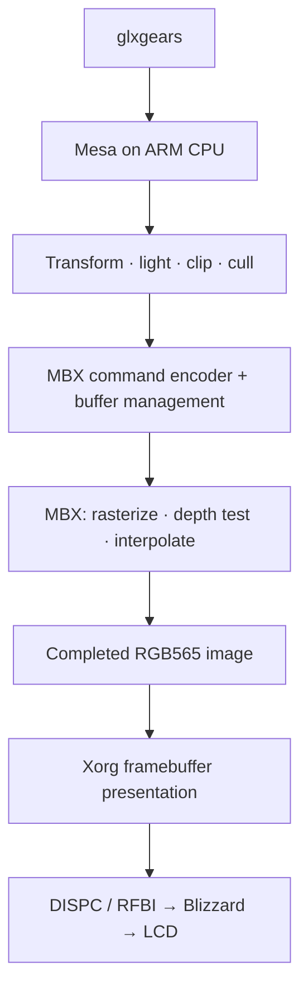
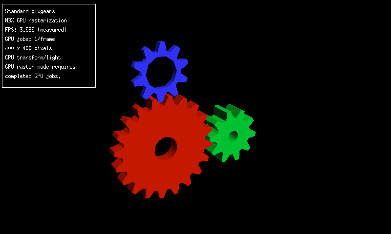

# Rendering standard glxgears on the MBX

*3 November 2026. Reconstructed on 4 November 2026 from development and test notes.*

By 3 November, the MBX was producing visible graphics on the Nokia. We used Debian's standard `glxgears` program in a 400 by 400 window. Its rotating gears provided a repeatable workload and a familiar image whose geometry, depth, and colors could be compared with a software reference.

Mesa handled vertex transformation, lighting, clipping, and culling on the ARM CPU. Transformation places vertices in the camera's coordinate system. Lighting calculates their colors; clipping cuts geometry at the view limits; culling discards faces pointing away from the camera. The MBX then rasterized the resulting primitives, tested depth, and interpolated values across the pixels. X11 presented the completed image.





Mesa's [driver overview](https://docs.mesa3d.org/systems.html) introduces the software reference drivers used to compare output. Our implementation supported the subset of drawing state needed for this experiment.

## Replacing hundreds of small submissions with one frame

The first working saved-frame prototype split the image into 169 synchronous jobs, each 32 by 32 pixels. Each job repeated submission and waiting. The full image took 4.56 seconds.

We changed the driver to submit the original primitives once into a persistent GPU-mapped surface, wait once, and copy the completed image once. That removed repeated work, but its first background was wrong. Gradients copied from the small-tile template sampled the wrong area when used for the larger surface. Correcting the background triangle and its texture coordinates produced a saved-frame result of 0.118 seconds.

The frame contained 390 original primitives. We compared all 160,000 pixels with the Mesa RGB565 reference: 159,923 matched exactly, 76 differed by at most one color quantization step, and one differed at a coverage edge. RGB565 rounds color into five red bits, six green bits, and five blue bits, so a one-step difference has a specific, small meaning.

The first live run completed 227 GPU frames. After startup, its reported intervals ranged from 3.418 to 3.724 frames per second. That gave us a moving application to profile, with CPU preparation, conversion, presentation, and display transfer all contributing to the result.



*The first live whole-frame run displayed 3.565 FPS in this capture. The [following day's capture](2026-11-04-gpu-performance.md#comparing-the-same-application-with-a-quiet-desktop) shows the later optimized path. The intervening changes are described below.*

## Removing conversions on the way to X11

The framebuffer used RGB565, while one presentation path expanded the image into BGRA, a four-byte blue/green/red/alpha representation. X11 could then convert it back for the display. We first replaced the conversion with direct integer operations and checked all 65,536 possible RGB565 input values. Conversion time fell from roughly 56–66 ms to about 22 ms; later work reduced it further.

A native 16-bit X11 window let us avoid that round trip. Its row pitch, the number of bytes between adjacent image rows, had to satisfy the tested alignment and width constraints. A full-frame comparison checked all 160,000 pixels before measuring the live path.

This uncovered a display-lifecycle failure. X blocked in the panel-enable path while the runner started and stopped X with GPU clocks held, and the idle timer could also initiate a display transition. Recovery required checking RFBI completion separately. The revised runner paused idle handling, started X and completed a round trip before taking GPU ownership, then released the GPU before stopping X or returning to the console. A subsequent run completed 967 frames with a median of 16.442 FPS and restored the desktop.

## Checking only the memory that needed checking

Guard checks detect writes beyond a buffer's intended contents. The original allocation and checking path covered more storage than the image required. The measured image used 332,800 bytes at an 832-byte row pitch, or 82 pages. We kept checks on the unused tail while reducing the allocation from the earlier 128-page arrangement.

The tail-check measurement fell from 9,251 microseconds to 154 microseconds. The corresponding run completed 1,161 frames with a median of 19.185 FPS and a peak interval of 19.799 FPS. This was CPU time removed from the path around GPU work.

## Moving repeated arithmetic out of the vertex loop

The shader path also repeated work. We decoded its intermediate instructions once and evaluated values constant across a draw once per draw. A native VFP emitter preserved the arithmetic order, wrote generated instructions into writable memory, then changed that memory to executable before using it. Numeric comparisons covered 18.8 million values, including the treatment of NaN representations.

The compiler options used for the ARM CPU were:

```text
-mcpu=arm1136jf-s -mfpu=vfp -mfloat-abi=softfp
```

`softfp` allows VFP instructions while retaining the function-calling convention used by Debian armel. The [GCC ARM options](https://gcc.gnu.org/onlinedocs/gcc/ARM-Options.html) explain the distinction. This continued the CPU work introduced in the [October VFP entry](2026-10-18-cpu-acceleration.md).

Several apparently useful changes gave little benefit or made the run slower. Combining the clear with a depth-always triangle saved a separate operation but added render work; its median stayed around 20.49 FPS. Sharing an uncached image with X made CPU reads expensive. A cacheable buffer with explicit DMA ownership performed better in that comparison. The [DMA guide](https://docs.kernel.org/5.15/core-api/dma-api-howto.html) explains why visibility between CPU and device must be managed when caches are involved.

Turning off Xorg's shadow framebuffer removed another copy in this tested configuration. X's measured CPU use fell from about 16.17% to 8.6%, with a median of 28.1145 FPS. The [fbdev manual](https://xorg.freedesktop.org/archive/X11R7.5/doc/man/man4/fbdev.4.html) describes `ShadowFB`. Later dynamic-lighting and per-draw VFP work reached a 1,792-frame run with a median of 29.2825 FPS after the first two intervals. One interval fell to 12.373 FPS, so the median alone did not describe every pause.

The [4 November performance investigation](2026-11-04-gpu-performance.md) returns to that variation and separates application throughput from the rate at which the panel received updates.

<!-- journal-sources:start -->
## Code, tests and build inputs

| Material | Repository files |
|---|---|
| Implementation | [Mesa integration](../assets/source/journal/graphics/mbx/mesa/prepare_mesa.py.txt) ([GitHub](https://github.com/gordol/n810-revival/blob/main/graphics/mbx/mesa/prepare_mesa.py))<br>[X11 shared image](../assets/source/journal/graphics/mbx/mesa/mbx_shared_image.h.txt) ([GitHub](https://github.com/gordol/n810-revival/blob/main/graphics/mbx/mesa/mbx_shared_image.h))<br>[ARM vertex emitter](../assets/source/journal/graphics/mbx/mesa/draw_mbx_arm_jit.h.txt) ([GitHub](https://github.com/gordol/n810-revival/blob/main/graphics/mbx/mesa/draw_mbx_arm_jit.h))<br>[Display lifecycle](../assets/source/journal/graphics/mbx/mesa/desktop_pause.py.txt) ([GitHub](https://github.com/gordol/n810-revival/blob/main/graphics/mbx/mesa/desktop_pause.py)) |
| Checks and fixtures | [Shared-image comparisons](../assets/source/journal/graphics/mbx/tests/test_shared_image.c.txt) ([GitHub](https://github.com/gordol/n810-revival/blob/main/graphics/mbx/tests/test_shared_image.c))<br>[ARM arithmetic](../assets/source/journal/graphics/mbx/tests/test_arm_vertex_jit.py.txt) ([GitHub](https://github.com/gordol/n810-revival/blob/main/graphics/mbx/tests/test_arm_vertex_jit.py))<br>[Display pause](../assets/source/journal/graphics/mbx/tests/test_desktop_pause.py.txt) ([GitHub](https://github.com/gordol/n810-revival/blob/main/graphics/mbx/tests/test_desktop_pause.py)) |
| Build inputs | [Pinned Mesa build](../assets/source/journal/graphics/mbx/build.py.txt) ([GitHub](https://github.com/gordol/n810-revival/blob/main/graphics/mbx/build.py))<br>[Graphics dependencies](../assets/source/journal/graphics/mbx/dependencies.lock.json.txt) ([GitHub](https://github.com/gordol/n810-revival/blob/main/graphics/mbx/dependencies.lock.json)) |

[Build and test instructions](../how-to/build-graphics.md) · [Chronological source index](../reference/journal-sources.md#2026-11-03-mbx-rendering)

The earlier graphics snapshot contains these implementations and tests. The later 30 FPS snapshot includes the command-reuse and FIFO changes described in the next GPU entry.
<!-- journal-sources:end -->

[Journal](../journal.md) | [Current status](../status.md)

[Previous entry](2026-11-03-kernel.md) | [Next entry](2026-11-04-pocket-0-1-0.md)
