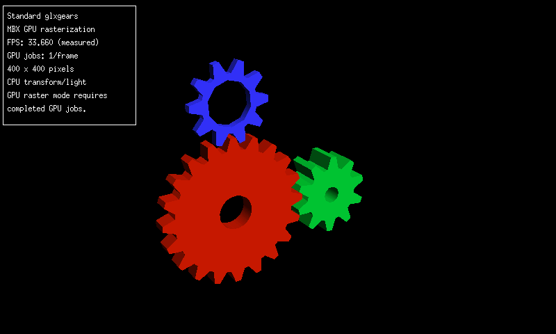
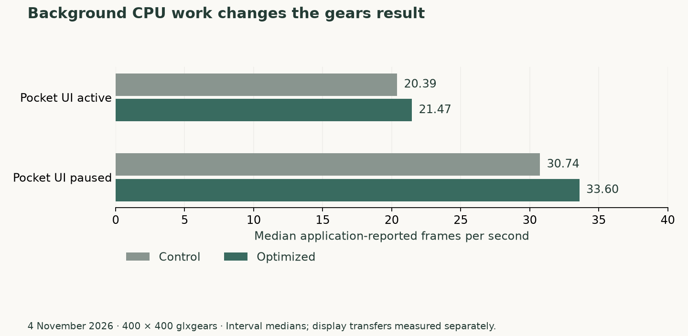
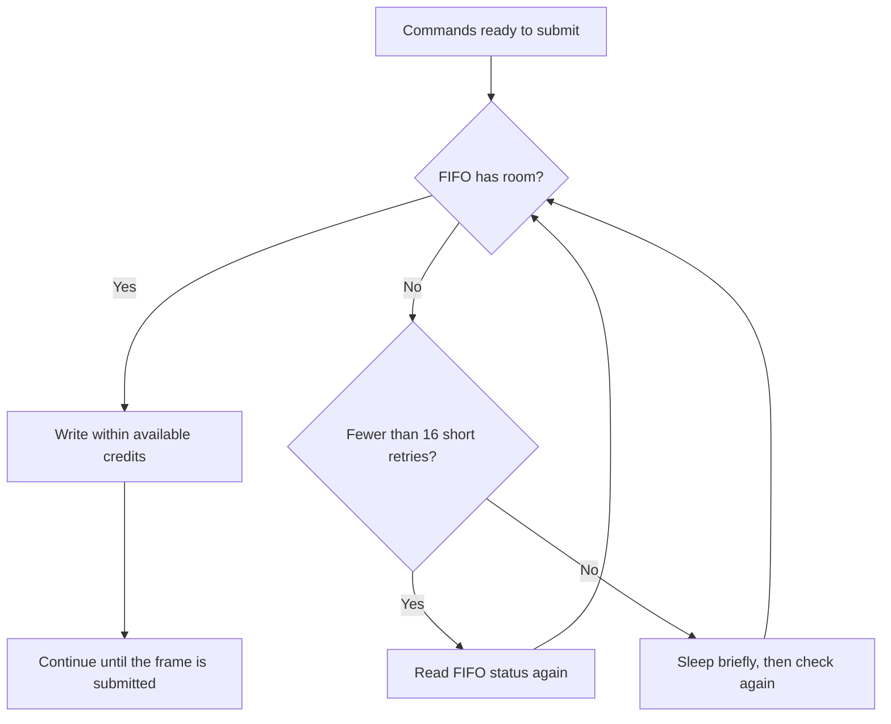
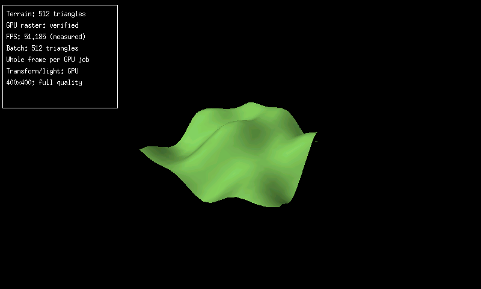
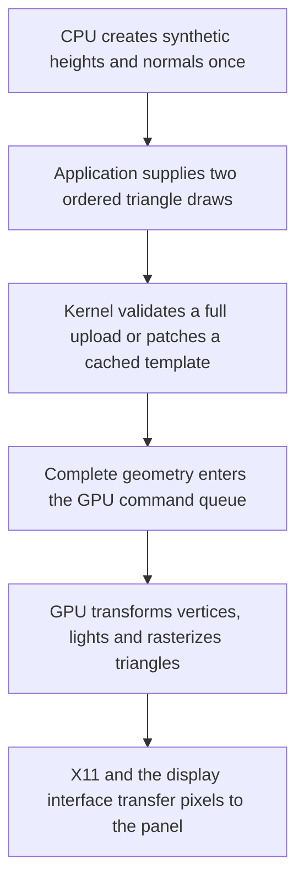

# Moving geometry onto the GPU and reaching 30 FPS

*4 November 2026. Reconstructed on 4 November 2026 from development and test notes.*

By the end of this work, standard `glxgears` completed two physical-device runs at 30.78 and 30.63 FPS with transformation, lighting, and rasterization on the GPU. Getting there meant reducing the CPU work around the GPU and changing how the driver waited for command-queue space. The sequence below starts with the earlier CPU-geometry measurements and follows the changes through the repeated result.

The first comparison showed how much background work affected `glxgears`. The hidden Pocket desktop was using roughly 28–33% of the CPU. With that workload present, the control driver measured a median of 20.3895 FPS and the CPU-cache candidate measured 21.4665 FPS. An asynchronous path intended to overlap work fell to 18.438 FPS. In that run, its additional queueing made the application slower.

## Comparing the same application with a quiet desktop

During an attended test, we paused the Pocket UI for each run and resumed it afterward. The window stayed at 400 by 400, and the application and image quality stayed the same. The control median rose to 30.7405 FPS; the optimized median was 33.596 FPS, about 9.3% higher. Its final six intervals had a median of 33.701 FPS.

*The panel in this capture reports one interval. The comparisons in the text use statistics from the complete recorded runs.*

*The same 400 by 400 application window under two background-load conditions. These bars show application interval medians. The LCD transfer measurement below observes a later stage.*

Counting completed GPU frames over the whole measurement window gave 28.3327 FPS for the control and 30.9953 FPS for the optimized path. This differs from taking a median of interval rates: startup and slow intervals contribute their full elapsed time to the whole-window calculation.

We checked the optimized command builder against ten complete frames from the existing builder. Shared presentation checked all 160,000 pixels. Completed runs released the GPU normally and restored Pocket with its saved preferences.

## Counting what the display actually transferred

A completed GPU frame still has to reach the LCD. On this board, X11 updates the framebuffer, and the OMAP display path sends updates through RFBI and the Blizzard controller. The DISPC interrupt count gave us an observation of display-transfer activity separate from the application's frame counter.

The observed interrupt rate was about 16.66 per second under the existing full-screen update policy. The application could complete more images than this path transferred. Requesting a shorter timer interval temporarily produced about 23.36 interrupts per second, but concurrent transfer activity complicated that comparison. We restored the original timing policy.

This left two useful measurements: completed renders describe application throughput; display-transfer observations describe the path toward the panel. A visible smoothness claim would also need an observation of what reached the screen over time.

## Measuring the cost of the measurements

Detailed tracing lowered the final-six median to 28.7285 FPS. With tracing disabled, the same library returned 33.222 FPS for that statistic. Full-cache and asynchronous variants also stayed around 31 FPS in their respective comparisons. Extra caching or overlap could consume enough CPU and memory bandwidth to outweigh the work they removed.

The collector itself mattered. The earlier Python sampler incurred 118–121 major page faults, which require retrieving pages from storage, and one observation took about 1.07 seconds. A native sampler measured roughly 4.944 ms per five-second collection, with zero major faults in the recorded run and six CPU ticks over 55 seconds. Reducing collector work made it easier to observe the application without repeatedly stalling the same small machine.

## Continuing the geometry investigation

The live path measured here still transformed and lit vertices on the ARM CPU. We also developed an original encoder for the VGP, the graphics hardware's vertex geometry processor. Local checks covered 10,000 matrix, color, and clipping cases, and a separate physical probe captured geometry output for independent checking.

We first checked small triangles whose expected positions and colors could be calculated independently. A vertex-format mismatch had made a three-component format read four-component positions with the wrong stride, the distance from one vertex to the next. Correcting the format produced the expected coordinates. Changing the translation matrix then moved the output by four pixels while preserving the source vertices. A separate raster-state correction made the transformed geometry visible.

The compiled gears shader subsequently produced projected positions within 1/32 of a pixel of the Mesa reference and exact packed lighting colors in the diagnostic cases. A larger test viewport made a tiny primitive visible and allowed us to check per-vertex normals and lighting. These small tests established the pieces needed for live integration.

Moving the full application onto that path introduced new costs around the GPU. The initial live version copied completed pixels back and measured 15.68 FPS. Sharing the completed image with X reached 19.32 FPS; reusing submission buffers reached 21.76 FPS. Further work brought the live path to the roughly 27–28 FPS stage filmed below. Throughout these live comparisons, the workload remained the standard 400 by 400 gears scene.

The [rendering explanation](../explanation/rendering.md) maps the CPU, GPU, and display stages to the hardware. The later measurements below follow the live GPU-geometry path.

## Watch the gears on the physical tablet

Later on 4 November, we recorded the running demonstration with a camera pointed at the N810. The clip shows the red, green, and blue gears rotating on the tablet's LCD, with the device bezel and diagnostic panel visible.

<video controls playsinline preload="none" poster="../../assets/demos/mbx-gears-device-20261104-poster.png" aria-label="Camera recording of glxgears running on the physical Nokia N810"><source src="../../assets/demos/mbx-gears-device-20261104.mp4" type="video/mp4"><a href="../../assets/demos/mbx-gears-device-20261104.mp4">Watch the N810 GPU demonstration</a>.</video>

*Camera recording supplied on 4 November 2026, approximately 6.5 seconds at the original playback speed. The site copy crops the lower edge and removes audio and camera metadata. The poster is a frame from that copy.*

The panel identifies standard `glxgears`, a 400 by 400 render, 886 triangles in a batch, and a whole frame per GPU job. It labels rasterization as verified and transform and lighting as running on the GPU. The visible application readings change from 27.462 to 27.658 FPS. Those readings belong to this demonstration; the earlier tables describe the separate CPU-geometry comparisons above.

This recording documents the moving result on the physical display before the command-submission changes below. Its FPS readings preserve that stage of the work.

## Finding the CPU work left around the GPU

GPU geometry still requires CPU preparation: Mesa fetches attributes, prepares drawing state, and submits commands to the kernel driver. A fresh profile collected 1,024 samples with detailed stage tracing disabled. Of those, 492 landed at the GPU submission system call and 49 in Mesa's derived-state update. The submission samples included kernel work, so we followed them with separate driver counters.

One smaller cost was a scan through unused texture-cache slots. The gears workload left those slots empty, but Mesa still visited them while checking state. We bounded the scan by the number of bound texture views and retained the validation of active entries. A comparison against the original code covered 12,000 cases, including gaps between bound slots and changes to timestamps and shader stages. On the Nokia, application CPU time fell from 20.14 to 19.29 milliseconds per frame. Throughput moved only from 27.60 to 27.76 FPS. That gave us a measured CPU saving and a reason to keep looking at submission. The [Mesa patch](../assets/source/gpu-30fps/sampler-patch.py.txt) and [actual-source comparison test](../assets/source/gpu-30fps/test-samplers.py.txt) are included in the frozen checkpoint.

## Reusing a validated command stream

Most of the gears' geometry and rendering state stays the same while its matrices change. We added a cache of the validated GPU command stream. On a hit, the driver reuses that stream and patches the values that are allowed to change, including matrix uniforms and viewport values. A uniform is a shader input shared by the vertices in a draw.

The match checks the complete static input: shader, geometry, indices, format, drawing state, padding, and frame header. The cache belongs to the exclusive command-buffer owner and is invalidated before a miss or error is handled. Large frames use the full encoder. The retained snapshot occupies 64 KiB of kernel memory. Read the [command-reuse implementation](../assets/source/gpu-30fps/command-reuse.c.txt), its [differential test](../assets/source/gpu-30fps/test-command-reuse.c.txt), and the [kernel ownership and submission code](../assets/source/gpu-30fps/render-service.h.txt).

This needed more than an attractive timing result. We compared every output word and rejection result in 19,190 local cases, including changes to every input word and 1,000 frames with changing uniforms and viewport values. AddressSanitizer and UndefinedBehaviorSanitizer checked those tests for memory errors and undefined operations.

On the Nokia, an alternating A–B–B–A CPU benchmark measured roughly 1.88 ms for full encoding and 0.65–0.67 ms for command reuse. Both produced the same 19,047 command words. The first live reuse run completed 979 clean jobs with 978 cache hits. It used 18.44 ms of application CPU per frame, but throughput was 26.59 FPS. The CPU saving had exposed another wait in the submission path.

## Checking FIFO space before sleeping

The GPU accepts commands through a FIFO, a first-in, first-out queue with limited room. The driver tracks available space so that writes stay within the hardware's capacity. When the queue fills, the GPU must consume commands before the CPU can send more.

The new counters recorded 10,919 sleeps across those 979 jobs: about eleven sleeps per job. Each sleep used `usleep_range(100, 200)`, asking the kernel for a short delay before checking again. Elapsed waiting also includes the time until the scheduler runs the submitting thread. The [Linux delay guide](https://docs.kernel.org/5.15/timers/timers-howto.html) explains the timer and scheduling tradeoffs behind this API.

We added a bounded retry: check the queue status up to sixteen times, then use the existing sleep if space is still unavailable. The command-credit checks, maximum burst of 42 words, and memory-ordering barriers remained in place. Those barriers preserve the required order of writes to the device. The [FIFO implementation](../assets/source/gpu-30fps/fifo-stream.c.txt) and [occupancy, retry, fault and timeout tests](../assets/source/gpu-30fps/test-fifo.c.txt) show the exact behavior.

The first physical run completed 1,175 jobs, passed its memory checks, and unloaded cleanly. FIFO sleeps fell to 1,177, roughly one per job. Mean elapsed FIFO submission fell to 5.33 ms. We then ran a control with polling disabled in the same module, followed by another sixteen-poll run.

## Repeating the 30 FPS result

All three runs used the same Mesa library, the same kernel module, command reuse, the original gears application, and a 400 by 400 RGB565 image. Transformation, lighting, and rasterization ran on the GPU. The hidden Pocket UI was paused during measurement and restored afterward.

| Configuration | Frames in measurement interval | Interval | Completed GPU FPS | Application CPU per frame |
|---|---:|---:|---:|---:|
| Polling disabled | 874 | 30.384 s | 28.77 | 18.24 ms |
| Sixteen polls, first run | 936 | 30.411 s | **30.78** | **17.64 ms** |
| Sixteen polls, repeat | 928 | 30.300 s | **30.63** | **17.66 ms** |

Together, the two winning intervals completed 1,864 frames in 60.711 seconds: **30.70 FPS**, with a frame-weighted application CPU cost of **17.65 ms**. The individual rates differed by less than half a percent. The control recorded 9.63 FIFO sleeps per job and 9.18 ms in FIFO submission; the repeated optimized run stayed near one sleep per job and 5.26 ms. These were sequential physical runs, so background scheduling could vary. The queue counters provide direct evidence of the behavior that changed.

*Actual framebuffer capture from the first successful run. Its diagnostic panel shows one application interval at 30.885 FPS. The table uses completed GPU frames divided by the elapsed time of each recorded measurement interval.*

During the winning runs, the application used about 54% of the CPU and Xorg about 11.4%. Application resident memory ranged from 12.48 to 13.45 MiB. Anonymous memory backing stayed at 5.89 MiB; the command cache added its separate 64 KiB kernel allocation. The recorded CPU frequency was 330 MHz.

The [downloadable measurement record](../assets/results/gpu-30fps-20261104.json) contains the interval counts, durations, CPU costs, whole-service FIFO counters, selected settings, and SHA-256 hashes identifying the tested module, Mesa library, and application. Whole-service counters include startup checks, which explains why their job counts exceed the table's measured frames. The repository now includes the exact frozen production source behind these measurements. The [30 FPS build and test guide](../how-to/build-gpu-30fps.md) links the driver changes and tests, documents the recorded options, and gives commands for rebuilding the module and Mesa library. The rebuilt Mesa library matches the physical-test binary byte for byte. The [source manifest](../assets/source/gpu-30fps/SOURCE.json) records the archive hashes and the one corrected historical test expectation. Ongoing GPU experiments remain in their separate bring-up workspace.

## Why the other submission paths stayed optional

We also tried sending commands through a batch-writing callback. Its first physical result fell to 24.87 FPS. Adding the same sixteen-poll retry brought it to 29.27 FPS with 17.74 ms of application CPU per frame. The simpler writer remained faster in these comparisons.

The asynchronous version used a worker thread to overlap preparation and submission. With the same module, Mesa library, command reuse, and retry setting, it measured 28.04 FPS and 19.09 ms of application CPU per frame. We kept the synchronous configuration as the verified 30 FPS checkpoint.

A separate diagnostic trace explained a constraint on overlap. The GPU and X shared one output image. The next render had to wait until X finished reading that image. After warmup, worker presentation took 6.34 ms of elapsed time but only 0.81 ms of CPU work per call. The rest was waiting. Other traced stages overlapped across threads, so each stage's elapsed time describes its own span. The [X shared-memory documentation](https://xorg.freedesktop.org/archive/X11R7.7/doc/xextproto/shm.html) explains how completion events establish when an image can safely be reused.

The follow-up work is giving each of two images its own ownership and completion tracking, so preparation can continue while X consumes the other image. That experiment follows this checkpoint in the bring-up work.

## What the completed run established

GPU completion checks, buffer guards, memory mappings, and reserved-page checks passed in the recorded physical runs. The test module unloaded normally, Pocket resumed, and its saved preferences were preserved. The full test launcher took roughly 38 seconds to reach its first GPU frame.

The display path recorded about 23.4 DISPC transfer interrupts per second. That counter observes transfers toward the panel; the 30.70 FPS result measures completed GPU renders. Counting distinct frames visible on the LCD remains a separate measurement. The panel driver currently accepts full-screen updates, so work on smaller display regions belongs in that driver as well as in presentation.

<!-- journal-sources:start -->
## Code, tests and build inputs

| Material | Repository files |
|---|---|
| Implementation | [Frozen command reuse](../assets/source/journal/graphics/mbx/checkpoints/30fps-20261104/experiments/vgp-service-20261104/common/mbx_vgp_wire.c.txt) ([GitHub](https://github.com/gordol/n810-revival/blob/main/graphics/mbx/checkpoints/30fps-20261104/experiments/vgp-service-20261104/common/mbx_vgp_wire.c)) [Frozen FIFO path](../assets/source/journal/graphics/mbx/checkpoints/30fps-20261104/experiments/vgp-service-20261104/common/mbx_vgp_stream.c.txt) ([GitHub](https://github.com/gordol/n810-revival/blob/main/graphics/mbx/checkpoints/30fps-20261104/experiments/vgp-service-20261104/common/mbx_vgp_stream.c)) |
| Checks and fixtures | [Frozen test runner](../assets/source/journal/graphics/mbx/checkpoints/30fps-20261104/test.py.txt) ([GitHub](https://github.com/gordol/n810-revival/blob/main/graphics/mbx/checkpoints/30fps-20261104/test.py)) [Verified result](../assets/source/journal/graphics/mbx/checkpoints/30fps-20261104/VERIFICATION.json.txt) ([GitHub](https://github.com/gordol/n810-revival/blob/main/graphics/mbx/checkpoints/30fps-20261104/VERIFICATION.json)) |
| Build inputs | [Source hashes](../assets/source/journal/graphics/mbx/checkpoints/30fps-20261104/SOURCE.json.txt) ([GitHub](https://github.com/gordol/n810-revival/blob/main/graphics/mbx/checkpoints/30fps-20261104/SOURCE.json)) [Checkpoint builder](../assets/source/journal/graphics/mbx/build.py.txt) ([GitHub](https://github.com/gordol/n810-revival/blob/main/graphics/mbx/build.py)) |

[Build and test instructions](../how-to/build-gpu-30fps.md) · [Chronological source index](../reference/journal-sources.md#2026-11-04-gpu-performance)

This frozen checkpoint contains the driver and Mesa changes behind the two physical 30 FPS runs, together with the offline regression tests and pinned build inputs.
<!-- journal-sources:end -->

[Journal](../journal.md) | [Current status](../status.md)

[Previous entry](2026-11-04-pocket-0-1-0.md)

## 5 November: rendering a synthetic terrain mesh

The next experiment applied the GPU geometry path to a small terrain surface. The CPU calculated a synthetic 16-by-16 heightfield and its surface normals once at startup. A normal describes the direction a surface faces and lets the lighting calculation determine its brightness. The resulting mesh contained 289 vertices and 512 indexed triangles. The GPU transformed those vertices for the rotating camera, calculated lighting, and filled the triangles into a 400-by-400 RGB565 image. RGB565 stores red, green, and blue in sixteen bits per pixel.

*Actual 800-by-480 N810 framebuffer capture, 5 November 2026. The overlay reports one five-second sample at 51.185 rendered frames per second. Sustained cached runs averaged 49.689 and 49.940 FPS. Display transfers remained around 23–24 per second. The scene uses invented heights in a standalone application; Pocket terrain integration remains future work.*

### Splitting the first draw

The first attempt submitted all 512 triangles in one draw. The existing driver limit was 256 triangles per draw, so validation rejected the request before terrain submission. The application was changed to submit two ordered draws of 256 triangles each. This preserved the triangle sequence and shading while respecting the existing driver interface. The driver implementation stayed at its tested version. A separate package-directory naming error was corrected before the successful run.

### Reusing the command template

The comparison used the same application, camera sequence, geometry, shader, viewport, Mesa library, and kernel module. Both modes used GPU transformation, lighting, and rasterization. The CPU ran at 330 MHz, and normal X11 display presentation remained enabled. Each phase supplied six matched five-second measurement windows.

| Mode | Completed GPU frames/s | Application CPU time per frame |
|---|---:|---:|
| Full uploads, clean forward run | 47.391 | 8.790 ms |
| Cached updates, clean forward run | 49.689 | 8.315 ms |
| Cached updates, reverse-order repeat | 49.940 | 8.435 ms |

In the clean forward pair, caching increased rendering throughput by 4.85% and reduced application CPU time per frame by 5.41%. After one initial upload, each update sent 432 bytes across the userspace-to-kernel boundary, compared with 13,696 bytes for a full upload. The kernel reused a whole-frame command template and patched the changing values. It still sent the complete geometry through the GPU command FIFO, the queue through which the hardware receives commands.

The reverse-order full-upload run averaged 37.662 FPS while the application and X server incurred major page faults, which require retrieving memory pages from storage. Its later samples recovered to roughly 47–48 FPS. The clean forward pair supplies the performance comparison above; the reverse cached run supplies a repeat measurement. The paging counters explain why the slower reverse baseline needs separate treatment, while leaving the duration of individual stalls unresolved.

### Checking the rendered result

Frame 30 matched pixel for pixel across all four runs: zero differences across 160,000 pixels. Advancing the camera by frame count made the comparison deterministic. This checks that the cached command path preserves the full-upload result. An independent software-renderer comparison remains a separate validation task.

The two successful paired runs completed 7,172 GPU jobs with zero reported GPU errors or failures. Memory guards and protected regions remained intact, and the module unloaded cleanly after both pairs. The rendering rate and panel-transfer rate measure different stages of the pipeline: roughly fifty completed GPU frames each second coexisted with roughly twenty-three to twenty-four display transfers.

The next integration work is to supply real geographic meshes and connect the resulting pixels to Pocket's presentation path. This experiment established the standalone synthetic-mesh path. Terrain generation from map data, texture sampling, map labels, and tile streaming require their own implementation and measurements.

[Previous checkpoint: build and test the 30 FPS driver](../how-to/build-gpu-30fps.md) · [Journal](../journal.md)
