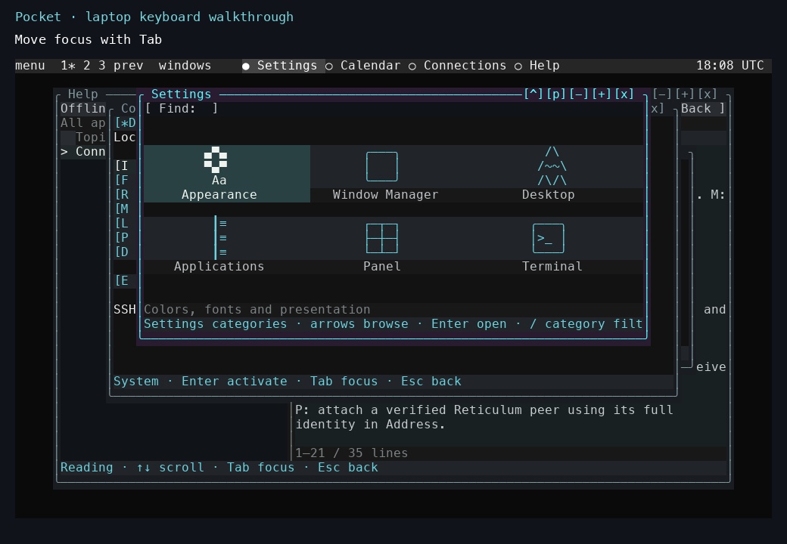

# Integrating the Pocket applications into version 0.1.0

*Source release recorded on 3 November 2026; journal entry revised on 4 November.*

Pocket 0.1.0 gave the integrated terminal desktop a product version. The release brought map and station views, radio and message applications, shared keyboard navigation, compact panel menus, and service selection into the same source tree.

The map sidebar collected details and filters in a layout sized for the N810. Terrain profiles and radius line-of-sight calculations gained cancellation, a limit on how much refinement each request performs, and separate worker processes on the desktop. A repeater directory supplied details and secondary-radio tuning through the shared owner, including offset and tone configuration with restoration.

The APRS Internet fill remained an explicit option. Observations retained their source so the station view could distinguish radio reception from Internet-supplied positions. Message evidence similarly separated submission, transport progress, and remote acceptance.

Connections could attach System telemetry and the configured radio, Reticulum, and MeshCore services. Each service could connect and become ready independently. Local applications continued to use the same UI while a remote attachment recovered. Commands retained explicit outcomes across timeouts and backend changes.

The desktop also carried Reader, Library, Workbench, CW, terminal applications, and rendering experiments. Their requirements differed: some consumed local files, some needed installed datasets, and some attached to independent services. Keeping those requirements visible made the shell useful across the laptop and tablet.

## See the integrated interface

*Settings in the 4 November laptop walkthrough. The active category has a filled background, the window has an active border, and the bottom line describes the available keys. Help and Connections remain open behind it.*

The [laptop walkthrough](../tutorials/laptop-tour.md) demonstrates the shared window controls on this source tree. The [application reference](../reference/applications.md) links each application's guide and dependencies. The [release notes](../pocket/releases-0.1.0.md) describe the changes included in 0.1.0.

The release notes establish the integrated source scope. The hardware history is recorded by workload: the October LXMF exchange, HTIT resource and recovery trials, console tests, and November graphics runs each identify what was exercised. Everyday responsiveness, broader radio recovery, and clean installation remain ongoing engineering work.

<!-- journal-sources:start -->
## Code, tests and build inputs

| Material | Repository files |
|---|---|
| Implementation | [Integrated launcher](../assets/source/journal/pocket/shell/launch.py.txt) ([GitHub](https://github.com/gordol/n810-revival/blob/main/pocket/shell/launch.py)) [Map view](../assets/source/journal/pocket/shell/offline_map.py.txt) ([GitHub](https://github.com/gordol/n810-revival/blob/main/pocket/shell/offline_map.py)) [Service selection](../assets/source/journal/pocket/shell/device_connection.py.txt) ([GitHub](https://github.com/gordol/n810-revival/blob/main/pocket/shell/device_connection.py)) |
| Checks and fixtures | [Release identity](../assets/source/journal/pocket/tests/test_release_version.py.txt) ([GitHub](https://github.com/gordol/n810-revival/blob/main/pocket/tests/test_release_version.py)) [Line-of-sight refinement](../assets/source/journal/pocket/tests/test_los_resolution.py.txt) ([GitHub](https://github.com/gordol/n810-revival/blob/main/pocket/tests/test_los_resolution.py)) [Service recovery](../assets/source/journal/pocket/tests/test_service_recovery.py.txt) ([GitHub](https://github.com/gordol/n810-revival/blob/main/pocket/tests/test_service_recovery.py)) [UI navigation](../assets/source/journal/pocket/tests/test_navigation_audit.py.txt) ([GitHub](https://github.com/gordol/n810-revival/blob/main/pocket/tests/test_navigation_audit.py)) |
| Build inputs | [Pocket build targets](../assets/source/journal/pocket/Makefile.txt) ([GitHub](https://github.com/gordol/n810-revival/blob/main/pocket/Makefile)) [Nokia package builder](../assets/source/journal/pocket/tools/package_nokia.py.txt) ([GitHub](https://github.com/gordol/n810-revival/blob/main/pocket/tools/package_nokia.py)) [Offline suite runner](../assets/source/journal/tools/check-source.py.txt) ([GitHub](https://github.com/gordol/n810-revival/blob/main/tools/check-source.py)) |

[Build and test instructions](../how-to/validate.md) · [Chronological source index](../reference/journal-sources.md#2026-11-04-pocket-0-1-0)
<!-- journal-sources:end -->

[Journal](../journal.md) | [Application reference](../reference/applications.md)

[Previous entry](2026-11-03-mbx-rendering.md) | [Next entry](2026-11-04-gpu-performance.md)
