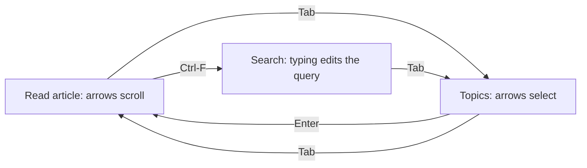
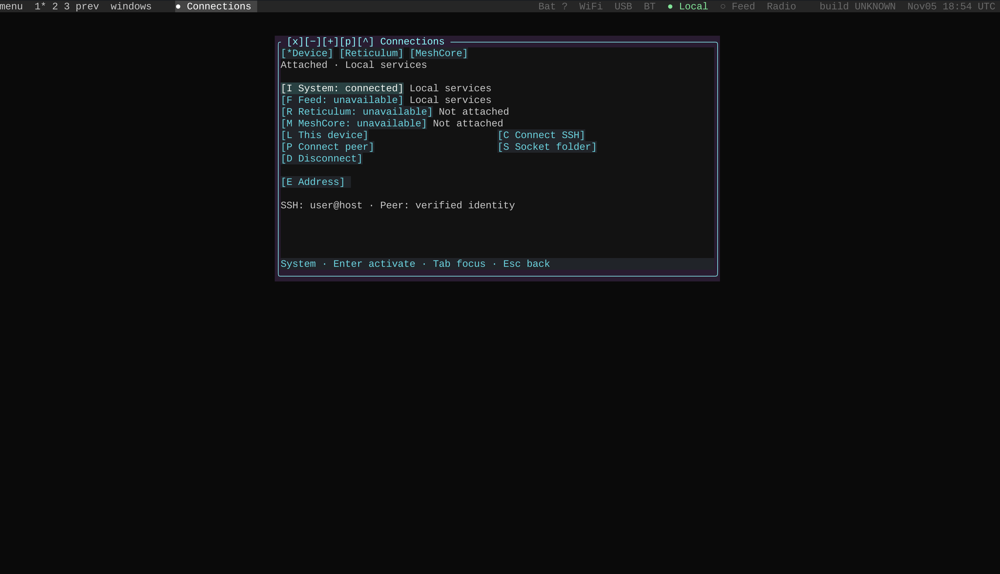

# Following our own keyboard instructions

*5 November 2026, with the resulting navigation checks consolidated on 6 and 7 November.*

Opening Help exposed a basic problem with the desktop: the instructions described one focus model while the running application used another. The help text suggested that the arrow keys selected topics. In the initial reading pane, they scrolled the article instead. Tab could take two presses to reach the topics, and focusing the apparent search field did not necessarily start text entry.

The failure mattered beyond Help. An application can draw a selected row while the shared navigation wrapper believes another control owns the keyboard. Testing the form directly can make every method appear correct while a real user still sends keys to the wrong target.

## Put the visible pane and keyboard focus together

Help opens with the article ready to read. Up and Down scroll that article; J and K provide the same movement. Tab moves to the topics, where Up and Down select a topic. Enter opens the selected topic and returns focus to its article. Ctrl-F enters search, and ordinary typing changes the query. Enter activates a selection; Tab changes focus.

The regression test now sends keys through `native_key`, the dispatcher used by the desktop's navigation wrapper. It asks the presentation layer to draw between operations, checks both the selected topic and reading position, and repeats the sequence at narrow and wide widths. This catches a disagreement between what the screen shows and where the next key goes.

The checks also cover application help that becomes available after the Help browser was created. Applications are loaded lazily, so collecting all their help once at browser startup left later applications without their pages. Looking up the current application's help when it is opened keeps that information available.

## Follow the outer application path

The review expanded to the registered applications: lists, detail panes, text fields, tabs, and action buttons. Connections supplied another concrete mismatch. Its tab strip was visible, but the generic focus order did not initially correspond to that strip. The later correction aligned the registered application's focus target with the drawn controls and preserved address edits when navigation left the input.

The isolated Docker terminal tour opened 23 registered native views, exercised Tab and Shift-Tab, entered and cancelled window selection, and looked up a public radio-club record. The outer terminal wrapper was exercised as well as the individual forms. These are laptop/container interaction results; physical touchscreen behavior has its own validation path.

## Start from the screen a new user gets

The first-session guide now begins with a fresh local session. The Connections window reports local system services and the availability of each optional provider. Its screenshot shows that initial state, so readers can compare their first launch directly with the guide.

*Fresh laptop session captured on 5 November. System is attached locally; the remaining services show their own availability.*

Run `make` from the `pocket` directory, then follow [Your first Pocket session](../tutorials/first-session.md). The [navigation manual](../pocket/navigation.md) describes the shared controls. The implementation and regression tests below record the focus contract used by the desktop.

<!-- journal-sources:start -->
## Code, tests and build inputs

| Material | Repository files |
|---|---|
| Implementation | [Help browser](../assets/source/journal/pocket/shell/on_device_manual/browser.py.txt) ([GitHub](https://github.com/gordol/n810-revival/blob/main/pocket/shell/on_device_manual/browser.py)) [Navigation dispatcher](../assets/source/journal/pocket/shell/native_navigation.py.txt) ([GitHub](https://github.com/gordol/n810-revival/blob/main/pocket/shell/native_navigation.py)) |
| Checks and fixtures | [Help focus regression](../assets/source/journal/pocket/tests/test_help_focus.py.txt) ([GitHub](https://github.com/gordol/n810-revival/blob/main/pocket/tests/test_help_focus.py)) [Application focus checks](../assets/source/journal/pocket/tests/test_app_focus_consistency.py.txt) ([GitHub](https://github.com/gordol/n810-revival/blob/main/pocket/tests/test_app_focus_consistency.py)) |
| Build inputs | [Pocket build targets](../assets/source/journal/pocket/Makefile.txt) ([GitHub](https://github.com/gordol/n810-revival/blob/main/pocket/Makefile)) |

[Build and test instructions](../how-to/validate.md) · [Chronological source index](../reference/journal-sources.md#2026-11-05-help-and-input)

The linked files are the reconciled current source. The post identifies the historical observations and their validation scope.
<!-- journal-sources:end -->
