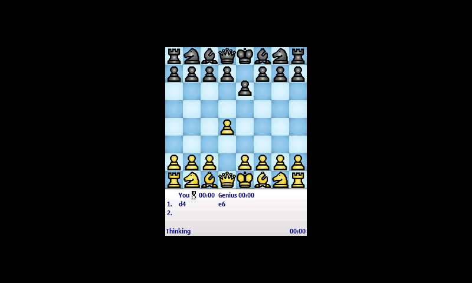
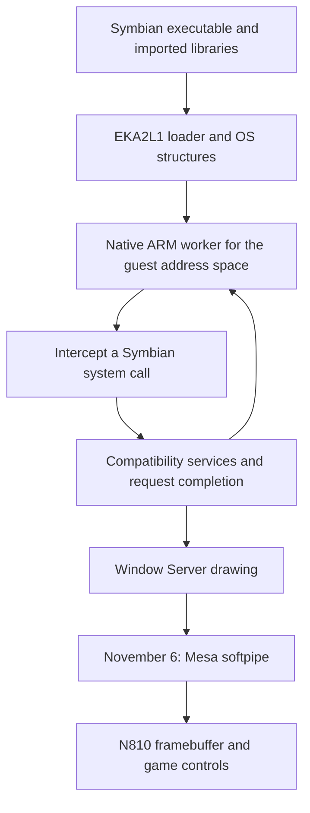

# Playing a Symbian chess game through native ARM execution

*6 November 2026. Reconstructed on 7 November from the native-runtime tests and framebuffer captures.*

ChessGenius reached a playable board on the N810. We moved the white pawn from d2 to d4, and the game replied with e7 to e6. Its ARM instructions executed on the Nokia's CPU through an experimental compatibility runtime. The graphics for this milestone came from Mesa's CPU renderer, softpipe.

*An actual 800 × 480 N810 framebuffer capture from the November 6 run. The centered game surface and move list show the completed interaction. This capture records software-rendered graphics; the following day's [GPU investigation](2026-11-07-symbian-surfaces.md) has separate acceptance results. ChessGenius artwork belongs to its respective rights holders.*

## Reuse the operating-system model, then replace execution

The starting point was [EKA2L1](https://github.com/EKA2L1/EKA2L1), an existing Symbian emulator. Its executable loader, process and kernel structures, imported-library handling, and Window Server supplied much of the compatibility machinery. The Window Server is the service through which applications create windows and request drawing. Our work added an explicit native execution backend and a Linux display path around those existing interfaces.

An application needs both its ordinary CPU instructions and the operating-system behavior those instructions request. The backend runs ARM, Thumb, and VFP instructions in unprivileged Linux worker processes. Each live guest address space has its own worker. A supervisor intercepts Symbian system calls before Linux dispatch and passes them to the compatibility runtime. The tested native path executes ordinary instructions directly.

Small tests came before the game. They exercised memory swapping, the tick counter, and an asynchronous delay through actual imported library functions. The delay request remained pending until its completion, then returned through the guest's wait operation. This checked that the runtime could preserve a request's lifetime across the native/host boundary.

## The CPU boundary had several sharp edges

The ARM1136 rejected two user thread-ID register instructions used by the supplied libraries. The backend handles those exact instructions while leaving ordinary code on the native path. Linux tracing also temporarily replaced register r12 with a system-call marker. A checked undefined-instruction trap gave the supervisor a point at which it could recover the real register value.

Shared mappings needed compatible address alignment in the host and worker. Executable pages had to contain their final bytes before instruction-cache maintenance. Reusing an address-space identifier needed a new worker when its generation changed; otherwise an old process mapping could survive into a different guest process. The physical regression covered these cases, thread-local storage, shared memory, and code invalidation.

These checks established the behavior needed by the test applications. Running arbitrary hostile binaries would require a separate security review of the worker and supervisor boundary.

## Profile the drawing path instead of guessing about native execution

Early launches took minutes. A sampled run placed approximately 79% of host CPU samples on the graphics thread, with texture conversion, linear sampling, and shader execution among the largest named costs. That directed the next work toward software rendering and memory pressure.

One bug was particularly concrete. The private softpipe texture cache had two direct-mapped entries. Bilinear filtering holds several sample pointers at once; colliding entries could overwrite a sample before interpolation finished. A larger, smaller-tile variant reduced drawing CPU in a probe but still failed image correctness. It was rejected. The replacement cache used associative lookup and least-recently-used eviction, followed by independent interpolation comparisons and exact image comparisons across cache layouts.

Resource lifetime mattered too. Caches became owned by the sampler views that actually used them. Shader objects were detached and compiler memory released. In the authored lifetime probe, allocated heap fell from 14,712,544 to 1,979,616 bytes. That measurement describes the probe's heap, rather than total application memory.

Presentation then copied the completed image directly to the framebuffer. Three nonuniform frames matched the earlier shader-copy path exactly, including orientation. The initial chessboard also matched the previous accepted board byte for byte.

## A correct board, a move, and a clean exit

In the later run, the first partial UI appeared at 86.716 seconds and its first panel presentation at 91.473 seconds. The preceding run recorded 323.711 and 329.459 seconds. The complete board was captured around 230 seconds in the later run, followed by the move and reply shown above. These are single-run startup observations under substantial memory pressure. They describe several distinct milestones within startup.

The memory measurements needed their own correction: the first supervisor relied on a kernel process-list file that was absent, silently omitting native workers. Later measurements used an explicit worker manifest and checked ownership. Earlier aggregate-memory claims were withdrawn.

After a requested stop, the later run completed graphics destruction and returned normally. The desktop and display mode were restored, and the boot identifier remained unchanged. This gave us a concrete compatibility result and a measured reason to pursue GPU drawing next.

The runtime changes and application-specific build inputs remain experimental. The [Symbian roadmap](../roadmap.md#run-selected-symbian-games-on-linux) tracks the remaining integration. The linked upstream project supplies the reused OS model; the published [MBX checkpoint](../how-to/build-gpu-30fps.md) supplies the separate graphics foundation. Proprietary ROM, library, and game inputs remain user-supplied.

<!-- journal-sources:start -->
## Source availability

[Chronological source index](../reference/journal-sources.md#2026-11-06-native-symbian)

The native backend extends EKA2L1. Its loader, kernel/service model, and Window Server come from that upstream project, linked in the narrative. The native backend and physical acceptance runner remain experimental and await a public source checkpoint.
<!-- journal-sources:end -->

[Journal](../journal.md) · [Next: the GPU surface requirements](2026-11-07-symbian-surfaces.md)
