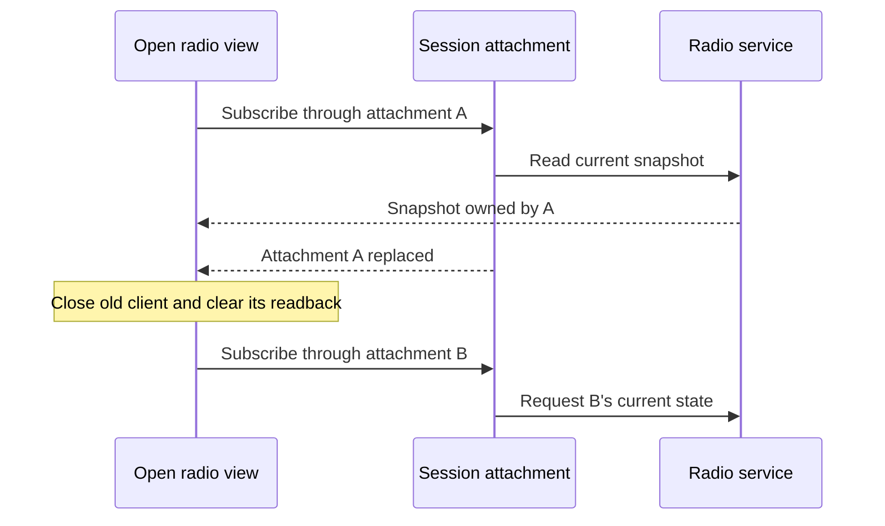

# Keeping session state correct across reconnects

*6 November 2026; disconnected-radio reporting was tightened on 7 November.*

Pocket lets a laptop attach to services running on the Nokia while keeping the same application windows open. That convenience exposed a stale-state bug: a window could retain an earlier radio readback after disconnecting and creating a replacement attachment.

The forwarded Unix socket had the same pathname after reconnecting. Comparing that string made the new connection look like the old one. A pathname identifies where a client connects; it does not identify the lifetime of the service attachment behind it.

## Track the attachment that owns the data

The fix ties retained radio readback to the underlying attachment identity. Replacing an attachment closes the old read client and clears its explicit readback. New data belongs to the replacement attachment, even when its forwarded socket has the same name.

A regression reproduces the important detail: two attachment objects use the same forwarded pathname. The expected behavior is still a reset. Keeping only a test that changes the path would miss the original failure.

## Verify providers, then the visible desktop

The updated radio-state and Connections modules were installed on the Nokia. Laptop providers completed two attach/disconnect/reconnect cycles, deliberately reusing the forwarded pathname and checking that injected stale readback disappeared. The installed Nokia providers completed corresponding local-service cycles.

The next check used the visible Connections window on the tablet. Disconnecting changed System to unavailable; reconnecting restored its connected state. The independent Reticulum and MeshCore owners retained their own state. This established that changing one attachment did not imply restarting every acquisition service.

For abrupt loss, the test terminated only its private SSH connection. The session created a replacement attachment and reconnected successfully. Other clients and the tablet's Wi-Fi configuration were left running. That test exercised connection recovery under a deliberately broken transport.

The radio-control owner remained a separate boundary. A running receive service and an older stored snapshot could not establish a current radio status read. Connections reported Feed unavailable while the control endpoint was absent. The following day's reporting change also stopped describing APRS reception as active when polling was disabled. Current availability and retained observations now have distinct jobs in the UI.

## Keep carrier selection explicit

The native Reticulum owner also gained direct serial and raw KISS carrier paths. KISS frames delimit packets on a byte stream; the carrier adapter supplies that stream to Reticulum. Unsupported routing choices are rejected at selection rather than silently falling through to an unrelated transport.

Use the [Connections guide](../pocket/connections.md) for attachment controls and the [radio explanation](../explanation/radio.md) for the independent acquisition owners. The source and tests below cover attachment lifetime and retained state. Live radio control and over-the-air delivery require their own observations for the selected hardware and transport.

<!-- journal-sources:start -->
## Code, tests and build inputs

| Material | Repository files |
|---|---|
| Implementation | [Radio state ownership](../assets/source/journal/pocket/shell/radio_state.py.txt) ([GitHub](https://github.com/gordol/n810-revival/blob/main/pocket/shell/radio_state.py)) [Session attachments](../assets/source/journal/pocket/shell/system_links.py.txt) ([GitHub](https://github.com/gordol/n810-revival/blob/main/pocket/shell/system_links.py)) |
| Checks and fixtures | [Retained radio snapshots](../assets/source/journal/pocket/tests/test_radio_snapshot_cache.py.txt) ([GitHub](https://github.com/gordol/n810-revival/blob/main/pocket/tests/test_radio_snapshot_cache.py)) [Attachment tests](../assets/source/journal/pocket/tests/test_system_attachment.py.txt) ([GitHub](https://github.com/gordol/n810-revival/blob/main/pocket/tests/test_system_attachment.py)) |
| Build inputs | [Pocket build targets](../assets/source/journal/pocket/Makefile.txt) ([GitHub](https://github.com/gordol/n810-revival/blob/main/pocket/Makefile)) |

[Build and test instructions](../how-to/validate.md) · [Chronological source index](../reference/journal-sources.md#2026-11-06-session-recovery)

The linked files are the reconciled current source. The post identifies the historical observations and their validation scope.
<!-- journal-sources:end -->
