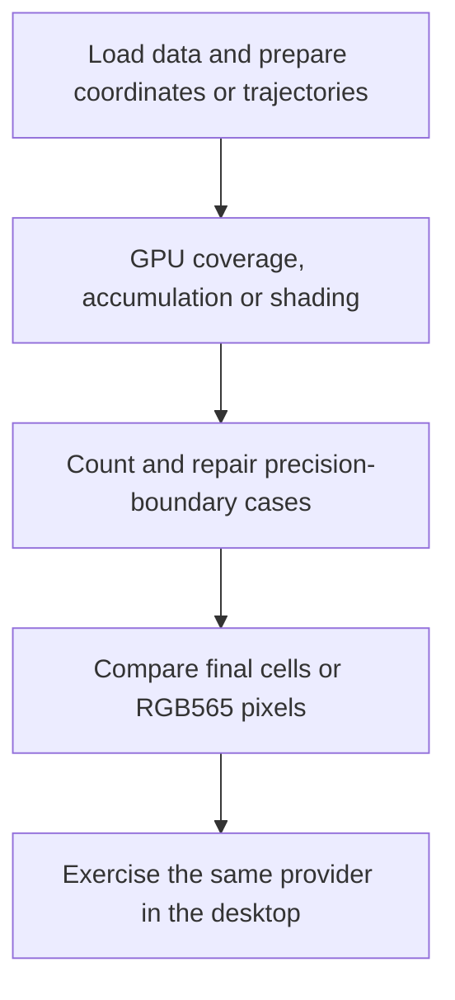

# Moving desktop effects and terrain work onto the Mac GPU

*7 November 2026. Experimental Mac GPU provider, with exact-output comparisons.*

After the [direct desktop frontend](2026-11-07-native-desktop.md) worked, the next question was which existing producers and composition stages could move onto the GPU while preserving their output. The work covered Flux, Flurry, window composition, Station Map, and terrain. Each needed a comparison with the existing renderer and counters identifying the work actually submitted.

The provider uses OpenGL for several cell-oriented passes and [Metal](https://developer.apple.com/metal/) for integer pixel composition, map shading, and terrain work. The N810's MBX requires its own supported graphics operations and validation. The Mac implementation gives us a working platform-specific path and a reference for shared interfaces.

## Keep trajectories and move accumulation and shading

Flux and Flurry already had established motion and appearance. Their trajectory preparation remained on the CPU. GPU passes accumulated their contributions and shaded the resulting colors. Tests compared glyphs and ink values against the existing producers across sizes, speeds, and ASCII mode.

Floating-point precision mattered at quantization boundaries. A tiny difference before conversion can select a different final color. The provider counts samples requiring the canonical CPU correction rather than silently accepting a different palette. That makes the remaining CPU work visible in the result.

## Preserve RGB565 rounding in translucent windows

Window composition combines text, materials, shadows, and underlying content. Opaque and unfilled cases passed before some translucent panes did. An early GPU-alpha candidate differed in 34,082 pixels at 88% opacity, although each difference was at most one RGB565 channel step. This was enough to reject equivalence.

The later programmable path implemented the integer arithmetic required by the existing RGB565 compositor. The Metal pixel checks covered all 256 alpha values, clipped windows, coverage masks, and shadows with zero pixel differences. Cell composition covered 17 combinations, including filled and unfilled panes and underlying text, with exact results after counted corrections.

Correct pixels and faster frames are separate questions. An earlier local composition workload was faster with native C, so that candidate kept C as its default. The broader GPU provider has correctness and execution evidence; a matched end-to-end timing comparison remains necessary before claiming a speedup.

## Accelerate the active map path

The desktop's Station Map used the newer digital elevation model (DEM) renderer. Work on a separate prepared-map path alone would have missed what the visible app was doing. The provider therefore added GPU gradient, relief, and color calculations to the active DEM path, alongside prepared half-cell sampling and geographic vector shading.

The DEM comparison covered 88,007 samples with exact RGB output. Geographic source selection, data loading, elevation gathering, coordinate preparation, and vector geometry remain CPU responsibilities. The GPU receives prepared inputs for the stages it implements.

## Compare the final terrain, then run it inside windows

Terrain tests first checked triangle coverage, depth selection, and retained interpolation weights across three uncached scenes. Lighting and atmospheric/water shading followed. Summer, winter, and autumn scenes matched their existing final cells. Real Tahoma terrain and Station Map data were then compared at 80 × 24 and 160 × 54 cells; all four comparisons had zero final-cell differences.

Those results still include CPU preparation and repairs. For example, the recorded real-scene test counted 200 terrain edge-repair pixels and 2,916 DEM precision samples. Mesh and camera preparation, geographic input loading, exact retained weights, and some overlays remain on the CPU. These counters explain the actual split of work.

A combined desktop run exposed a resize crash: pixel composition could request a window plane before it had been prepared. After that fix, the test completed 738 frames without form errors. It exercised Room/window interaction, nine GPU DEM frames, two GPU coverage builds, and five GPU terrain-lighting frames. The exit audit separately reported missed application-view notifications, leaving session-save correctness as a follow-up.

This records exact-output and runtime-execution evidence on the Mac. Current rendering still includes readbacks, CPU buffers, and presentation uploads. The source integration, clean-checkout build, persistent-session fix, and matched performance measurements are tracked in the [roadmap](../roadmap.md#native-graphical-desktop-and-interactive-scenes). The underlying [cell and console interfaces](../explanation/rendering.md) continue to define the terminal path.

<!-- journal-sources:start -->
## Published CPU reference implementations

| Material | Repository files |
|---|---|
| Implementation | [Flux producer](../assets/source/journal/pocket/shell/flux.py.txt) ([GitHub](https://github.com/gordol/n810-revival/blob/main/pocket/shell/flux.py)) [Flurry producer](../assets/source/journal/pocket/shell/flurry.py.txt) ([GitHub](https://github.com/gordol/n810-revival/blob/main/pocket/shell/flurry.py)) [DEM preparation and shading](../assets/source/journal/pocket/shell/desktop_elevation.py.txt) ([GitHub](https://github.com/gordol/n810-revival/blob/main/pocket/shell/desktop_elevation.py)) |

[Chronological source index](../reference/journal-sources.md#2026-11-07-gpu-effects)

The Mac OpenGL/Metal provider and its exact-output comparison programs are being integrated into the public source build. The results here describe the recorded local provider. The existing published terminal producers remain available in the repository.
<!-- journal-sources:end -->

[Journal](../journal.md) · [Native desktop](2026-11-07-native-desktop.md)
