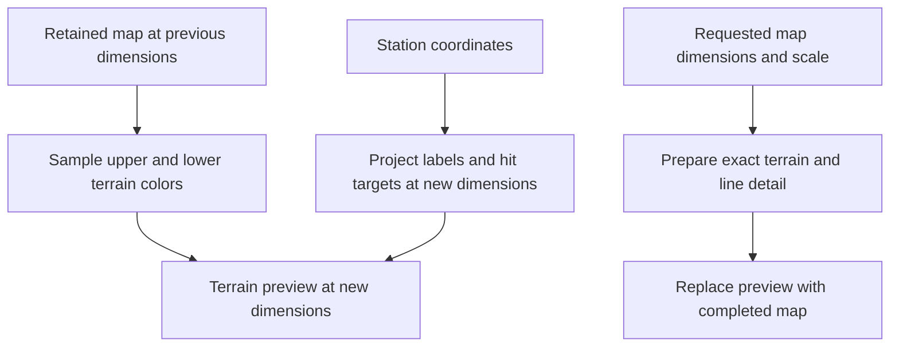
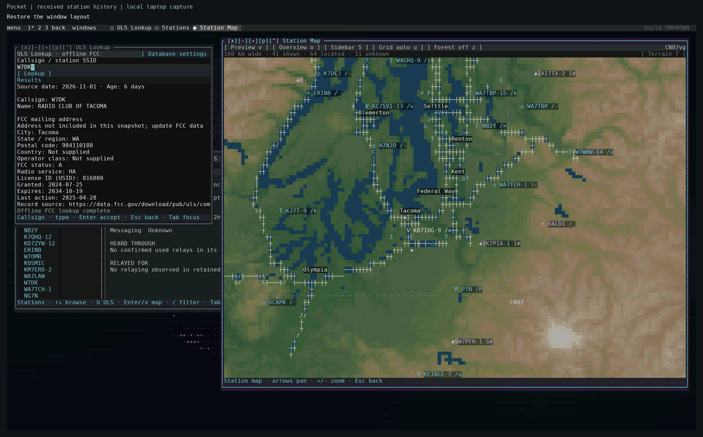

# Resizing the map without stretching its annotations

*7 November 2026.*

The homepage recording exposed a map defect clearly: resizing the terminal left doubled lines and repeated detail while the next view loaded. The recording preserved the behavior of the November 6 implementation. Converting it to a GIF also preserved the defect.

The map keeps a previous image available while a worker prepares the requested view. This makes navigation usable during expensive terrain work. The previous image contains terminal cells, however, and a cell can represent two different kinds of information: terrain colors in its upper and lower halves, or a character such as a road stroke or station label.

## Resample terrain and project annotations separately

The retained-image path had treated those cells alike during a scale change. Repeating a cell repeats its character as well as its colors. A road stroke stretched into several cells becomes several road strokes. Reusing station annotations at the old dimensions also disagrees with the new screen positions and click targets.

The corrected path samples each terrain half-cell separately. It can rebuild a colored preview at the requested dimensions without copying road characters into stripes. Station annotations are projected at the displayed size, and hit targets use that same geometry. When the exact view completes, its newly rendered detail replaces the interim preview.

A same-scale pan can preserve useful existing glyphs because their scale remains unchanged. Repeated pans also flatten the sampling maps back to their original source; they do not grow a chain of images that each has to sample the preceding image.

The regression builds a small two-color terrain image, enlarges it, and checks the resulting half-cell colors. A second input contains road glyphs and verifies that scaling produces terrain-colored cells rather than repeated strokes. A station test then verifies one projected label and the matching click target at the resized dimensions. These tests make the separate responsibilities explicit.

*Recorded on 7 November in an isolated Linux terminal session using filtered historical station reports. The edited loop plays at twice its recorded speed and omits brief partial redraws. It shows the corrected source at both terminal sizes. The [homepage](../index.md) includes a pause control and a still-frame alternative.*

## Reduce the work behind the preview

The renderer had padded a retained detail region by half of the visible width and height on each side. That produces roughly four times the visible area. The new padding uses one eighth on each edge, approximately 1.56 times the visible area. It retains room for nearby pans while reducing the amount of terrain prepared for a new view.

Elevation sampling also became selective. After choosing a display overview, the sampler gathers fine elevation only for unresolved land pixels. Known water and pixels already covered by a suitable overview avoid fine-tile reads. A packed color lookup preserves the existing RGB565 quantization while removing repeated arithmetic from that conversion.

## Build one elevation catalogue and derive its views

The map build now starts with selected areas and one fine elevation catalogue. Local display overviews serve terminal and desktop rendering, while profile and line-of-sight readers retain access to fine samples. This gives the different readers a common source without requiring each to acquire its own regional copy.

The [map build guide](../how-to/build-map-data.md) explains the inputs and commands. `make maps-plan` reports reusable work and remaining exports. The integrated area-and-layer download pane remains on the [roadmap](../roadmap.md); the current selection workflow uses commands and saved configuration.

See the [map rendering reference](../pocket/map-rendering.md) for cache limits and the [rendering explanation](../explanation/rendering.md) for how colors, glyphs, and retained layers fit together. The source checks below cover the algorithm; the replacement documentation capture is a separate visual check of the running application.

<!-- journal-sources:start -->
## Code, tests and build inputs

| Material | Repository files |
|---|---|
| Implementation | [Retained map sampling](../assets/source/journal/pocket/shell/offline_map.py.txt) ([GitHub](https://github.com/gordol/n810-revival/blob/main/pocket/shell/offline_map.py)) [Station projection](../assets/source/journal/pocket/shell/station_workspace.py.txt) ([GitHub](https://github.com/gordol/n810-revival/blob/main/pocket/shell/station_workspace.py)) [Elevation sampling](../assets/source/journal/pocket/shell/desktop_elevation.py.txt) ([GitHub](https://github.com/gordol/n810-revival/blob/main/pocket/shell/desktop_elevation.py)) [Map build commands](../assets/source/journal/pocket/tools/maps.py.txt) ([GitHub](https://github.com/gordol/n810-revival/blob/main/pocket/tools/maps.py)) |
| Checks and fixtures | [Resize and sampling regressions](../assets/source/journal/pocket/tests/test_map_latency_regressions.py.txt) ([GitHub](https://github.com/gordol/n810-revival/blob/main/pocket/tests/test_map_latency_regressions.py)) [Incremental regions](../assets/source/journal/pocket/tests/test_map_incremental_regions.py.txt) ([GitHub](https://github.com/gordol/n810-revival/blob/main/pocket/tests/test_map_incremental_regions.py)) |
| Build inputs | [Pocket build targets](../assets/source/journal/pocket/Makefile.txt) ([GitHub](https://github.com/gordol/n810-revival/blob/main/pocket/Makefile)) |

[Build and test instructions](../how-to/validate.md) · [Chronological source index](../reference/journal-sources.md#2026-11-07-map-resizing)

The linked files are the reconciled current source. The post identifies the historical observations and their validation scope.
<!-- journal-sources:end -->
