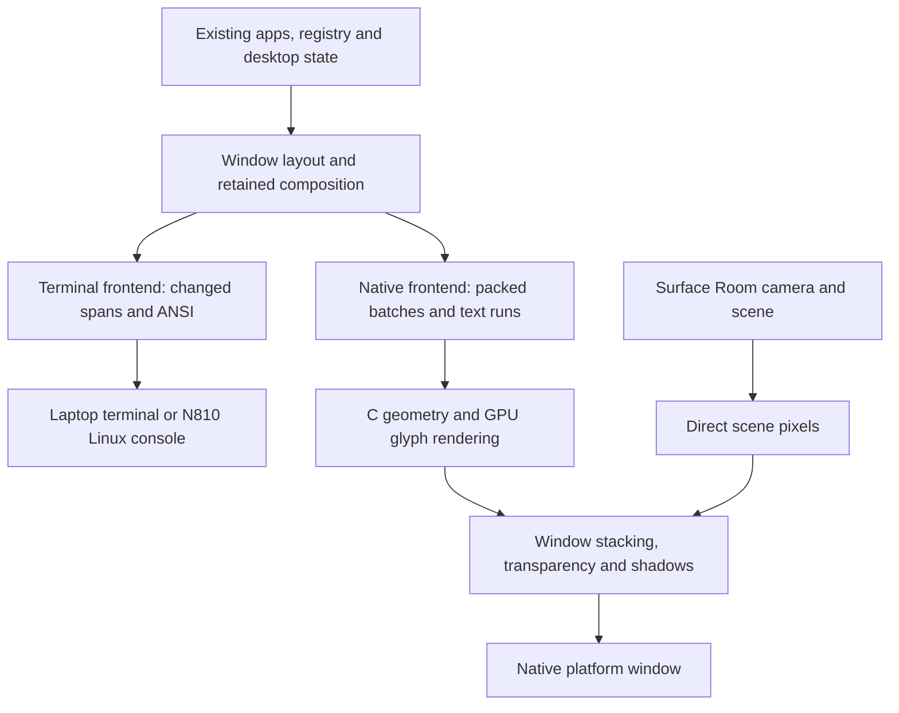
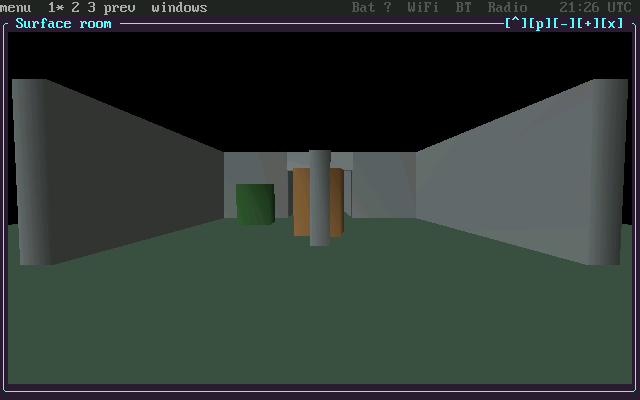

# Running the Pocket desktop in a native Mac window

*7 November 2026. Local Mac results, followed by source-build integration.*

Pocket began with cells sent to a terminal. The [console RGB work](2026-10-16-16-bit-console.md) preserved their colors on the N810, and the desktop grew around retained cell layers, input dispatch, windows, and application ownership. A native graphical frontend lets us keep those application interfaces while choosing how their contents reach pixels.

The first Mac experiment drew recorded block cells through OpenGL. It understood spaces and full or half blocks, with a separate color for each half. Its independent pixel check was useful, but it covered only that small vocabulary. Ordinary text, input, application state, and window lifetime needed the rest of the desktop.

The [Surface Room recording](2026-11-07-surface-room.md) shows the native window in use, with movement, aiming, firing, and target resets at normal speed.

## First carry the terminal, then attach to the model

A compatibility launcher ran the real desktop through a pseudo-terminal (PTY), parsed its ANSI output in C, and drew glyphs in a native window. That exercised the existing app catalogue and input handlers. Synchronized-output markers delayed presentation until a coherent terminal update was available.

The direct frontend subsequently attached to the existing `shell.desktop` model. Its platform adapter supplies input, dimensions, presentation, and cleanup. The app registry, launcher, panels, Settings, service ownership, and session lifetime continue through the same desktop implementation. The renderer consumes native composition records directly, and structured text runs draw the panels.

The normal Terminal application still owns a PTY for its child process. That is a separate relationship from the desktop-to-renderer interface. A terminal inside the graphical desktop remains a terminal application.

The [integrated frontend source](https://github.com/gordol/n810-revival/tree/d7cbc64d8324e4f948426b37fc91c46fe32d73ff/pocket/graphics) records this boundary. Its [full desktop adapter](https://github.com/gordol/n810-revival/blob/d7cbc64d8324e4f948426b37fc91c46fe32d73ff/pocket/graphics/full.py) and [pixel interface](../pocket/graphics.md) describe the integrated boundary. The [graphical frontend guide](../pocket/graphics.md) gives the dependencies, Makefile commands, and test path.

## Let a scene use its actual window resolution

Surface Room retains its camera and input model, while its graphical renderer submits the scene's 632 triangles directly. The scene image occupies the window's pixel area. Controls and other text remain part of the desktop's cell/text interfaces.

*Local Mac GPU output captured on 7 November. This is the frontend's rendered image, with Surface Room at pixel resolution inside the shared desktop. It is an intermediate 640 × 400 capture; later tests also exercised changing window sizes.*

The renderer divides drawing into targets up to 400 × 400 pixels. A 640 × 368 Room image therefore requires two tile jobs. Comparing different tile subdivisions exposed depth artifacts with a 16-bit depth buffer. Requesting 24-bit depth removed those artifacts. The local Mac comparison then had zero subdivision differences; the ARM software reference retained a one-channel-step difference in one pixel between its tested subdivisions.

Transparent windows required another pass. An early launcher forced opaque windows while overlapping direct images were unsupported. The subsequent compositor cached native RGB565 images and alpha values for window chrome, shadows, and overlays, replaying them in window order. Moving a window reused its cached layer; closing it released that layer. Tests compared clipped overlap and transparency against an independent pixel calculation.

## Resize the desktop, and check the edges

The early native window scaled an 800 × 480 logical canvas. The later adapter reports actual content dimensions, resizes the desktop grid at the existing 8 × 16 font size, and recreates the relevant render buffers. Existing layout code then repositions panels and windows.

An operating-system resize test exercised 100 × 30, 140 × 50, 80 × 28, and 160 × 54 cells with Room open. It completed 164 frames and 397 Room tile jobs with no form errors. Separate checks compared full pixel output and memory guards, including partial tiles and invalid dimensions.

A border bug left old pixels in presentation margins after resizing. Clearing the complete presentation target before copying the current image fixed the tested cases. A negative control reproduced 200,000 stale margin pixels, showing that the test could detect the defect it was intended to prevent.

The full-desktop acceptance run covered the 24 registered apps, menu actions, Messages, Settings, Terminal, Room, and changing grid dimensions. It recorded 533 frames and 1,036 Room tile jobs without form errors. Those are coverage counts; performance needs matched timing measurements. GPU readbacks, CPU image buffers, and presentation uploads remain in the current path.

The [rendering explanation](../explanation/rendering.md) now places this frontend beside the console path. The [next entry](2026-11-07-surface-room.md) follows the interactive Room experiment, and [GPU effects](2026-11-07-gpu-effects.md) records the later acceleration of existing desktop producers.

## Build it from the repository

The source integration includes the SDL input adapter, native renderer, font preparation, Room mesh generator, optional Mac compute provider, and build-input identities. A fresh clone built the Mac frontend and passed 22 focused tests. The integrated desktop check exercised the 24-app registry, direct Room, menu actions, and two grid resizes. Linux container checks built and exercised the frontend through explicitly selected software OpenGL, and cross-built the ARM framebuffer presenter.

From `pocket/`, `make gui` checks the native build and opens the graphical desktop; `make graphics-check` runs its isolated acceptance sequence. The [build guide](../pocket/graphics.md) lists compiler, SDL, OpenGL, and optional Mac compute dependencies. Physical Nokia installation and mixed-state MBX rendering remain separate validation work.

<!-- journal-sources:start -->
## Code, tests and build inputs

| Material | Repository files |
|---|---|
| Implementation | [Shared platform adapter](../assets/source/journal/pocket/graphics/full.py.txt) ([GitHub](https://github.com/gordol/n810-revival/blob/main/pocket/graphics/full.py)) [Native launcher](../assets/source/journal/pocket/graphics/run.py.txt) ([GitHub](https://github.com/gordol/n810-revival/blob/main/pocket/graphics/run.py)) [Pixel composition](../assets/source/journal/pocket/graphics/pixel_compositor.py.txt) ([GitHub](https://github.com/gordol/n810-revival/blob/main/pocket/graphics/pixel_compositor.py)) |
| Checks and fixtures | [Desktop acceptance runner](../assets/source/journal/pocket/graphics/check.py.txt) ([GitHub](https://github.com/gordol/n810-revival/blob/main/pocket/graphics/check.py)) [Frontend tests](../assets/source/journal/pocket/tests/test_graphical_frontend.py.txt) ([GitHub](https://github.com/gordol/n810-revival/blob/main/pocket/tests/test_graphical_frontend.py)) [Build-input tests](../assets/source/journal/pocket/tests/test_graphics_build_inputs.py.txt) ([GitHub](https://github.com/gordol/n810-revival/blob/main/pocket/tests/test_graphics_build_inputs.py)) |
| Build inputs | [Native build](../assets/source/journal/pocket/graphics/build.py.txt) ([GitHub](https://github.com/gordol/n810-revival/blob/main/pocket/graphics/build.py)) [Source identities](../assets/source/journal/pocket/graphics/SOURCES.json.txt) ([GitHub](https://github.com/gordol/n810-revival/blob/main/pocket/graphics/SOURCES.json)) [Make targets](../assets/source/journal/pocket/Makefile.txt) ([GitHub](https://github.com/gordol/n810-revival/blob/main/pocket/Makefile)) [Optional Mac compute dependencies](../assets/source/journal/pocket/requirements-graphics-macos.txt.txt) ([GitHub](https://github.com/gordol/n810-revival/blob/main/pocket/requirements-graphics-macos.txt)) |

[Build and test instructions](../pocket/graphics.md) · [Chronological source index](../reference/journal-sources.md#2026-11-07-native-desktop)

Source integration: [d7cbc64](https://github.com/gordol/n810-revival/commit/d7cbc64d8324e4f948426b37fc91c46fe32d73ff). The linked files are included in this checkout. Historical Mac captures and measurements describe their dated experimental runs; Linux software-GL checks and ARM cross-builds establish separate build/test results.
<!-- journal-sources:end -->

[Journal](../journal.md)
