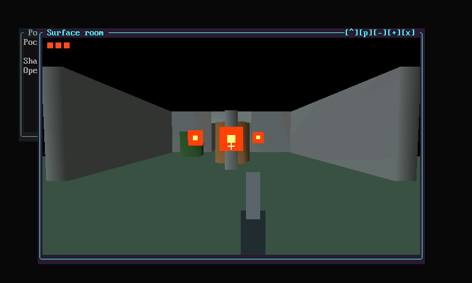
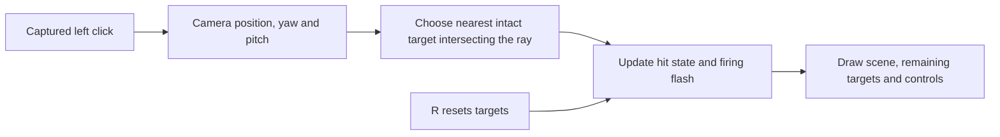

# Adding movement, aiming, and targets to Surface Room

*7 November 2026. Experimental native Mac interaction and rendering.*

Surface Room gave the [native frontend](2026-11-07-native-desktop.md) a scene with geometry, lighting, a camera, and a visible response to input. Adding a small target range made input and rendering failures easier to expose. A shot has to use the camera direction, change target state, update the image, and leave the surrounding desktop usable.

*Local Mac GPU frame captured on 7 November. The weapon, crosshair, targets, and target-state markers are geometry drawn over the Room scene. This capture shows the initial three-target state.*

## Make movement follow held input

The exploration policy handles WASD movement, IJKL look, Shift running at three times walking speed, and Space jumping. The platform supplies key press/release edges and relative mouse deltas. Clicking the focused Room image captures the mouse; Escape releases capture. Focus loss also releases capture and clears held keys and modifiers, preventing a movement key from remaining stuck after switching applications.

SDL's [relative mouse mode](https://wiki.libsdl.org/SDL2/SDL_SetRelativeMouseMode) supplies continuous movement deltas while the cursor is constrained to the window. The shared [exploration policy](https://github.com/gordol/n810-revival/blob/476423b1a9e12ac5029927084c6cafd46af78d0c/pocket/graphics/explore_controls.py) keeps movement decisions separate from that platform mechanism.

Mac text input introduced an unexpected interaction: holding a movement letter could open the accent picker. The movement-only prototype explicitly disabled text input while keeping raw key edges. The complete desktop still needs text input when a text widget owns focus. This made focus ownership part of the input contract rather than a global keyboard preference change.

## A shot checks the current camera ray

The target proof keeps three target positions and a broken/unbroken flag for each. On a shot, it calculates a direction from the camera's yaw and pitch. For every intact target, it projects the vector from the camera to the target onto that direction. A positive projection places the target ahead of the camera. The remaining perpendicular distance determines whether the ray passes within the hit radius.

The closest accepted target becomes broken and increments the hit count. The rendering pass removes its board and changes its corner marker. A short firing flash and recoil offset make the action visible. This is immediate ray-based hit detection (often called hitscan). Extending it to moving projectiles would add travel time, trajectories, and collision checks between successive simulation states.

The game layer saves and restores its OpenGL state. Target boards use the scene projection, while the crosshair and weapon use screen-space drawing for the current tile. Restoring that state matters because Room and the desktop share a graphics context: a screen-space overlay must leave later drawing with the expected projection and depth state.

## Check the state change and the image

The acceptance sequence renders the intact targets, fires an aligned shot, and checks both the hit count and the changed GPU image. A second shot at the destroyed target must produce no new hit. Reset restores all three targets and clears the hit count. Separate native-input tests cover modifiers, wheel events, relative capture, and focus reset.

The experimental controls use **G** to toggle the target layer, captured left click to fire, and **R** to reset. The standalone Room launcher starts with the game layer enabled. The [target logic](https://github.com/gordol/n810-revival/blob/476423b1a9e12ac5029927084c6cafd46af78d0c/pocket/graphics/native/game.c) and [native input adapter](https://github.com/gordol/n810-revival/blob/476423b1a9e12ac5029927084c6cafd46af78d0c/pocket/graphics/native/desktop_input.c) are now included in the source integration. The integrated desktop check exercises Room and resizing; the earlier standalone hit/reset sequence remains separate evidence.

Several fixes came from using the experiment rather than just inspecting a frame. Window overlap originally raised an unsupported-composition exception. The subsequent native pixel compositor supplied ordered translucent layers. Frame pacing also changed to subtract rendering time from the frame budget instead of sleeping for a full interval after drawing. The app reports presentation calls, elapsed wall time, and process CPU separately, so a call count remains distinguishable from physical display refreshes.

The next steps are reproducible target-range tests in the integrated build, interaction checks through the complete desktop, and later physical Nokia validation. The scene, controls, and host results provide the starting evidence for those steps.

<!-- journal-sources:start -->
## Code, tests and build inputs

| Material | Repository files |
|---|---|
| Implementation | [Target game](../assets/source/journal/pocket/graphics/native/game.c.txt) ([GitHub](https://github.com/gordol/n810-revival/blob/main/pocket/graphics/native/game.c)) [Native input](../assets/source/journal/pocket/graphics/native/desktop_input.c.txt) ([GitHub](https://github.com/gordol/n810-revival/blob/main/pocket/graphics/native/desktop_input.c)) [Room pixels](../assets/source/journal/pocket/graphics/native/room_pixels.c.txt) ([GitHub](https://github.com/gordol/n810-revival/blob/main/pocket/graphics/native/room_pixels.c)) [Exploration controls](../assets/source/journal/pocket/graphics/explore_controls.py.txt) ([GitHub](https://github.com/gordol/n810-revival/blob/main/pocket/graphics/explore_controls.py)) |
| Checks and fixtures | [Native input tests](../assets/source/journal/pocket/graphics/native/test_desktop_input.c.txt) ([GitHub](https://github.com/gordol/n810-revival/blob/main/pocket/graphics/native/test_desktop_input.c)) [Desktop and Room integration](../assets/source/journal/pocket/graphics/check.py.txt) ([GitHub](https://github.com/gordol/n810-revival/blob/main/pocket/graphics/check.py)) |
| Build inputs | [Native build](../assets/source/journal/pocket/graphics/build.py.txt) ([GitHub](https://github.com/gordol/n810-revival/blob/main/pocket/graphics/build.py)) [Source identities](../assets/source/journal/pocket/graphics/SOURCES.json.txt) ([GitHub](https://github.com/gordol/n810-revival/blob/main/pocket/graphics/SOURCES.json)) [Make targets](../assets/source/journal/pocket/Makefile.txt) ([GitHub](https://github.com/gordol/n810-revival/blob/main/pocket/Makefile)) [Optional Mac compute dependencies](../assets/source/journal/pocket/requirements-graphics-macos.txt.txt) ([GitHub](https://github.com/gordol/n810-revival/blob/main/pocket/requirements-graphics-macos.txt)) |

[Build and test instructions](../pocket/graphics.md) · [Chronological source index](../reference/journal-sources.md#2026-11-07-surface-room)

Source integration: [476423b](https://github.com/gordol/n810-revival/commit/476423b1a9e12ac5029927084c6cafd46af78d0c). The linked files are included in this checkout. Historical Mac captures and measurements describe their dated experimental runs; Linux software-GL checks and ARM cross-builds establish separate build/test results. The earlier standalone hit/reset acceptance sequence has yet to join the integrated test runner.
<!-- journal-sources:end -->

[Journal](../journal.md) · [Native desktop](2026-11-07-native-desktop.md) · [Roadmap](../roadmap.md#native-graphical-desktop-and-interactive-scenes)
