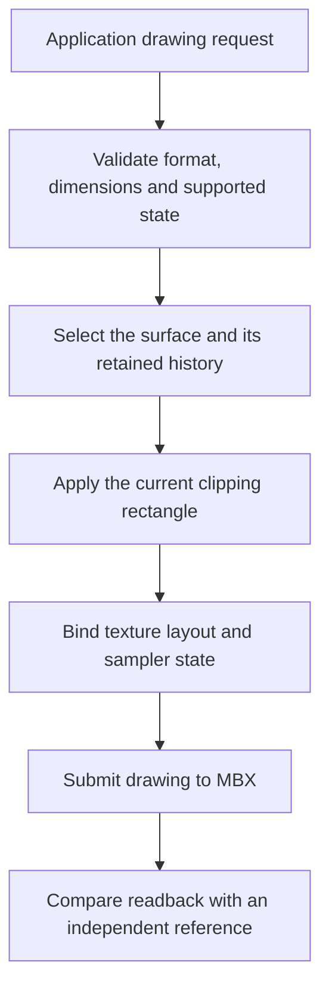

# Teaching the MBX path the drawing operations that Symbian apps use

*7 November 2026. Work in progress, recorded from bounded physical GPU tests.*

The [native ChessGenius result](2026-11-06-native-symbian.md) established executable loading, ARM execution, visible drawing, and a move/reply interaction through software rendering. GPU drawing brought a different set of failures. The [gears checkpoint](2026-11-04-gpu-performance.md) exercised a particular 3D workload; these applications used clears, clipped images, retained surfaces, and different texture formats.

A drawing surface is an image that survives long enough for subsequent operations to read or change it. A window may draw a strip, bind another surface temporarily, then return to its previous image. The driver has to preserve the right contents and state across those operations.

## Clear colors and preserve the rest of the surface

The first general UI obstacle was a black-only clear contract. The candidate driver reused its existing GPU clear shader and changed its color uniforms. It validated normalized, finite color values before submission. Physical black, white, red, and green clears then gave a simple pixel-by-pixel check of the result.

The apps also requested depth/stencil-only clears. Depth stores which geometry is nearer; stencil provides an additional per-pixel mask. A strictly two-dimensional color surface can receive a request to clear unused depth/stencil state. Treating every clear as a fresh color image destroyed history that the application expected to keep.

The next candidate retained submitted color history across temporary target bindings, then gave resources their own bounded command histories. The corresponding physical test completed 31 GPU jobs, 14 exact positive image checks, and six rejected unsupported cases. The regression's four histories occupied 17,652 bytes. This was a measured bound for that test's resources.

## A 25-pixel strip exposed clipping errors

ChessGenius progressed to a 240 × 25 textured draw. A scissor rectangle limits drawing to a rectangular part of the target. An initial attempt changed the viewport to implement that restriction. Its first clipped image differed in 70,800 pixels, so that approach was rejected.

The next investigation used GPU mask geometry. Early packet captures turned out to contain stale startup scenes; conclusions based on missing mask records were withdrawn. Capturing the successful service job with an explicit job identifier made the comparison meaningful.

The corrected sequence first rejects the full region, then admits the clip rectangle for the draw. Clears and ordinary unclipped draws restore full-area allowance. Without that restoration, the mask also blocked the background clear. Six physical cases finally matched exactly: the full image, a 25-pixel strip, an interior rectangle, one-pixel top and left edges, and an empty clip. The starting 76,800-pixel image also matched a separately captured GPU reference.

## Real applications required larger images

Snakes requested a 320 × 320 texture with nearest sampling, repeated wrapping, and opaque alpha. This exceeded the earlier small-resource assumptions. The investigation first brought up a linear image-copy path within the existing allocation, then expanded the source allocation with guards and page-table checks.

The first 64 × 64 copy revealed a useful pattern: every in-bounds output selected source coordinate `(2x+1, 2y+1)`. Halving the texture-coordinate slope corrected the sampling relationship. Two patterns then preserved every color and alpha byte. Larger 240 × 320 and 320 × 320 sources produced 153,600 compared output pixels with zero channel mismatches. Guard checks and source-immutability checks passed.

Ordinary textured primitives were checked next against the independently rendered tiled reference. All 76,800 target pixels matched. Texture-coordinate scale and bias ran on the vertex processor. CPU preparation copied or converted texture storage and prepared addressing borders.

The Mesa adapter exposed another distinction: an RGB image with an unused fourth byte can use a different internal storage format from an RGBA image with meaningful alpha. The first integration accepted RGBA/clamp tests, then rejected RGBX/repeat before submission. The next candidate added explicit storage-format and opaque-alpha validation. That result still needs application-level acceptance.

## Application failures remain useful evidence

Both original applications reached native ARM execution and completed GPU jobs. Their failures differed. ChessGenius exposed clipped drawing and sampler requirements. Snakes reached direct screen access, then exposed a destroyed-window reference during cleanup. Cancelling direct-screen-access objects while their screen and canvas were alive fixed that shutdown path on hardware.

A further mapping correction moved native EKA2 kernel-mapping sections into the worker's usable address range. Snakes then progressed to the sampler rejection. The process lifetime from that run measures a failure path; it cannot stand in for a game launch or frame-rate result.

At this entry's checkpoint, complete visible GPU-backed UI and controls for both applications remain pending. Individual driver tests have exact pixel results. The experimental source has yet to become a reproducible public runtime checkpoint. The [published build guide](../how-to/build-gpu-30fps.md) identifies the earlier driver source readers can currently build, and the [roadmap](../roadmap.md#run-selected-symbian-games-on-linux) records the remaining application work.

<!-- journal-sources:start -->
## Source availability

[Chronological source index](../reference/journal-sources.md#2026-11-07-symbian-surfaces)

These driver candidates extend the published MBX/Mesa foundation. Their physical results are dated here; their candidate source and real-application acceptance are still in progress. Use the frozen 30 FPS build guide for the currently published checkpoint.
<!-- journal-sources:end -->

[Journal](../journal.md) · [Previous: native ChessGenius](2026-11-06-native-symbian.md)
