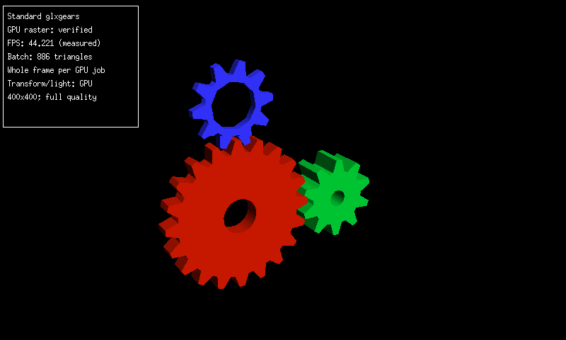
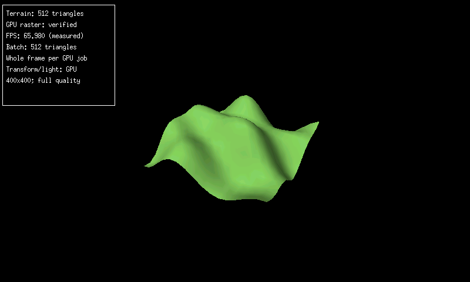

# Keeping GPU work resident, recovering performance, and testing at 480 MHz

*9–10 November 2026. Physical Nokia N810 measurements and a separate local driver candidate.*

Standard `glxgears` now averages **42.74 completed GPU frames per second**, and the rotating terrain test averages **71.67 FPS** on the 480 MHz kernel. Both keep the earlier 400 × 400 RGB565 target, application binaries and Mesa library. Transform, lighting and rasterization run on the MBX GPU. The fixed-camera terrain image matches all 160,000 pixels of the previous reference.

These results followed two days of work on the less visible parts of rendering: retained window images, repeated command preparation, mask jobs, service ownership and the cost of collecting evidence. The desktop and standalone scenes have different workloads, so their numbers stay separate.

## 9 November: retain windows and stop visiting owners that do not exist

The native Pocket desktop can keep rendered window images in guarded GPU storage. Moving an unchanged window then samples its image instead of rebuilding all its geometry. Transparent layers retain the GPU RGB, alpha and channel-merge paths. The terminal frontend remains available through the same framework.

Admission matters. Creating images eagerly made an early comparison slower because creation and upload cost exceeded reuse. Waiting for repeated use, retaining exact texture identities and keeping the normal four-tile budget made sustained movement useful. Later work reused DMA resources and narrowed CPU preparation, while retaining the existing lifetime checks.

The next CPU profile found repeated readiness, deadline and future queries across application slots that had never acquired an owner. Skipping those exact uncreated wrappers preserved existing hidden owners and their work. In a matched 960-frame plain-desktop drag test, throughput rose from **18.927 to 20.966 FPS**, and app CPU fell from **38.761 to 33.860 ms per redraw**. Peak RSS rose from 37,016 to 38,084 KiB. All 48 mixed-interaction snapshots matched exactly. The background was off in both controls; these are desktop movement results, not Room frame rates.

The [native rendering reference](https://github.com/gordol/n810-revival/blob/main/pocket/graphics/driver/mbx/WINDOW-IMAGES.md) records the resident-image contract, earlier rejected variants and the selected release. Stable surfaces and generation-checked handles let the driver reuse work without treating a stale pointer or retired image as valid.

## 10 November: make mask batching pay for its traffic

The shared Mesa/MBX path can combine source color and mask alpha in one GPU job. For a 128 × 128 logical mask, the physical operation comparison rose from **25.978 to 40.355 operations per second**. CPU time fell from **26.764 to 19.501 ms per operation**. Pixel checks and memory guards passed.

Dense two-plane uploads were wasteful for small crops. Adaptive admission now compares their byte cost with the compact path before selecting fusion. An explicit atlas API can validate and pack up to 64 disjoint regions into one bounded retained image. Unsupported inputs are rejected before submission. These operation rates describe mask processing; game input response also includes runtime scheduling, drawing and presentation.

A separate four-entry command-compilation cache is now available behind `gpu_command_reuse=1`. It compares immutable shader, geometry and scissor inputs exactly, then validates and patches changing finite uniforms and viewports. Current image tokens are still checked on every dispatch. Texture pixels are uploaded or retained through the existing rules. Local sanitizer, differential and ARM checks pass; its default remains off pending an application-level physical comparison. It has no new FPS claim here.

## Recover the older standalone path before comparing clocks

The older GLX client used compact updates for an already validated command template. A regression had cleared that template and rebuilt full uploads. Restoring the owned legacy replay contract brought back compact updates without admitting newer surface dependencies through that older API.

Diagnostic success capture was another substantial cost: copying every successful buffer is useful for investigation, but expensive during timing. The normal comparison disables those success snapshots while retaining admission, synchronization, periodic and resource-change verification, close checks and fault capture. With background radio owners stopped, the repaired 330 MHz runs measured **36.248 FPS for gears** and **60.964 FPS for terrain**.

This was a regression repair and a measurement-policy correction. It was necessary to establish a useful baseline for the new kernel.

## Preserve the kernel's initial GPU clock state

The 480 MHz kernel left the idle GPU at divider 2. The old probe required divider 1 on entry and refused the otherwise idle state before any rendering job. The corrected driver accepts either verified idle divider, skips a commit when already at the execution divider, and restores the complete original selector on cleanup. It does not force the board back to divider 1.

Tests compile the actual admission and cleanup code, inject failures at every cleanup readback, and verify partial enables and failed commits retain ownership. They pass under host and Linux sanitizers and ARM1136 emulation. Physical identity, rendering, guard checks and normal removal then passed at 480 MHz.

A failed preflight also exposed a display-cleanup bug. Framebuffer memory contained the normal console, while the panel showed repeating grey/green lines. The helper had left RFBI in manual-update mode. Restoring the original update policy and submitting the restored console recovered the panel without reboot. Cleanup now does that even if preflight fails before the GPU service exists.

## The matched 480 MHz result

Pocket was quit and radio owners were stopped through their normal shutdown paths. SSH and battery services remained available; boot hooks were untouched. The app used nice 0 and the collector nice 10. CPU readings stayed at 480 MHz throughout.

| Workload | Earlier 330 MHz FPS | 480 MHz FPS | Gain | CPU ms/frame, earlier → new |
| --- | ---: | ---: | ---: | ---: |
| Standard glxgears | 36.248 | 42.742 | 17.9% | 16.289 → 13.533 |
| 512-triangle terrain | 60.964 | 71.668 | 17.6% | 6.801 → 5.493 |

Gears used a 32.05-second sample; the final terrain sample ran for 33.53 seconds. App peak RSS was 17,060 KiB for gears and 17,392 KiB for terrain, with Xorg around 11.3 MiB. Neither app incurred a major page fault during its timed sample. All recorded GPU error, retained-fault and cleanup counters were zero.

*Actual N810 framebuffer, captured on 10 November at 480 MHz. The pictured interval is 44.221 FPS; the full sample average is 42.742. The application and 400 × 400 render quality are unchanged.*

*Actual N810 framebuffer from the clean terrain run on 10 November. The pictured interval is 65.980 FPS; the full sample average is 71.668. Archived five-second intervals reached 73.991 FPS. A still image demonstrates the rendered output, not physical LCD motion.*

One terrain run overlapped an SSH download of the gears evidence. Its whole-window result fell to 60.95 FPS despite faster intervals. We retained that run as contaminated evidence and repeated terrain once without concurrent SSH commands or transfers. The table uses that uninterrupted result. Evidence collection has to stay outside the measurement it is meant to preserve.

Completed renders and panel transfers remain different measurements. The observed display-transfer interrupt rates were about **25.68/s for gears and 25.77/s for terrain**. The higher GPU counts do not establish 72 distinct LCD frames per second. This compares the 480 MHz kernel with the previous 330 MHz kernel and required the entry-divider compatibility fix; it is not a frequency-only toggle within one kernel session.

The remaining work is to measure the optional compilation cache in real applications and carry qualified improvements into the shared installed release. The new compatibility module is verified as a test artifact; the installed release was not silently replaced. Pocket and radio services remain stopped after these tests. The device returned to its console with automatic display updates, at 480 MHz, without a reboot during this work.

<!-- journal-sources:start -->
## Code, tests and build inputs

| Material | Repository files |
|---|---|
| Implementation | [Window images and mask APIs](../assets/source/journal/pocket/graphics/driver/mbx/mesa/mbx_window_export.h.txt) ([GitHub](https://github.com/gordol/n810-revival/blob/main/pocket/graphics/driver/mbx/mesa/mbx_window_export.h)) [Owned command replay](../assets/source/journal/pocket/graphics/driver/mbx/common/mbx_vgp_wire.c.txt) ([GitHub](https://github.com/gordol/n810-revival/blob/main/pocket/graphics/driver/mbx/common/mbx_vgp_wire.c)) [Compiled command cache](../assets/source/journal/pocket/graphics/driver/mbx/common/mbx_command_cache.h.txt) ([GitHub](https://github.com/gordol/n810-revival/blob/main/pocket/graphics/driver/mbx/common/mbx_command_cache.h)) [GPU clock lifetime](../assets/source/journal/pocket/graphics/driver/mbx/kernel/n810_mbx_gpu_probe.c.txt) ([GitHub](https://github.com/gordol/n810-revival/blob/main/pocket/graphics/driver/mbx/kernel/n810_mbx_gpu_probe.c)) |
| Checks and fixtures | [Clock admission and cleanup fault injection](../assets/source/journal/pocket/graphics/driver/mbx/tests/check_clock_initial.py.txt) ([GitHub](https://github.com/gordol/n810-revival/blob/main/pocket/graphics/driver/mbx/tests/check_clock_initial.py)) [Clock receipt checks](../assets/source/journal/pocket/graphics/driver/mbx/tests/test_clock_receipt.py.txt) ([GitHub](https://github.com/gordol/n810-revival/blob/main/pocket/graphics/driver/mbx/tests/test_clock_receipt.py)) [Prepared and legacy commands](../assets/source/journal/pocket/graphics/driver/mbx/tests/check_prepared.py.txt) ([GitHub](https://github.com/gordol/n810-revival/blob/main/pocket/graphics/driver/mbx/tests/check_prepared.py)) [Compilation-cache parity](../assets/source/journal/pocket/graphics/driver/mbx/tests/test_command_cache.c.txt) ([GitHub](https://github.com/gordol/n810-revival/blob/main/pocket/graphics/driver/mbx/tests/test_command_cache.c)) |
| Build inputs | [Pinned kernel build](../assets/source/journal/pocket/graphics/driver/mbx/build_kernel.py.txt) ([GitHub](https://github.com/gordol/n810-revival/blob/main/pocket/graphics/driver/mbx/build_kernel.py)) [Pinned Mesa build](../assets/source/journal/pocket/graphics/driver/mbx/build_mesa.py.txt) ([GitHub](https://github.com/gordol/n810-revival/blob/main/pocket/graphics/driver/mbx/build_mesa.py)) [Hardware verification record](../assets/source/journal/pocket/graphics/driver/mbx/VERIFICATION.md.txt) ([GitHub](https://github.com/gordol/n810-revival/blob/main/pocket/graphics/driver/mbx/VERIFICATION.md)) |

[Build and test instructions](../how-to/build-graphics.md) · [Chronological source index](../reference/journal-sources.md#2026-11-10-gpu-residency-and-480mhz)

The linked source includes the compatibility fix and opt-in compilation candidate. The measurements above are physical N810 results; local candidate checks do not imply an application-level speedup. The graphics build guide describes prerequisites; later device experiments require their exact kernel and artifact identities.
<!-- journal-sources:end -->

[Journal](../journal.md) · [Earlier GPU performance investigation](2026-11-04-gpu-performance.md) · [Native desktop](2026-11-07-native-desktop.md)
