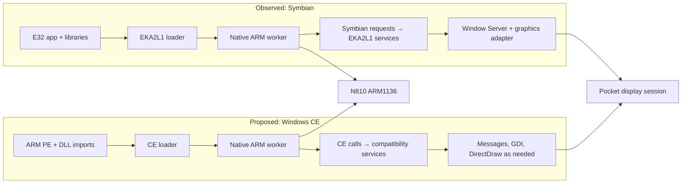

# Investigating a native ARM Windows CE runtime

*10 November 2026. Design investigation; no Windows CE application has been run on the N810 through this path.*

The [Symbian runtime](2026-11-06-native-symbian.md) suggested another use for its execution model. It loads Symbian applications and lets their ordinary ARM instructions run on the N810 processor, while a compatibility runtime supplies the operating-system services and Pocket regains the display when the application exits. We investigated whether selected ARM Windows CE 3, 4.x, and 5.x applications could use a similar boundary.

## The processor is shared; the operating-system contract is different

An ARM instruction that calculates a result can run on the N810 regardless of which operating system the program was built for, provided the instruction is supported by its ARM1136 processor. Loading a program, creating a thread, opening a file, and drawing a window depend on the operating system. Native CPU execution solves the first problem; a compatibility runtime must solve the second.

| Boundary | Symbian runtime on the N810 | Proposed Windows CE runtime |
| --- | --- | --- |
| Application image | Symbian E32 executable and imported libraries | ARM Portable Executable (PE) and CE DLL imports |
| Loader and system model | EKA2L1 already supplies the loader, guest processes, services, and library resolution | A CE loader and the services used by the selected application would have to be supplied |
| Ordinary instructions | ARM, Thumb, and supported VFP code execute in Linux workers on the tablet CPU | Compatible ARM and Thumb code would execute in a similar worker; the binary's instruction set and calling convention must be checked |
| Calls into the OS | The supervisor intercepts Symbian system calls before Linux dispatch and gives them to EKA2L1 | CE library exports would lead to our service layer; direct CE state or trap accesses need separate handling |
| User interface | EKA2L1's Window Server feeds the N810 graphics path | CE window messages, GDI drawing, and any DirectDraw surfaces would need implementations before feeding that path |

*The upper lane reflects the tested Symbian architecture. Every CE box is proposed. The shared CPU and display path do not make the two application interfaces interchangeable.*

The largest difference in starting position is EKA2L1. Our Symbian work reused its established model for executable loading, handles, asynchronous requests, and the Window Server, then added a native ARM backend and N810 display adapters. For CE we have no equivalent service model in this repository. A PE loader can map code and import trampolines can route selected calls, but a windowed application still expects CE's handle lifetimes, message queue, timers, files, and drawing behavior. The [Symbian native execution record](2026-11-06-native-symbian.md) describes the existing worker and supervisor boundary.

A tested Symbian delay illustrates the distinction: guest code requested `User::After`, the supervisor delivered the request to the compatibility service, and the guest resumed after completion. A CE window call would demand a different sequence. The CE-facing API must create a window handle, retain its state, deliver later messages such as paint and input to the application's queue, and translate its GDI drawing into an image Pocket can present. The ARM processor runs both call sites; the runtime defines what those calls mean. Microsoft's [CE window-message account](https://learn.microsoft.com/en-us/archive/msdn-magazine/2004/april/windows-messages-add-keyboard-support-to-compact-framework-apps) describes the handle and message side of that model.

## What CE would require

Booting Windows CE would require adapting its kernel and hardware support to the tablet. The proposed runtime keeps Linux running. It needs a PE loader, CE library imports, process and thread state, and implementations of the services each selected application calls. A small board support package would not supply those services. Windows CE through version 5 divided APIs among the kernel and processes for files, devices, and graphics; Microsoft's [CE architecture account](https://learn.microsoft.com/en-us/archive/msdn-magazine/2006/december/mobilize-explore-the-new-features-in-windows-embedded-ce-6-0) describes that boundary.

There are two possible library starting points. Loading an original ARM `coredll.dll` would preserve its wrappers but require the kernel calls and CE state behind them. A replacement CE-facing `coredll` could resolve selected imports into our Linux-backed services. The replacement still needs PE import resolution; it cannot be only an ordinary Linux shared library. We favor the replacement for the first narrow test, then can measure whether original-library wrappers help a particular application. Neither performance claim is established yet.

Memory and faults need explicit design. CE 3 applications had a 32 MB private address space and could allocate additional shared memory, as described in Microsoft's [process overview](https://learn.microsoft.com/en-us/archive/msdn-magazine/2000/november/windows-ce-3-0-enhanced-real-time-features-provide-sophisticated-thread-handling). A guest allocator must reproduce the observable `VirtualAlloc` behavior, PE section protections, and address placement. The N810's 32-bit ARM Linux kernel has 4 KB pages, so the large-page concern sometimes raised for modern ARM64 hosts does not apply to this machine. CE's high KData and trap addresses cannot simply become Linux user mappings. The runtime must provide expected thread state and dispatch intentional guest calls without mistaking a real crash for a call. Applications using structured exception handling will also need CE exception delivery; a Linux signal alone is insufficient.

The 32 MB layout is an application-visible CE rule, not a reason to replace Linux page tables. Linux mappings can hold guest code and data while a CE allocation manager enforces the addresses, sharing, and protection seen by the application. CE versions 3 through 5 share this broad layout, but their DLL exports, optional components, and device profiles still need to be checked against each target. Windows Mobile and vendor shells add another layer beyond the CE kernel; an ARM PE for one device is not automatically portable to every CE device.

## Choose a test that isolates the boundary

We found a useful later test in the locally supplied PocketDOS 1.12.3 demo. Its outer `.exe` is a desktop x86 self-extractor containing ARM CE CABs. Inspection of the ARM HPC Pro CAB shows a CE PE32 executable with a preferred base of `0x10000` and no base relocations. It imports `COREDLL.dll`, `commctrl.dll`, `commdlg.dll`, `WINSOCK.dll`, and `WININET.dll`; many `COREDLL` imports use ordinals rather than names. Its PE header also has an exception directory. These are concrete loader and API requirements, before we account for PocketDOS's own PC/XT emulation, graphics, input, files, and timing. An independently authored CE fixture gives a clearer first failure signal; PocketDOS is a stronger end-to-end target once the basic runtime works. We can study a user-supplied binary's imports, calls, and observed behavior for interoperability without making PocketDOS code part of the runtime. The separate Casio BE-300 build is MIPS and cannot use the native ARM path.

The demo readme forbids reverse engineering and modification, but that statement alone does not settle every private interoperability use. Nor does an old, unsupported release become public domain merely because it is called abandonware. U.S. law recognizes some reverse engineering for interoperability; the exact rights and any applicable license terms need review before we publish derived material or redistribute the binary. The [Copyright Office's case summary](https://www.copyright.gov/fair-use/summaries/segaenters-accolade-9thcir1992.pdf) and [17 U.S.C. § 1201(f)](https://uscode.house.gov/us/usc/119-134/t17/s1201/) describe two relevant, limited routes.

Prior work gives useful comparisons. [WCECL](https://github.com/gweslab/wcecl) implements a replacement `COREDLL` for x86 CE programs on desktop Windows, but its author archived it and reported one confirmed working application. [CERF](https://github.com/gweslab/cerf) and [MAME](https://docs.mamedev.org/initialsetup/mameintro.html) emulate hardware; they can inform behavior without determining the native execution design. Any source reuse needs a revision and license review.

The first experiment should load an authored ARM CE PE, resolve a few imports, execute its ordinary instructions natively, print expected output, and exit cleanly. File and thread behavior, a simple window, DirectDraw, and PocketDOS follow only when the preceding result is repeatable. The [roadmap](../roadmap.md#run-selected-arm-windows-ce-applications-on-linux) records those acceptance steps. This entry records a design decision, not a working CE runtime or a device test.

<!-- journal-sources:start -->
## Research status

[Chronological source index](../reference/journal-sources.md#2026-11-10-windows-ce-runtime)

Design investigation only. No Windows CE compatibility implementation or N810 test is included.
<!-- journal-sources:end -->
