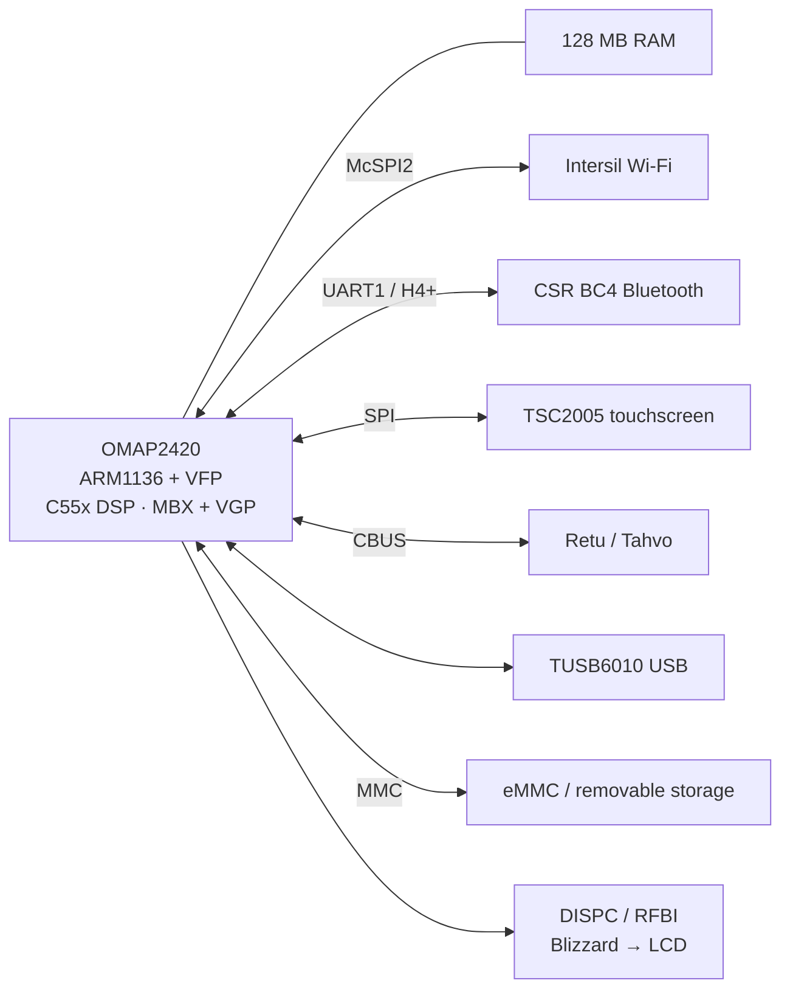
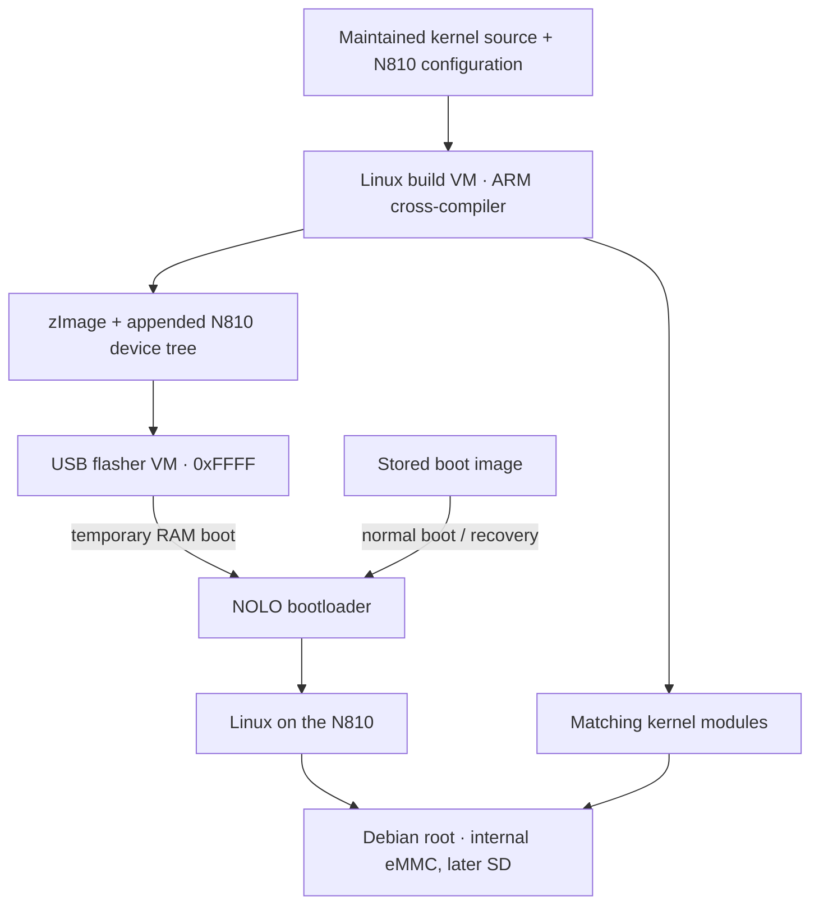

# Recovering the machine and booting Debian

*Early October 2026. Reconstructed on 4 November 2026 from development and test notes.*

We started with a Nokia N810 running Maemo, Nokia's original Linux-based operating system. The tablet has an OMAP2420 processor, 128 MB of RAM, an 800 by 480 display, a resistive touchscreen, and a sliding keyboard. We wanted to run modern Debian while keeping a reliable way to recover from a failed kernel or filesystem change.

## Understanding what was already working

Maemo gave us a working example of the hardware. We could compare its charging, wireless startup, and display behavior with Debian on the same tablet. That comparison mattered because getting a Linux driver to recognize a chip is only part of bringing up a board. The chip also needs the right power sequence, clocks, firmware, and connections to the other components.

We used three sources of information. Board source described wiring and initialization. A read-only extractor recovered files from JFFS2, the filesystem used in the saved NAND flash images. Observations of a running Maemo system showed which files and device bindings it actually used. The original backups also gave us recovery material.

The display has several stages. The OMAP display subsystem sends data over RFBI, its parallel display interface, to a separate controller called Blizzard, which drives the LCD. CSR's BC4 Bluetooth controller communicates over a serial UART using Nokia's H4+ transport. Retu and Tahvo are companion chips involved in power and other board functions. Maemo's Battery Management Entity, or BME, supplied a useful reference for charging behavior. The [hardware reference](../reference/hardware.md) explains these components and links to further reading.

## Keeping a way back to a working kernel

NOLO is Nokia's bootloader. For these experiments, it accepts an image made by appending the N810 device tree to the compressed Linux kernel. A device tree describes the board's hardware to Linux. Its compiled form is called a DTB.

We used two virtual machines on the development laptop. A Linux builder VM provided the ARM cross-compiler, which builds code for the tablet while running on the host. A separate flasher VM controlled the tablet's update-mode USB connection and ran the `0xFFFF` flashing tool. A temporary RAM boot let us try a kernel while keeping the stored boot image available for recovery.

The kernel and its loadable modules had to come from the same build. A module contains driver code loaded after the kernel starts. A mismatch could leave us with a successful boot and unusable peripherals, so we kept the image, configuration, device tree, and module set together.

USB networking supplied a maintenance connection while Wi-Fi was being repaired. The TUSB6010 USB controller used the MUSB driver with programmed I/O, or PIO: the CPU moved data through the controller. This gave us a way to inspect a failed wireless experiment without depending on wireless connectivity.

## Repairing the first Debian filesystem

Debian Bookworm armel first ran from the tablet's internal eMMC storage. The armel port provides Debian's software and calling convention for this generation of ARM processor.

One early failure came from Debian's merged `/usr` layout. `/lib` was supposed to be a symbolic link to `/usr/lib`. A real directory had replaced it, so programs could no longer find the dynamic loader through the expected path. The loader is the program that brings an executable's shared libraries into memory before running it.

The rescue program checked for the expected loader and module directories before changing the filesystem. It moved the module tree into place and restored `/lib -> usr/lib`. We then invoked the loader directly and ran an ordinary dynamically linked program. Those two checks answered different questions: whether the loader worked, and whether normal execution could find it. Regenerating module metadata checked the repaired module layout as well.

Root selection used PARTUUID, an identifier stored in the partition table, so changing device enumeration would still select the intended filesystem.

The earliest notes establish this order of work, although they leave some first-run dates uncertain. The dated entries that follow describe the individual hardware tests. The [kernel build guide](../how-to/build-kernel.md) explains the current build process and its required inputs.

<!-- journal-sources:start -->
## Code, tests and build inputs

| Material | Repository files |
|---|---|
| Implementation | [JFFS2 extractor](../assets/source/journal/platform/scripts/n810-jffs2-extract.py.txt) ([GitHub](https://github.com/gordol/n810-revival/blob/main/platform/scripts/n810-jffs2-extract.py)) [CAL record reader](../assets/source/journal/platform/scripts/n810-cal-inspect.py.txt) ([GitHub](https://github.com/gordol/n810-revival/blob/main/platform/scripts/n810-cal-inspect.py)) [Merged-/usr rescue](../assets/source/journal/platform/scripts/n810-merged-usr-rescue-r14-init.c.txt) ([GitHub](https://github.com/gordol/n810-revival/blob/main/platform/scripts/n810-merged-usr-rescue-r14-init.c)) [Partition assembler](../assets/source/journal/platform/scripts/assemble-clean-n810-emmc.py.txt) ([GitHub](https://github.com/gordol/n810-revival/blob/main/platform/scripts/assemble-clean-n810-emmc.py)) |
| Checks and fixtures | [Synthetic flash records](../assets/source/journal/platform/maemo/test_readers.py.txt) ([GitHub](https://github.com/gordol/n810-revival/blob/main/platform/maemo/test_readers.py)) [Partition preservation](../assets/source/journal/platform/maemo/test_image_assembly.py.txt) ([GitHub](https://github.com/gordol/n810-revival/blob/main/platform/maemo/test_image_assembly.py)) [Boot-tag converter regression](../assets/source/journal/platform/scripts/test-n810-boot-tags.c.txt) ([GitHub](https://github.com/gordol/n810-revival/blob/main/platform/scripts/test-n810-boot-tags.c)) |
| Build inputs | [ARM helper builder](../assets/source/journal/platform/build-tools.py.txt) ([GitHub](https://github.com/gordol/n810-revival/blob/main/platform/build-tools.py)) [Maintained kernel pins](../assets/source/journal/platform/kernel/source.lock.json.txt) ([GitHub](https://github.com/gordol/n810-revival/blob/main/platform/kernel/source.lock.json)) [Kernel configuration](../assets/source/journal/platform/kernel/n810.config.txt) ([GitHub](https://github.com/gordol/n810-revival/blob/main/platform/kernel/n810.config)) |

[Build and test instructions](../how-to/test-journal-checkpoints.md) · [Chronological source index](../reference/journal-sources.md#beginnings)

The rescue init source and its compiler inputs are retained. Its historical 5.15.86 combined boot image still needs the exact earlier kernel tree and initramfs configuration. Original flash backups and device calibration remain private inputs.
<!-- journal-sources:end -->

[Journal](../journal.md) | [Current status](../status.md)

[Next entry](2026-10-03-wifi.md)
