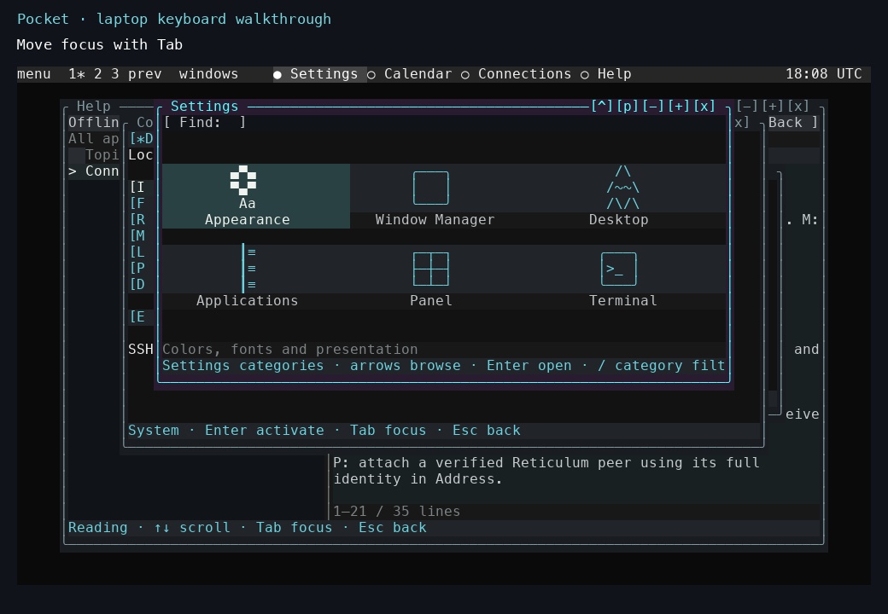

# Applications and their dependencies

| Application group | Data or service | Documentation |
|---|---|---|
| Connections and System | Local or SSH-attached device catalogue and telemetry. | [Connections](../pocket/connections.md). |
| Radio Feed, Stations, Station Map, Services, Nets, Walk | Shared APRS owner, retained observations, and optional prepared maps. | [Receive history](../pocket/receive-history.md). |
| Messages | Selected APRS, Reticulum, or MeshCore owner. | [Messaging](../pocket/messaging.md). |
| Reticulum and Heard | Selected local or external runtime, peer/contact store, and explicit interface configuration. | [External execution](../pocket/external-node.md). |
| Reader, Library, Workbench, CW | App-specific files, libraries, and configured services. | [Apps and services](../pocket/apps-and-services.md). |
| Scenery and rendering experiments | Scene resources and optional native implementations. | [Rendering architecture](../explanation/rendering.md). |
| Help, Settings, Calendar, terminal windows | Local instance state and installed applications. | [Keyboard navigation](../pocket/navigation.md). |

*The Settings application in the 4 November laptop recording. Appearance, window controls, desktop behavior, application configuration, panel settings, and terminal settings have separate categories.*

The source release includes terrain profiles, line-of-sight estimates, repeater lookup, optional APRS Internet fill, and secondary-radio controls. Prepared regional data is installed separately. Each service reports its own availability and command results.
