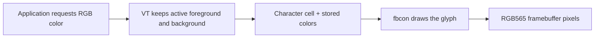

# The RGB console patch

[Download the patch from this site](../assets/patches/console-rgb.patch) · [Read it on GitHub](https://github.com/gordol/n810-revival/blob/main/platform/patches/console-rgb.patch) · [Read the investigation](../posts/2026-10-16-16-bit-console.md)

This is the retained October RGB-console patch for the Linux 5.15.86 N810 tree. Its recorded base source commit is `6e98fd1ce2701d29bbea8b50ad643bdf948cc813`. The review copy is byte-for-byte identical to that patch. Applying it to the retained before-files reproduces all four after-files exactly; this check was repeated on 4 November 2026.

| File changed | Role |
|---|---|
| `drivers/tty/vt/vt.c` | Parse RGB and indexed color requests; keep colors aligned with characters through edits and scrolling. |
| `include/linux/console_struct.h` | Add active foreground/background state and storage associated with each virtual console. |
| `include/linux/vt_rgb.h` | Allocate, copy, move, fill, and release the additional color storage. |
| `drivers/video/fbdev/core/fbcon.c` | Convert the stored colors into the framebuffer's channel layout while drawing text and the cursor. |

The kernel command-line option `vt.rgb=1` enables the extension. RGB storage is allocated when a console first needs it. The patch carries colors alongside the existing character storage, including when rows scroll or cells are inserted and erased.

## Recorded validation

The original host checks compiled the affected ARM translation units and the complete candidate kernel. Extracted-function tests exercised all 65,536 RGB565 values, color parsing, scrolling, insertion/deletion, inversion, cursor colors, and mixed ANSI/RGB output under AddressSanitizer and UndefinedBehaviorSanitizer. Kernel checkpatch reported zero errors and warnings.

The coherent r4 package combined this work with the accepted board support and 199 matching modules. Its RGB-enabled physical RAM boot matched twelve expected swatches and passed nine color/control checks. A normal power-cycle boot of the selected RGB build was recorded on 16 October.

The patch contains the console changes. Reproducing the full tablet image also requires the corresponding board support, configuration, device tree, and module build. The [kernel build guide](../how-to/build-kernel.md) describes the later maintained 5.15.224 tree and its required inputs. The October validation record left broader VT switching, resize/font, selection, suspend/resume, and hardware regression coverage open.
