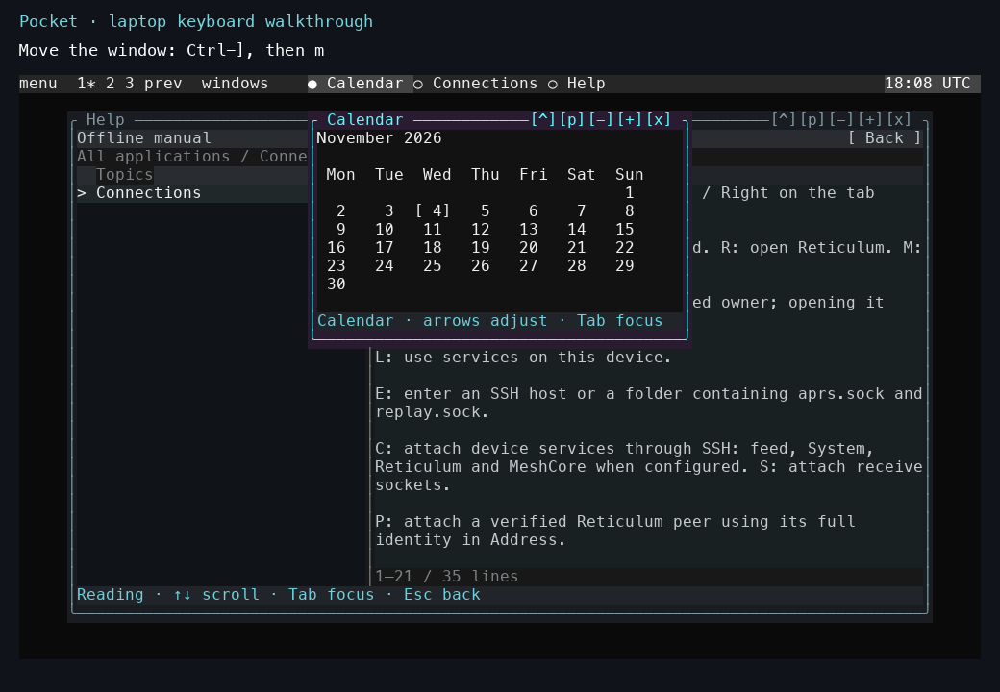

# Pocket controls

| Context | Key | Action |
|---|---|---|
| Window controls | Tab / Shift-Tab | Move focus forward or backward. |
| Focused tab strip | Left / Right | Select a tab. |
| Lists | Up / Down, then Enter | Select and open an item. |
| Windows | F6 / Shift-F6 | Select the next or previous window. |
| Window-manager escape | Ctrl-], then q | Quit Pocket. |
| Panel menu | Escape or an outside click | Dismiss the menu. |

*Ctrl-], then m selects movement. Use the arrow keys and Enter to keep the new position. The [recorded tour](../tutorials/laptop-tour.md) shows movement, resizing, and desktop switching in order.*

Text inputs and terminal/game canvases own their application keys. The focused region and bottom-line help identify the active context. [Detailed navigation](../pocket/navigation.md).
