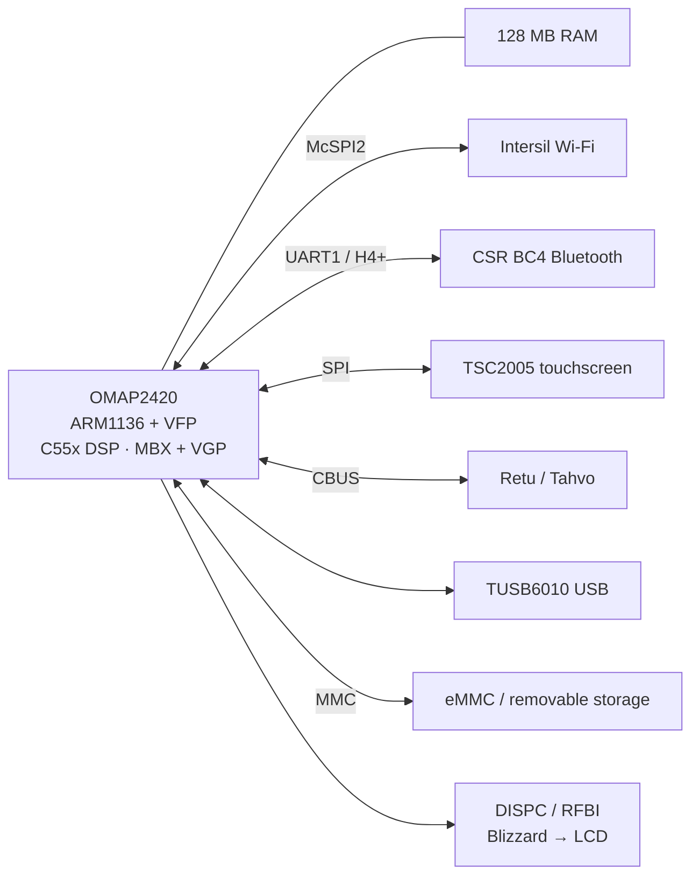

# Hardware and terminology

The Nokia N810 combines an OMAP2420 system-on-chip with 128 MB of RAM, an 800 by 480 display, a resistive touchscreen, and a sliding keyboard. A system-on-chip contains the CPU and several other processing and peripheral blocks in one package. This page introduces the parts used in the journal.

## Processor and graphics

| Component | What it does here |
|---|---|
| ARM1136 CPU | Runs Linux, Pocket, applications, and the CPU stages of rendering. |
| VFP | The CPU's floating-point unit executes arithmetic used by the renderer and Mesa. |
| C55x DSP | A separate digital signal processor studied through assembler and numerical experiments. Physical execution remained a separate milestone in these records. |
| PowerVR MBX | The graphics engine used for rasterization, depth tests, and color interpolation in the November tests. Rasterization turns geometric primitives into covered pixels. |
| VGP | A vertex geometry processor associated with the graphics hardware. Its instruction encoding and geometry execution were investigated separately from the measured Mesa path. |
| PRCM | The processor's power, reset, and clock management hardware. It controls the conditions under which peripheral blocks run. |

TI's [OMAP2420 architecture brief](https://www.ti.com/pdfs/wtbu/TI_omap2420.pdf) describes the chip's processing blocks. The [CPU journal entry](../posts/2026-10-18-cpu-acceleration.md) and [graphics clock entry](../posts/2026-10-31-gpu-clocks.md) describe what we tested on the N810.

## Board connections

| Connection | Components and purpose |
|---|---|
| SPI / McSPI | SPI is a synchronous serial bus. The OMAP's McSPI controller connects the Intersil Wi-Fi device; the TSC2005 touchscreen also uses SPI. |
| UART / H4+ | A UART is a serial controller. Nokia's H4+ transport carries Bluetooth controller traffic to the CSR BC4 over UART1. |
| CBUS | The board bus used to communicate with the Retu and Tahvo companion chips. |
| RFBI | The OMAP's parallel display interface, used between its display subsystem and the Blizzard display controller. |
| DISPC | The OMAP display controller block involved in producing display transfers. |
| TUSB6010 / MUSB | The external USB controller hardware and Linux driver path used for USB maintenance networking. |
| MMC | The storage-controller family connecting internal eMMC and removable storage. eMMC combines flash memory and its controller in one package. |
| NAND / JFFS2 | NAND is flash storage; JFFS2 is the filesystem used in the original flash-image extraction. |

The [Linux p54 page](https://wireless.docs.kernel.org/en/latest/en/users/drivers/p54.html) introduces the wireless driver family. The [display and input entry](../posts/2026-10-05-power-display-input.md) follows the actual board failures.

## Terms used in the debugging

An **IRQ** is an interrupt request from hardware. A driver registers a handler to process it. `IRQF_NO_AUTOEN` keeps that interrupt disabled at registration until the driver explicitly enables it. The [kernel entry](../posts/2026-11-03-kernel.md) explains why the ordering mattered during the Wi-Fi merge.

**PIO**, or programmed I/O, has the CPU move data through device registers. **DMA**, or direct memory access, lets a device access memory itself. Drivers must manage which side owns a buffer and make data visible before transferring ownership. The [Linux DMA guide](https://docs.kernel.org/5.15/core-api/dma-api-howto.html) describes addressing and synchronization.

A **VT** is a Linux virtual terminal. **fbcon** draws text-console characters into a framebuffer. **RGB565** uses five bits for red, six for green, and five for blue in each 16-bit pixel. The [console entry](../posts/2026-10-16-16-bit-console.md) follows color information from escape sequences to those pixels.

A **Unix socket** is a local communication endpoint represented by a filesystem path. Pocket uses these endpoints for service requests and events. SSH can forward them to another machine; the [SSH guide](../how-to/ssh.md) describes the two desktop arrangements.

A **generation** identifies one use of a replaceable object or connection. Checking it lets a late result from an older request leave the current request intact. The map and HTIT entries use this idea for different kinds of delayed work.
